# Website giới thiệu và bán sách trực tuyến

Bài tiểu luận trình bày cách chuyển yêu cầu của một website bán sách thành đặc tả hành vi, mô hình UML, hợp đồng dữ liệu và các phép kiểm chứng. Trọng tâm là tính nhất quán giữa lựa chọn của khách, giá được chấp nhận, lượng hàng có thể bán, quyền truy cập và trạng thái thanh toán COD. Các sơ đồ, quy tắc và kịch bản được trình bày trực tiếp trong báo cáo để có thể đọc và đánh giá độc lập.

Sinh viên thực hiện cá nhân: Nguyễn Duy Trường, mã số sinh viên 24150180. Ngành Công nghệ thông tin, chuyên ngành Kỹ thuật phần mềm. Học phần Thiết kế và xây dựng phần mềm, mã 241401, lớp 020100138702. Giảng viên hướng dẫn: Lê Huỳnh Phước.

**Phạm vi kết luận.** Quy tắc nghiệp vụ đã được duyệt triển khai. Bản này hoàn thiện nội dung đặc tả và thiết kế; phần thực nghiệm chỉ sử dụng kết quả đã quan sát tại mốc kiểm thử đơn hàng. 89 trường hợp đã thực thi đạt ở mốc đó không đồng nghĩa mọi scenario hoặc phiên bản sửa mới nhất đều đạt. Các thay đổi quản trị, kho, tìm kiếm và giao diện sau mốc ấy còn phải chạy kiểm tra lại. Email SMTP và Facebook Login có hướng tích hợp thật nhưng chưa có thông tin dịch vụ để kiểm chứng kết nối.

## 1 Đặc tả các tính năng

### 1.1 Căn cứ và phạm vi bài toán

Đề tài số 05 trong danh sách của học phần yêu cầu website giới thiệu và bán sách trực tuyến với ba vai trò Guest, Customer và Admin. Ảnh nghiệp vụ bổ sung sáu nhóm phải kiểm soát: kho; bán hàng theo giá thường, giảm sản phẩm, voucher, coupon, sỉ, bộ và đính kèm; giỏ hàng; xác thực; đơn hàng; thanh toán COD. Bộ được hiểu là combo, còn đính kèm là sách hoặc phụ kiện khách chủ động mua thêm có tính tiền.

| Căn cứ | Nội dung rút ra | Cách áp dụng trong bài |
|---|---|---|
| Danh sách đề tài trang 1 và đề tài 05 trang 2 | Ba vai trò và các chức năng mua, quản trị | Phân quyền ở use case và phía HTTP; không cho guest checkout |
| Cấu trúc tiểu luận trang 2 | Gherkin, class UML, draw.io cá nhân, SOLID, DDD, lát cắt, Request và Response | Đặc tả chi tiết; hình lớp có interface; giải thích chính sách và luồng dữ liệu |
| Phiếu chấm trang 1 mục 3.1 đến 3.5 | Đặc tả, class UML, bộ kiểm thử, tài liệu sống và chương trình | Tách bằng chứng tài liệu, code và kết quả thực thi; không tự cho điểm |
| Software Architecture slide 12 và 15 đến 18 | Tách chính sách khỏi chi tiết | Core không phụ thuộc UI, SQL hoặc framework kiểm thử |
| Request Response Model slide 4 đến 10 | Input Boundary, Interactor, Output Boundary | Controller tạo Request; interactor chuyển Response qua output port |
| Kiến Trúc Độc Lập slide 2 đến 10 | Tách theo tầng đồng thời theo chức năng | Module catalog, cart, pricing, auth, order, inventory và admin |
| Đạn Vạch Đường slide 5 đến 8 và 10 đến 12 | Lát cắt nhỏ chạy xuyên suốt, có phản hồi | Bắt đầu xem sách và sửa giỏ, sau đó giá, tài khoản, đơn và kho |
| The TDD BDD Blueprint trang PDF 4 và 6 đến 12 | BDD vòng ngoài và TDD vòng trong | Given–When–Then định nghĩa hành vi; unit test kiểm quy tắc; chạy Red rồi Green khi có bằng chứng |

Java, Spring Boot, PostgreSQL chạy qua Docker và Jupiter là lựa chọn đã được chủ đề tài xác nhận. Cucumber trên JUnit Platform nối đặc tả với hệ thống; Jupiter cung cấp assertions và kiểm thử Java. Không có yêu cầu số lượng pattern hoặc trọng số điểm được điền trong tài liệu của thầy; bài không tự đặt các con số đó.

Thanh toán trực tuyến, hoàn tiền, nhận hàng trả sau bàn giao, microservices và triển khai cloud không nằm trong phạm vi được duyệt. Việc không triển khai các phần này không thay đổi yêu cầu phải có đầy đủ các hình thức bán hàng trong ảnh.

### 1.2 Vai trò và quyền sử dụng

| Vai trò | Hành động được phép | Điều kiện và điều bị từ chối |
|---|---|---|
| Guest | Xem, tìm, lọc, xem chi tiết; thêm, sửa, bỏ dòng giỏ; đăng ký | Giỏ riêng theo phiên; không đặt đơn và không quản trị |
| Customer | Các quyền Guest; đăng nhập, đăng xuất; áp mã hợp lệ; đặt, xem, hủy đơn của mình | Tài khoản hoạt động và email đã xác minh trước checkout; không đọc đơn người khác |
| Admin | Các quyền Customer; quản lý sách, loại, tài khoản, kho, ưu đãi và đơn | Chuyển trạng thái và ghi COD theo guard; không được bỏ qua kiểm tồn hoặc làm sai lịch sử |

Actor của yêu cầu ghi được lấy từ phiên đã xác thực. Trình duyệt không được quyết định owner, vai trò, đơn giá, số tiền giảm hoặc trạng thái đã thu. Ẩn nút trên giao diện không thay thế kiểm quyền tại backend.

### 1.3 Thuật ngữ và dữ liệu kiểm thử

SKU định danh một ấn bản hoặc sản phẩm tồn kho. Hai ấn bản trùng tên vẫn có SKU riêng. Cart là tập lựa chọn trước cam kết; SaleQuote là báo giá tại một thời điểm; snapshot là giá, recipe, lượng, giảm, phí và thông tin nhận đã chốt trong đơn. Reservation là lượng giữ theo từng đơn và SKU. Một combo có recipe, nghĩa là số lượng của từng sản phẩm thành phần; không có một kho combo độc lập.

H là tồn thực tế, R là lượng đã giữ, A = H − R là khả dụng. Luôn phải giữ 0 ≤ R ≤ H. Các số lượng là số nguyên theo sản phẩm; tiền là VND nguyên. Mã yêu cầu cùng fingerprint thể hiện một thao tác đã cam kết để xử lý gửi lặp.

Dữ liệu S001 giá 120000 VND, S002 giá 180000 VND, tài khoản KH01/KH02/QT01, tên người nhận, địa chỉ thử, mật khẩu thử và email miền example.test chỉ là fixture. Phí giao và COD bằng 0 trong fixture không phải cam kết miễn phí của website. Mỗi scenario thiết lập lại trạng thái riêng, không dựa vào scenario trước đã chạy.

### 1.4 Quy tắc nghiệp vụ đã thống nhất

| Mã | Quy tắc và ví dụ | Bị từ chối hoặc dữ liệu phải giữ nguyên |
|---|---|---|
| BR-001 | Một SKU cho một ấn bản; hai sách cùng tên vẫn độc lập | Không gộp kho chỉ vì tên trùng |
| BR-002 | Sách có tên, tác giả, NXB, thể loại, mô tả và ảnh; sách ẩn không công khai | Không thêm mới với SKU trùng hoặc loại không tồn tại; ẩn không xóa lịch sử |
| BR-003 | Lượng nguyên; SET 0 xóa dòng, ADD phải lớn hơn 0 | Lượng âm, lẻ, chữ, tràn số giữ nguyên giỏ |
| BR-004 | Tiền hàng bằng tổng đơn giá hợp lệ nhân lượng; tiền VND nguyên | Không dùng tổng tiền frontend để lưu đơn; phí là cấu hình riêng |
| BR-005 | Giảm sản phẩm trong khoảng bắt đầu bao gồm, kết thúc loại trừ; giảm phần trăm làm tròn xuống | Ngoài khoảng dùng giá khác hợp lệ; không nhân chồng ưu đãi |
| BR-006 | Coupon giảm phần trăm, có ngưỡng, hạn và lượt | Chưa đạt ngưỡng, hết hạn hoặc hết lượt không được giữ mã cho đơn |
| BR-007 | Voucher giảm tiền cố định, thuộc một tài khoản | Tài khoản khác không dùng; giảm không quá tiền sách |
| BR-008 | Tối đa một mã, chỉ cho giỏ toàn giá thường | Có dòng giảm, sỉ, combo hoặc kèm thì không áp mã toàn đơn |
| BR-009 | Quote chưa giữ lượt; tạo đơn giữ; hủy trước giao giải phóng; hoàn tất tiêu lượt | Không dùng vượt quota tổng hoặc mỗi khách; retry không tác động thêm |
| BR-010 | Bậc sỉ tính theo lượng cùng SKU; chọn giá thấp nhất hợp lệ giữa thường, giảm và sỉ | Dưới ngưỡng không áp giá sỉ; không cộng số lượng SKU khác |
| BR-011 | Combo có giá và recipe; hai bộ cần hai lần từng thành phần | Thiếu một thành phần thì không giữ dở các thành phần khác |
| BR-012 | Mua kèm do khách chọn, cần sản phẩm chính và tỷ lệ cấu hình | Không tự thêm; giảm/xóa món chính thì giảm/xóa món kèm tương ứng |
| BR-013 | 0 ≤ R ≤ H; A = H − R; ADD tăng H, SET đặt H tuyệt đối | Kiểm kê H mới thấp hơn R bị từ chối; lý do phiếu bắt buộc |
| BR-014 | Giỏ không giữ; đặt tăng R; bàn giao giảm cả H và R | Sửa giỏ không làm thay đổi kho; bàn giao lặp không xuất thêm |
| BR-015 | Chủ đơn/admin hủy trước bàn giao, giải phóng R một lần | H không tăng; sau bàn giao không dùng luồng hủy để giả lập nhập trả |
| BR-016 | Guest có giỏ theo phiên, tài khoản có giỏ theo owner | Thay cartId không cho phép đọc hoặc sửa giỏ người khác |
| BR-017 | Gộp cộng lượng, kiểm tổng demand, chuyển nguồn một lần | Vượt tồn giữ cả hai giỏ; không tự cắt và không cộng lại khi retry |
| BR-018 | Backend tính lại giá và kiểm tồn ngay khi đặt | Giá khác báo giá đã chấp nhận thì yêu cầu xác nhận lại, chưa tạo đơn |
| BR-019 | PENDING → CONFIRMED → SHIPPING → COMPLETED; hủy trước SHIPPING | Không nhảy bước hoặc quay ngược; giao thất bại ghi lịch sử, giữ SHIPPING |
| BR-020 | Admin ghi giao thành công, số thu bằng payable thì mới PAID | Tạo COD chưa thu; sai tiền không hoàn tất; payable 0 dùng NONE |
| BR-021 | Trả hàng/hoàn tiền ngoài phạm vi hiện tại | Không tự cộng kho hoặc khẳng định đã hoàn tiền sau giao |
| BR-022 | Đơn giữ snapshot giá, giảm, phí, recipe và thông tin nhận | Thay cấu hình sau đặt không sửa số phải thu của đơn cũ |
| BR-023 | Hai khách tranh món cuối: chỉ lượng đủ A được cam kết | Bên thiếu hàng không tạo đơn, không giữ dở, không xóa giỏ |
| BR-024 | Key và nội dung giống nhau trả lại kết quả cũ; khác nội dung báo xung đột | Không tạo đơn, giữ/xuất/giải phóng hoặc thu tiền thêm |
| BR-025 | Customer xem đơn của chính mình, admin theo quyền quản trị | Không trả nội dung đơn người khác dù đoán đúng UUID |
| BR-026 | Email trim và chữ thường; mật khẩu tối thiểu 8 ký tự; token 30 phút dùng một lần | Token sai, đã dùng, đúng mốc hết hạn không xác minh; chưa xác minh không checkout |
| BR-027 | Facebook dựa vào provider id và OAuth state; không ghép chỉ do email giống | Không nhận quyền từ frontend; đăng nhập Facebook chưa thay xác minh email website |
| BR-028 | Quyền lấy từ tài khoản hiện hành và được kiểm lại | Customer bị khóa không tiếp tục ghi bằng phiên cũ; tự đăng ký admin bị từ chối |
| BR-029 | Đặt đơn cần đăng nhập và email xác minh | Guest có giỏ vẫn phải đăng nhập trước khi đặt |
| BR-030 | Tài khoản và công việc mail lưu trước khi gửi; lỗi mail không xác minh giả | Gửi lại không tạo thêm tài khoản; token cũ bị vô hiệu khi cấp token mới |
| BR-031 | Giới thiệu, tìm/lọc và xem sách công khai | Không công khai sách ẩn hoặc dữ liệu tài khoản trong kết quả tìm |

BR-031 xác định phạm vi tìm/lọc; chi tiết tìm khoảng giá, giao diện báo lỗi khoảng giá và phân trang cần đối chiếu riêng với đặc tả bên dưới. Không coi một ô tìm tên đã bao phủ mọi điều kiện lọc. Mẫu hiện tại tìm tên, tác giả, SKU và loại; phần lọc giá phải được kiểm tra/bổ sung trong đợt hoàn thiện code.

### 1.5 Hợp đồng chức năng và kết quả quan sát

**Xem và tìm sách.** Người khởi tạo là Guest hoặc tài khoản. Đầu vào gồm từ khóa, thể loại, điều kiện lọc và trang. Backend chuẩn hóa điều kiện, chỉ đọc sách công khai và trả danh sách cùng số lượng/trạng thái trang. Chi tiết sách trả đầy đủ thông tin một SKU; mã không tồn tại hoặc bị ẩn trả không tìm thấy. Không sửa kho hoặc giá vì một lần xem.

**Thêm, sửa và xóa giỏ.** Input gồm cartId, selectionKey, quantity dạng chuỗi, expectedVersion và ADD/SET. Owner lấy từ phiên. Use case kiểm quyền, định dạng lượng, lựa chọn đang bán và tổng nhu cầu SKU. SET 0 xóa đúng dòng; giữ các dòng khác. Ghi dùng expectedVersion; xung đột yêu cầu tải lại, không ghi đè phiên bản mới. Giỏ không tạo reservation. Ví dụ giỏ S001×2 và S002×1, SET S001=0 trả S002×1, tổng 180000, H/R không đổi.

**Gộp giỏ.** Sau đăng nhập, server nhận diện giỏ guest trước và giỏ tài khoản, cộng lượng từng selectionKey rồi kiểm nhu cầu toàn bộ. Nếu tổng vượt khả dụng, cả hai giỏ giữ nguyên để khách chỉnh lại. Thành công chuyển nguồn chỉ một lần; retry không cộng lại. Đây là transaction khác với thao tác sửa một dòng dùng version.

**Báo giá và mã.** Input là Cart, owner, thời gian và code đã chọn. Đọc chính sách hiện hành, chọn giá, mở rộng recipe, kiểm tỷ lệ kèm, tính tổng, điều kiện mã và phí. Response gồm các dòng, subtotal, discount, shipping, codFee, payable, demand và fingerprint. Không cập nhật tồn/quota. Giá 120000 giảm 10% cho đơn giá 108000; nếu đủ bậc sỉ 100000 thì dùng 100000. Coupon 20% trên 240000 giảm 48000, còn 192000 khi phí bằng 0. Giảm của 101 VND với 10% là 10 VND, còn 91 VND.

**Đặt COD.** Input gồm accountId từ server, cartId, version, quoteFingerprint, key, recipient, phone, address. Tài khoản phải active và verified, giỏ đúng chủ và không rỗng. Backend tính lại, so báo giá, kiểm stock và quota. Thành công lưu một đơn PENDING, UNPAID nếu phải thu dương, snapshot, reservations, lượt giữ và làm rỗng giỏ trong một transaction. Sai dữ liệu/giá/tồn/quota thì không có tác dụng phụ. Nếu không rõ commit đã thành công hay chưa, client dùng cùng key để hỏi lại, không phát sinh key mới tùy tiện.

**Xem, xử lý và hủy đơn.** Đầu vào orderId và actor. Customer chỉ thấy đơn của mình; admin được xử lý theo vai trò. Request chuyển trạng thái có action, key, received và reason. Domain kiểm guard. Hủy trước giao giải phóng R và lượt giữ; bàn giao xuất H/R; giao thành công đúng tiền ghi biên nhận COD rồi hoàn tất. Một thao tác thất bại giữ trạng thái và dữ liệu liên quan. Các bước không được gộp thành một nút bỏ qua quy tắc.

**Kho và quản trị.** Phiếu kho nhận SKU, ADD/SET, quantity, reason và key. Phải là admin, SKU tồn tại, lượng nguyên, có lý do, H mới không thấp hơn R. Lưu H mới cùng lịch sử và biên nhận chống lặp. Thêm sách mới không tự sinh hàng; admin nhập bằng phiếu kho. Sửa loại giữ mã và liên kết; loại đang được dùng không xóa. Khóa customer giữ lịch sử; tài khoản có đơn không xóa cứng. Cấu hình combo/kèm kiểm tồn tại của các SKU và recipe trước ghi.

**Đăng ký và xác minh.** Input tên, email, password, confirmation, requestedRole. Chỉ tạo Customer; chuẩn hóa email và kiểm trùng. Token ngẫu nhiên có hạn 30 phút, dùng một lần; mật khẩu được băm, không trả hash/token trong response. Gửi mail lỗi vẫn giữ tài khoản chưa xác minh và công việc chờ. VERIFY đúng token còn hạn mới đổi verified. Facebook phải kiểm qua dịch vụ thật và state; không tự nối với tài khoản email đã có. Chưa có thông tin SMTP/Facebook để kết luận tích hợp thật đã hoạt động.

### 1.6 Cách đọc đặc tả đầy đủ

Báo cáo chứa trọn 49 Rule, 154 định nghĩa Scenario và Scenario Outline, tương ứng 221 trường hợp khi khai triển Examples tại Phụ lục A. Mỗi mục ghi mã TC, mã REQ/BR liên quan, Given thiết lập đầu vào, When là hành động chính, Then/And là trạng thái cuối và tác dụng phụ. Phụ lục là nội dung đặc tả cụ thể, không phải danh sách nơi lưu tệp.

Một scenario là hợp đồng mong đợi, chưa tự là test thực thi. Muốn chạy phải có glue gọi use case thật và assertions cho từng Then. Các trường hợp chưa được bind hoặc chưa chạy được tách khỏi số đã đạt ở Chương 3.

<!-- page -->
## 2 Thiết kế tính năng bằng UML

### 2.1 Chính sách và mức độ phụ thuộc

Chính sách cấp cao quyết định ai được đặt đơn, khi nào giữ hàng, giá nào được chấp nhận, lúc nào thu COD và lỗi nào phải rollback. Chi tiết cấp thấp là HTTP, Thymeleaf, BCrypt, SMTP, OAuth, JDBC và PostgreSQL. Cấp cao/cấp thấp được xác định bằng trách nhiệm và độ gần nghiệp vụ, không phải vị trí folder hoặc lớp cha/lớp con.

Input adapter chuyển dữ liệu HTTP thành Request. Input Boundary khai báo thao tác. Interactor dùng domain và các port phía application. Response đi qua Output Boundary; presenter nhận và chuẩn bị dữ liệu cho controller render. Composition root tạo các implementation và truyền qua constructor. Không có nghĩa mọi lớp dùng new đều vi phạm DIP: tạo BigDecimal hoặc Cart là dùng kiểu ổn định của core, khác với use case tự tạo JDBC hoặc concrete presenter.

Trong class UML, mũi tên nét đứt với tam giác rỗng hướng về interface là realization; nét đứt với đầu nhọn là dependency; nét liền có đầu nhọn là giữ tham chiếu/association. Generalization của actor dùng nét liền và tam giác rỗng. Trong sequence, mũi tên là message lúc chạy, nét đứt là phản hồi. Chúng không có cùng ý nghĩa với mũi tên dependency trong package diagram.

Các hình class dùng tên lớp, interface và các phương thức chính có trong source tại thời điểm rà soát; constructor, getter và một số dependency được lược bỏ và giải thích ngay dưới hình. Use case, activity, state và DFD là mô hình nghiệp vụ, không khẳng định mỗi hình có một lớp riêng.


<!-- page -->
### 2.2 Vai trò và phạm vi sử dụng

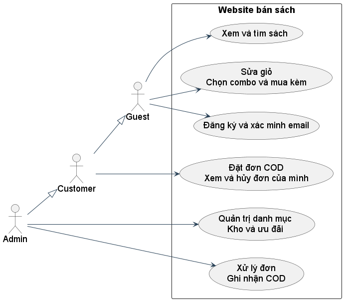

Guest được lựa chọn hàng nhưng chưa được đặt đơn. Customer thừa hưởng quyền Guest và phải xác minh email trước checkout. Admin có quyền quản trị và vẫn có thể mua hàng. Kế thừa tác nhân biểu diễn quyền sử dụng, không khẳng định có các lớp Java Guest, Customer hoặc Admin.

**Truy vết:** REQ-F01–F10, F17–F23; TC_ADMIN_SC053, TC_CHECKOUT_SC033–034.


<!-- page -->
### 2.3 Lớp sửa giỏ và ranh giới đầu ra

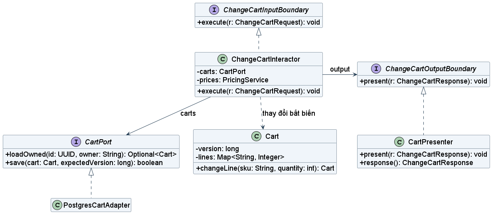

Interactor nhận yêu cầu, kiểm chủ giỏ và phiên bản rồi tạo Cart mới. CartPort.save dùng phiên bản mong đợi để chặn ghi đè dữ liệu mới. Đầu ra đi qua ChangeCartOutputBoundary; CartPresenter giữ Response cho controller dựng trang. Phụ thuộc mã nguồn từ interactor đến interface, không đến presenter hoặc JDBC. Lược bỏ constructor và các phương thức đọc khác để giữ hình dễ đọc.

**Truy vết:** REQ-F03–F04, F22; TC_CART_SC015–019, TC_CART_S1_OWNER, TC_CART_S1_VERSION.


<!-- page -->
### 2.4 Lớp đặt hàng và transaction

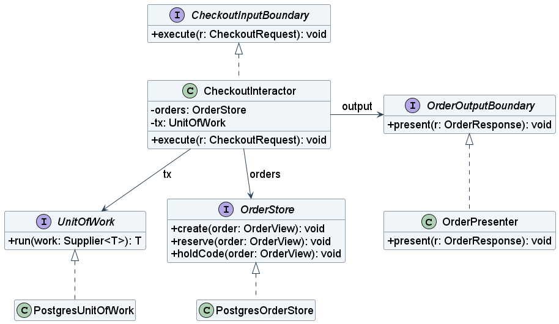

CheckoutInteractor sở hữu chính sách đặt đơn. OrderStore là hợp đồng đọc và ghi cần cho đơn; UnitOfWork bảo đảm các thao tác thuộc cùng transaction. Adapter PostgreSQL thực hiện hợp đồng. Success chỉ được đưa tới OutputBoundary sau khi UnitOfWork trả kết quả đã commit. Hình lược bỏ CartPort, PricingService và Clock; các dependency này được trình bày trong hợp đồng dữ liệu.

**Truy vết:** REQ-F07, F20–F22; TC_CHECKOUT_SC034, SC039, NEW006–007; TC_ORDER_DH03–05.


<!-- page -->
### 2.5 Lớp xác thực và dịch vụ ngoài

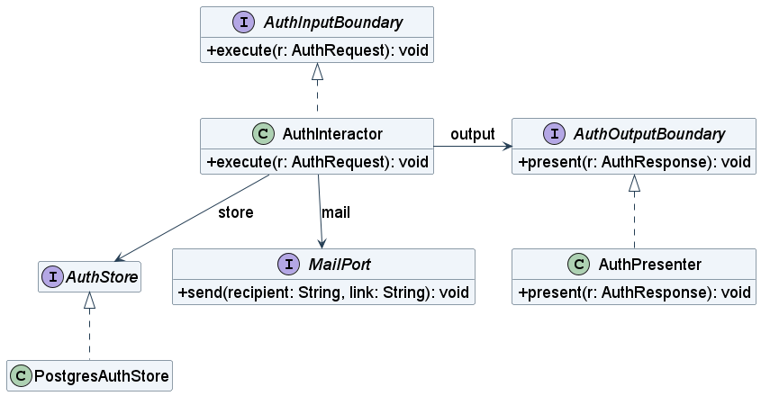

AuthInteractor kiểm dữ liệu đăng ký, tạo token và yêu cầu AuthStore lưu tài khoản cùng công việc gửi thư. MailPort là hành vi gửi thư do use case cần. Composition root cung cấp implementation dùng SMTP; nguồn hiện dùng lambda nên hình không bịa thêm lớp SmtpAdapter. PasswordPort, TokenPort và Clock cũng được truyền vào constructor. Đăng nhập Facebook dùng adapter OAuth bên ngoài và không chứng minh email website đã xác minh.

**Truy vết:** REQ-F05–F06, F18–F19; TC_AUTH_SC020–026, XT01–07, NEW009–010, REV004.


<!-- page -->
### 2.6 Ranh giới module và chiều phụ thuộc mã nguồn

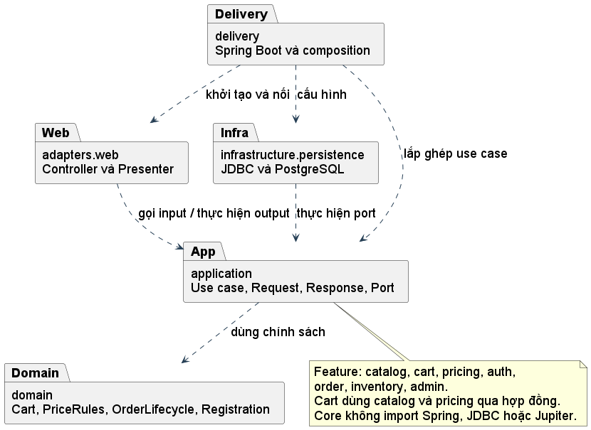

Nét đứt chỉ dependency mã nguồn. Lời gọi lúc chạy có thể đi từ application ra adapter qua port, nhưng interface vẫn thuộc phía application. Sơ đồ không mô tả mạng hay thứ tự message. Dự án là một ứng dụng nguyên khối có module theo tính năng; không tách thành microservices.

**Truy vết:** REQ-A03–A07; toàn bộ các nhóm chức năng.


<!-- page -->
### 2.7 Tìm sách và chỉnh giỏ

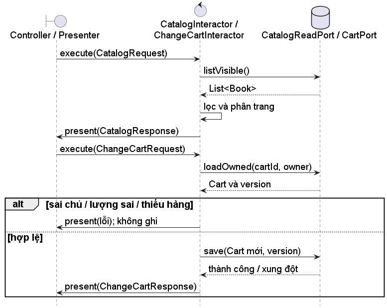

Danh mục chỉ đọc. Sửa giỏ dùng owner do server lấy từ phiên, không dùng owner do trình duyệt gửi. Kiểm tồn khi sửa giỏ chỉ giúp phản hồi sớm; không giữ tồn. Checkout vẫn phải kiểm tồn lần nữa. Phân trang/tìm kiếm mới bổ sung chưa được gán kết quả chạy của S1.

**Truy vết:** REQ-F01–F04, F23; TC_CATALOG_NEW002–004, TC_CART_SC008–019.


<!-- page -->
### 2.8 Chọn giá và kiểm mã ưu đãi

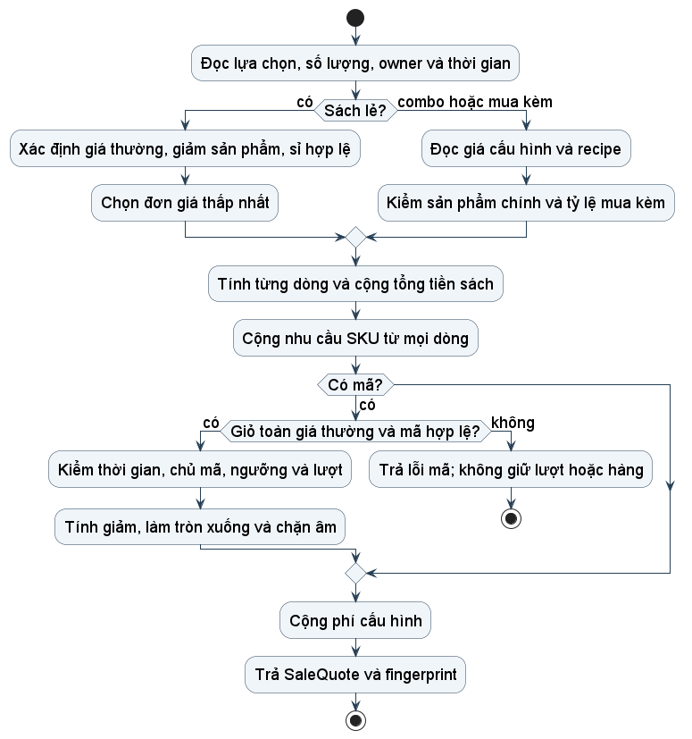

Giá sỉ dựa trên lượng cùng SKU; combo có recipe theo thành phần, không có kho combo độc lập. Tổng demand phải cộng cả SKU bán lẻ trùng với thành phần combo. Quote không sửa kho hoặc quota. Mã chỉ hợp lệ khi mọi dòng là giá thường; không bỏ điều kiện này chỉ vì một phần giỏ vẫn là giá thường.

**Truy vết:** REQ-F11–F16; TC_PRICE_BH01–BH22, TC_PRICE_REV003, TC_PRICE_REV011.


<!-- page -->
### 2.9 Đặt COD và chống yêu cầu trùng

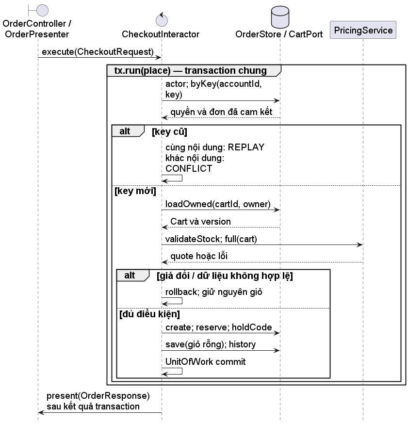

CheckoutInteractor gọi các port trong callback place do UnitOfWork thực thi. Kiểm key trước khi đọc giỏ giúp trả lại đơn đã cam kết dù giỏ đã rỗng. Giá thay đổi cần chấp nhận lại; thiếu tồn, quota hoặc lỗi ghi sẽ rollback. Chỉ trả success sau commit. Cột ngoài cùng nhóm controller và presenter để lược bớt phần HTTP, không coi đó là một lớp Java.

**Truy vết:** TC_CHECKOUT_SC034–039, NEW006–007, NEW016; TC_ORDER_DH03–05; TC_INV_SC046.


<!-- page -->
### 2.10 Hủy đơn trước bàn giao

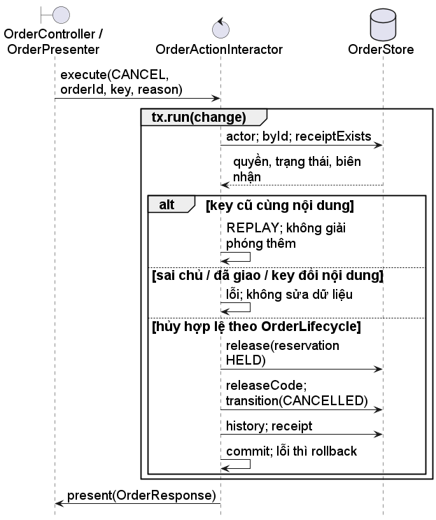

Hủy làm R giảm đúng lượng giữ, H không tăng. Hủy cạnh tranh với bàn giao được tuần tự hóa trong cùng cơ chế transaction. Nếu bàn giao thắng, hủy bị từ chối; nếu hủy thắng, bàn giao bị từ chối. Trả hàng sau bàn giao không thuộc use case này.

**Truy vết:** TC_ORDER_DH01–02, DH06, REV002, NEW017; TC_INV_REV009.


<!-- page -->
### 2.11 Trạng thái đơn hàng

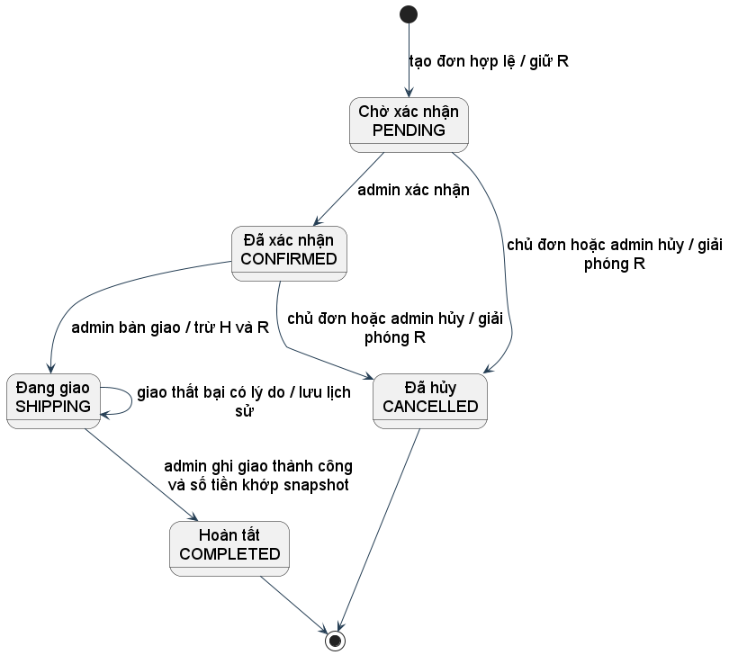

Không có mũi tên từ Chờ xác nhận sang Hoàn tất hoặc từ Đang giao trở lại Đã xác nhận. Giao thất bại giữ trạng thái Đang giao và chưa thu tiền, không tự nhập hàng về kho. Trạng thái đơn và tiền là hai thuộc tính khác nhau.

**Truy vết:** TC_ORDER_SC070–073, TC_PAY_*; OrderLifecycleTest.


<!-- page -->
### 2.12 Trạng thái thanh toán COD

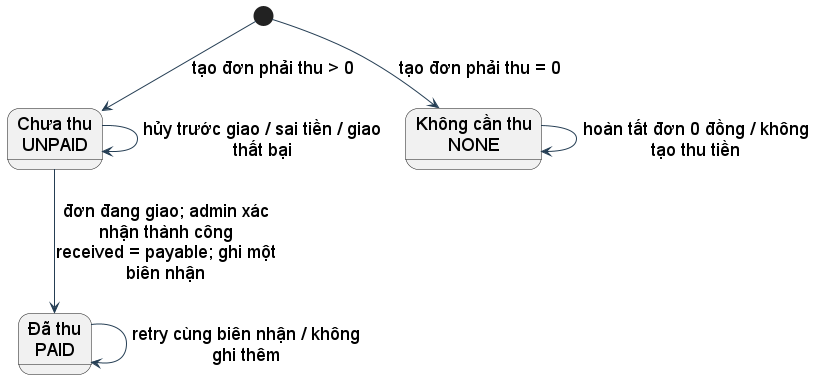

PAID chỉ phát sinh khi giao thành công và số tiền khớp số phải thu. NONE dùng cho đơn có khoản phải thu bằng 0 sau giảm và phí. Hủy đơn chưa thu vẫn UNPAID; không tạo nghiệp vụ hoàn tiền vì chưa thu. Đây là máy trạng thái nghiệp vụ, không là thanh toán online.

**Truy vết:** REQ-F17; TC_PAY_TT01–TT07, TC_PAY_NEW012.


<!-- page -->
### 2.13 Vòng đời lượng giữ chỗ

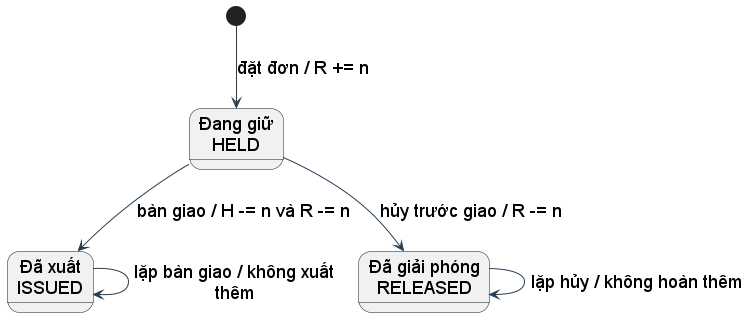

HELD/ISSUED/RELEASED thuộc từng reservation của đơn và SKU. H là tồn thực tế, R là lượng giữ; n là số lượng của reservation đang xử lý. Khi recipe combo đổi sau đặt, chuyển kho vẫn dùng số lượng đã chốt. Dữ liệu giữ không được tạo hai lần vì retry.

**Truy vết:** BR-013–BR-015, BR-023–BR-024; TC_INV_KHO06–08, TC_ORDER_REV002.


<!-- page -->
### 2.14 Nhập và điều chỉnh kho

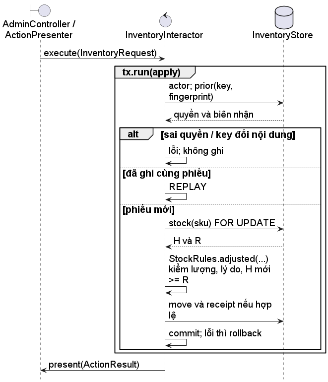

ADD yêu cầu lượng nguyên dương; SET là giá trị tuyệt đối không âm và không thấp hơn R. Lý do bắt buộc. Hình mô tả code vừa được bổ sung, chưa có kết quả Green sau thay đổi này tại mốc cập nhật báo cáo. Không dùng kết quả OrderIT để tuyên bố InventoryInteractor đã đạt.

**Truy vết:** TC_INV_KHO02–05, KHO09, NEW011, REV010; StockRulesTest đang chờ Green.


<!-- page -->
### 2.15 Đăng ký và xác minh email

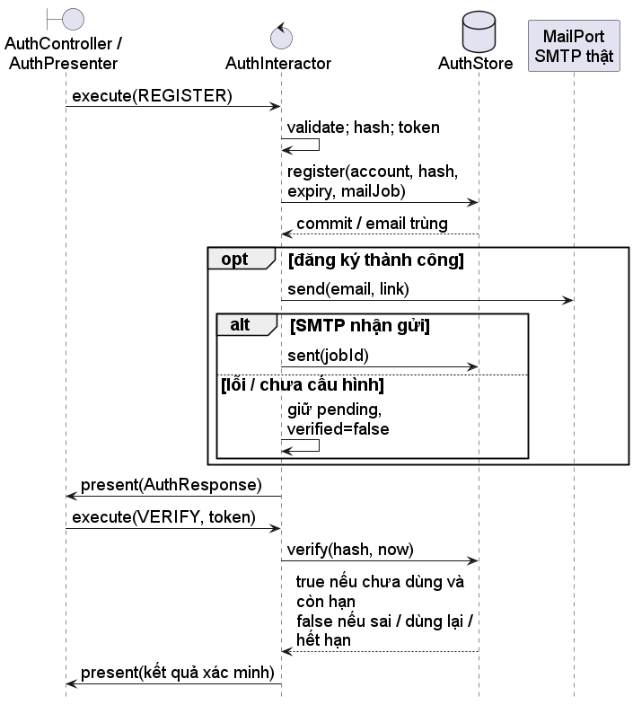

Gửi thư diễn ra sau transaction tạo tài khoản; SMTP không nằm trong transaction database. Chưa có worker gửi nền: chức năng gửi lại do người dùng yêu cầu thực hiện phục hồi. Test dùng MailPort thay thế để kiểm hành vi khi gửi lỗi; chưa kiểm SMTP thật. Facebook cũng chưa có thông tin ứng dụng để kiểm kết nối thật.

**Truy vết:** TC_AUTH_SC020–023, XT01–05, NEW009–010, REV012.


<!-- page -->
### 2.16 DFD mức tổng quan dữ liệu

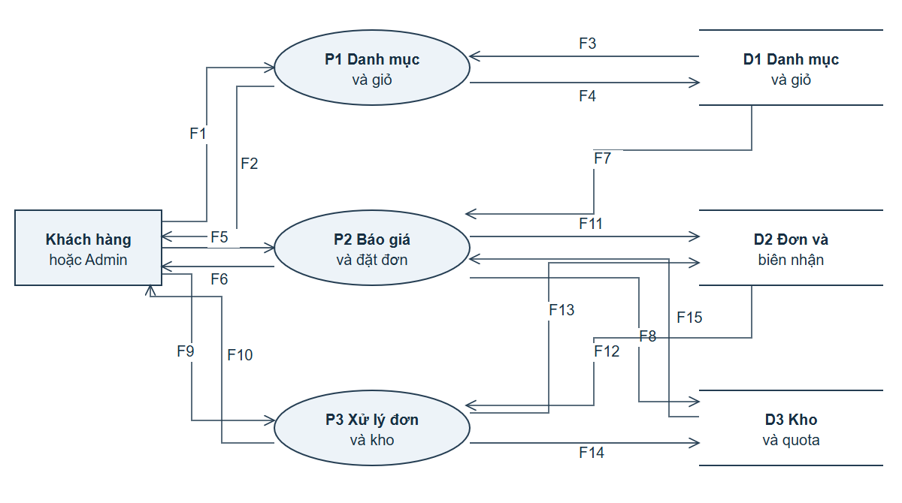

Các D1–D3 là nhóm dữ liệu logic trong cùng PostgreSQL, không phải ba database độc lập. Mọi dữ liệu đầu vào có nguồn: actor từ phiên, lựa chọn từ giỏ, giá/quota từ backend, nội dung nhận hàng từ người dùng. DFD bổ sung cách nhìn dữ liệu; không thay class hoặc sequence UML.

**Truy vết:** REQ-F01–F23; kiểm giá backend, quyền, snapshot, kho và quota.


| Luồng | Nguồn và đích | Dữ liệu cụ thể |
|---|---|---|
| F1 và F2 | Khách → P1; P1 → Khách | Từ khóa, lọc, lựa chọn; danh sách sách và giỏ hiện hành |
| F3 và F4 | D1 → P1; P1 → D1 | Sách công khai; giỏ và version mới |
| F5 và F6 | Khách → P2; P2 → Khách | cartId, quote, key, thông tin nhận; mã đơn hoặc lỗi |
| F7 | D1 → P2 | Lựa chọn, lượng và chính sách giá hiện hành |
| F8 và F15 | P2 → D3; D3 → P2 | Lượng giữ hàng và lượt mã; tồn và điều kiện quota |
| F9 và F10 | Admin hoặc chủ đơn → P3; P3 → người gọi | Hủy, bàn giao, thu tiền, mã thao tác; trạng thái và kết quả |
| F11 | P2 → D2 | Đơn, snapshot và key đã cam kết |
| F12 và F13 | D2 → P3; P3 → D2 | Đơn/trạng thái cũ; trạng thái mới, lịch sử và biên nhận |
| F14 | P3 → D3 | Giải phóng giữ chỗ, xuất kho hoặc tiêu lượt mã |


<!-- page -->
### 2.17 Hợp đồng Request và Response

| Hợp đồng | Dữ liệu đầu vào | Dữ liệu đầu ra và trách nhiệm |
|---|---|---|
| ChangeCartRequest | UUID cartId, String owner/sku/quantity, long expectedVersion, ChangeMode mode | ChangeCartResponse có status, message, CartSnapshot và SaleQuote khi có; owner không lấy từ form |
| CartSnapshot | Dữ liệu do backend dựng | id, version, danh sách dòng, totalVnd, code; không chứa thông tin tài khoản khác |
| SaleQuote | Kết quả tính từ Cart và chính sách | cart, demand theo SKU, discount, shipping, codFee, code, payable, fingerprint; không giữ hàng |
| CheckoutRequest | accountId, cartId, version, quoteFingerprint, key, recipient, phone, address | OrderResponse chứa success/code/message/order; thành công chỉ sau commit |
| OrderActionRequest | actorId, orderId, action, key, received, reason | OrderResponse với trạng thái hiện hành; retry hợp lệ không gây tác dụng thêm |
| AuthRequest | action REGISTER/VERIFY/RESEND và dữ liệu tương ứng | AuthResponse có success/code/message; không trả mật khẩu, hash hoặc token |
| InventoryRequest | actorId, sku, mode, quantity, reason, key | ActionResult có success/code/message; H mới và R được mô tả trong kết quả |

**Ví dụ luồng dữ liệu.** Browser gửi cartId, version=2, key K1 và thông tin nhận. Controller bổ sung accountId đã xác thực, không chuyển số tiền do browser khai thành giá lưu đơn. CheckoutInteractor đọc Cart, PricingService trả payable=240000 và demand S001=2. OrderStore giữ R=2 và lưu snapshot. OutputBoundary nhận OrderResponse CREATED. Controller lấy response từ presenter để trả trang đơn. Lời gọi interactor → output đi ra ở thời gian chạy; source interactor vẫn chỉ import hợp đồng application.

### 2.18 DDD và invariant

Cart có identity và version; thay đổi trả đối tượng mới, không công khai Map có thể sửa. Quy tắc lượng hợp lệ và giữ các dòng khác thuộc Cart. PriceRules kiểm cách chọn giá và làm tròn bằng BigDecimal. Registration kiểm dữ liệu đăng ký trước lưu. OrderLifecycle quyết định chuyển trạng thái theo vai trò, trạng thái và số tiền. Đây là các chính sách có đầu vào và kết quả quan sát được, không chỉ là nhãn thư mục domain.

Đơn chứa snapshot và reservation theo SKU. Transaction đặt/hủy/bàn giao bảo vệ invariant liên quan nhiều bảng: đơn, kho, quota, giỏ và biên nhận. Không giả định một object Java đơn lẻ có thể tự ngăn tranh chấp của hai kết nối database. Mô hình hiện dùng record cho một số dữ liệu, nên không gọi mọi record là aggregate giàu hành vi.

Từ vựng dùng nhất quán: giữ chỗ khác xuất kho; hủy trước giao khác nhập trả; báo giá khác snapshot; đã tạo đơn khác đã thu COD. Những phân biệt này quyết định guard và phép kiểm tra dữ liệu cuối.

### 2.19 OOP SOLID và các mẫu phù hợp

| Nguyên lý | Áp dụng cụ thể | Lợi ích và giới hạn |
|---|---|---|
| Encapsulation | Cart giữ Map bất biến và version, changeLine tạo trạng thái mới | Giảm sửa giỏ tùy tiện; database vẫn phải có constraint và transaction |
| Abstraction và polymorphism | CartPort, OrderStore, MailPort, OutputBoundary; adapter thật/fake cùng hợp đồng | Kiểm core độc lập chi tiết; fake đạt chưa chứng minh database đạt |
| SRP | PriceRules tính giá; CheckoutInteractor điều phối; presenter hiển thị; JDBC lưu | Tách lý do thay đổi; PricingService hiện còn nhiều trách nhiệm tính quote và recipe cần theo dõi |
| OCP | Thay implementation port ở composition root | Giữ use case khi đổi adapter cùng hợp đồng; thêm nghiệp vụ mới vẫn có thể sửa core |
| LSP | Adapter giữ semantics save theo version, ownership và lỗi | Phải chạy test hợp đồng cho cả fake và PostgreSQL, không chỉ implements về cú pháp |
| ISP | Input/output theo use case; MailPort chỉ gửi thư | Client không bị ép thực hiện thao tác vô nghĩa; OrderStore còn lớn, có thể tách khi client cần khác nhau |
| DIP | Use case phụ thuộc port phía application; chi tiết thực hiện port | Không rò HTTP/JDBC vào core; constructor injection chỉ là cách lắp ghép, không tự chứng minh DIP |

Kế thừa lớp không được thêm chỉ để đủ tên tính chất OOP. Interface và composition đáp ứng nhu cầu thay thế adapter trong phạm vi này. Factory Method và Abstract Factory của bài giữa kỳ không được đưa vào website một cách gượng ép.

**Repository hoặc gateway.** CartPort và OrderStore che cách đọc/ghi mà use case cần. Phương án đơn giản hơn là SQL ngay trong controller; cách đó trộn quyền, transaction và HTTP nên khó kiểm riêng. Chi phí của port là số lớp và việc giữ fake đúng hợp đồng.

**Unit of Work.** Đặt đơn phải ghi đơn, giữ kho, giữ lượt và xóa giỏ cùng nhau. UnitOfWork cho application mô tả ranh giới cam kết mà không import transaction của Spring. Nếu mỗi adapter tự commit riêng, lỗi cuối luồng sẽ để dữ liệu dở. Chi phí là nhiều thành phần phải dùng cùng connection/transaction và phải có test rollback thật.

**Presenter và Adapter.** OutputBoundary thể hiện nhu cầu trả kết quả; presenter bên ngoài nhận Response. SMTP, OAuth và JDBC là các adapter kỹ thuật. Phương án trả trực tiếp Response đơn giản hơn vẫn có thể hợp lệ, nhưng các luồng ghi chính dùng output port theo tài liệu Request/Response. Truy vấn quản trị hiện trả projection trực tiếp; đây là cách đọc đơn giản cần nêu riêng, không mô tả như tất cả use case đều đã có OutputBoundary.

**Chống lặp và snapshot.** Key/fingerprint gắn với kết quả đã commit; snapshot giữ điều khách chấp nhận. Đây là quyết định xử lý dữ liệu của bài, không được tự gắn thành một mẫu GoF. Giữ key lâu dài làm tăng dữ liệu; xóa key phải có chính sách lưu trữ riêng, chưa triển khai.

### 2.20 Transaction và đánh đổi hiện tại

PostgresUnitOfWork dùng transaction của Spring và khóa advisory chung cho các quyết định thương mại. Các truy vấn giữ hàng còn có điều kiện khả dụng; giỏ sửa bằng version. Cách này ưu tiên tính nhất quán và dễ kiểm trong ứng dụng nhỏ, nhưng tuần tự hóa nhiều thao tác độc lập nên giảm thông lượng khi số người dùng tăng. Không tuyên bố đây là giải pháp hiệu năng tối ưu hoặc đã benchmark.

Tùy chọn còn mở có cơ sở là chuyển sang khóa hàng theo thứ tự SKU và khóa quota liên quan, tách query đọc quy mô lớn và thêm worker gửi mail. Trước khi thay cơ chế khóa, cần giữ các test tranh hàng cuối, tranh lượt cuối, hủy/bàn giao và rollback sau từng điểm ghi. Online payment phải thêm hợp đồng callback và đối soát, không chỉ thêm một giá trị enum.

<!-- page -->
### 2.21 Lần theo các scenario rủi ro

| Scenario | Đường đi và trạng thái mong đợi | Kết quả đối chiếu thiết kế |
|---|---|---|
| TC_INV_SC046 | H=1,R=0; hai checkout độc lập; một CREATED, một thiếu hàng; H=1,R=1 | BC08 và BC12 có kiểm và cam kết chung; OrderIT dùng hai tác vụ/kết nối kiểm thực tế |
| TC_ORDER_DH03 | Gửi K1 cùng nội dung hai lần; cùng orderId; một reservation | BC08 kiểm key trước giỏ đã rỗng; không chạy lại thao tác giữ |
| TC_ORDER_DH04 | K1 đã dùng, payload khác | CONFLICT, giữ snapshot và kho cũ; không tự sửa đơn |
| TC_ORDER_NEW017 | Lỗi sau dự kiến giải phóng, trước commit hủy | BC09 rollback; trạng thái và R giữ nguyên; có test lỗi do constraint |
| TC_INV_REV009 | Hủy và bàn giao cạnh tranh | BC09/BC10/BC12 chỉ một chuyển trạng thái thắng, không cùng hoàn và xuất |
| TC_PRICE_REV003 | Giỏ chứa dòng thường và combo | BC07 không cho thêm mã; không tiêu lượt trong quote |
| TC_ORDER_SC049 | KH01 yêu cầu UUID đơn của KH02 | Kiểm chủ ở use case; không trả nội dung đơn; HTTP không phải chỗ kiểm duy nhất |
| TC_PAY_TT01 | Mới tạo COD | BC10 PENDING và BC11 UNPAID; chưa có biên nhận thu |
| TC_AUTH_REV012 | SMTP nhận thư nhưng khách chưa mở link | BC14 vẫn unverified; chỉ VERIFY hợp lệ mới đổi trạng thái |

Luồng thiết kế phù hợp với các scenario đã đối chiếu ở bảng này. Kết luận này áp dụng cho mô hình, không thay thế việc chạy test của toàn bộ phiên bản ứng dụng mới nhất.

<!-- page -->
## 3 Bộ kiểm thử và đặc tả thực thi

### 3.1 Chiến lược BDD và TDD

BDD xác định hành vi bằng ví dụ và kết quả quan sát. Glue thiết lập fixture, gọi Input Boundary và đối chiếu Response hoặc trạng thái lưu; không tự viết lại công thức giá để tạo một hệ thống giả trong test. Jupiter kiểm domain và use case ở mức nhỏ; kiểm thử tích hợp dùng PostgreSQL thật và schema riêng. HTTP test mở ứng dụng ở cổng ngẫu nhiên để kiểm controller, CSRF, phiên và dữ liệu trả về.

Nhịp TDD được dùng cho các quy tắc có log Red và Green: Cart, use case giỏ, đăng ký, PriceRules và OrderLifecycle. Ở pha Red, test có thể chạy nhưng thất bại vì hành vi chưa triển khai. Sau implementation, chạy lại để Green rồi refactor. Lỗi compile do thiếu class không được trình bày như Red hành vi. Sự hiện diện của test hoặc một lần build xanh không chứng minh toàn dự án đã làm TDD từ đầu.

### 3.2 Glue code gọi đúng hệ thống

Đoạn trích dưới giữ hành vi của glue giỏ hiện có. Given đã tạo giỏ và dữ liệu; When gọi ChangeCartInteractor thông qua ChangeCartInputBoundary. Lambda chỉ thu Response để assertions; không tính tiền hoặc thay đổi giỏ thay use case.

```java
ChangeCartInputBoundary input = new ChangeCartInteractor(
    store, store, new PricingService(store), r -> result = r);
input.execute(new ChangeCartRequest(
    id, who, sku, quantity, version, mode));
```

Một Then kiểm số lượng phải kiểm trạng thái OK, số dòng và quantity. Một Then về tiền kiểm totalVnd lấy từ Response. Một Then về kho cần đối chiếu H/R trước và sau. Test chỉ kiểm object không null không đủ chứng minh hành vi.

**Giới hạn glue hiện tại.** Runner đang chọn @s1: 24 trường hợp thực thi và 197 trường hợp chưa chạy bằng Cucumber. Một số bước S1 như “không cho tạo đơn từ giỏ trống” mới kiểm trạng thái giỏ rỗng, chưa gọi checkout trong chính bước đó; không được dùng bước này như bằng chứng checkout đã bị chặn. Đợt bổ sung test phải nối hành động thật và kiểm không có đơn/reservation được tạo.

<!-- page -->
### 3.3 Minh chứng trực tiếp từ đặc tả và mã kiểm thử

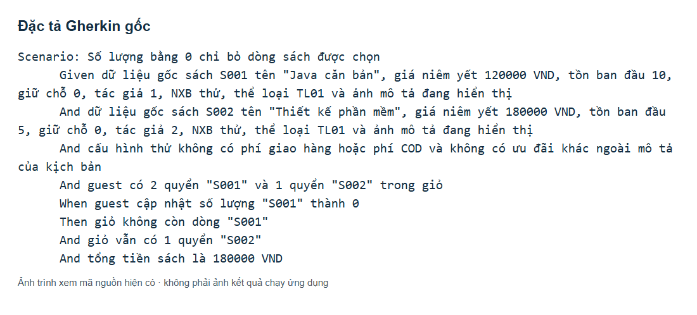

Ảnh chụp trình xem cục bộ hiển thị nguyên văn scenario hiện hành. Given tạo hai dòng riêng; When đặt lượng S001 về 0; Then kiểm S001 bị bỏ, S002 giữ nguyên và tổng tiền được tính lại. Dữ liệu sách và cấu hình thử được thiết lập trong chính scenario, không vay kết quả của scenario khác.

<!-- page -->
### 3.4 Glue và unit test của cùng hành vi

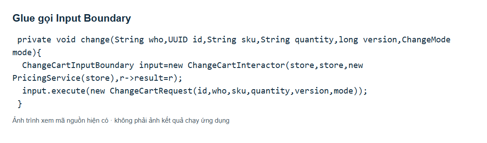

Glue truyền dữ liệu đầu vào và thu Response. Nó không tự xóa dòng hoặc tính lại tổng tiền thay hệ thống. MemoryStore là fixture dùng cho test core; kết luận về transaction cần test adapter PostgreSQL riêng.

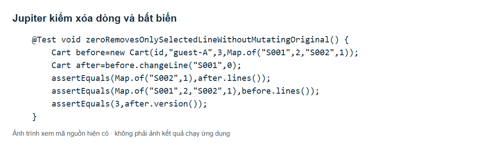

Unit test tạo giỏ có hai dòng, gọi changeLine và kiểm Map kết quả chỉ còn dòng còn lại. Map của đối tượng before phải giữ nguyên. Version chưa tự tăng trong domain; tăng khi lưu qua CartPort. Ảnh này là source test, không phải ảnh báo test thành công.

<!-- page -->
### 3.5 Đặc tả test phải thực thi ở đợt hoàn thiện code

Các mục KTTT dưới đây là hợp đồng cho test tự động tiếp theo, không phải kết quả đã chạy. Mỗi mục nêu trạng thái ban đầu, lời gọi cần thực hiện, phép kiểm tra và tầng kiểm. Test không đạt phải báo lỗi, không được bỏ qua bằng tag để làm xanh toàn bài.

| Mã và mục tiêu | Given và When cụ thể | Then cần assert và cấp kiểm |
|---|---|---|
| KTTT01 Tìm và lọc | S001 Java 120000/TL01; S002 Thiết kế 180000/TL01; S003 90000/TL02; tìm Java và TL01 | Chỉ S001; sách ẩn không xuất hiện; kiểm Input Boundary và HTTP |
| KTTT02 Khoảng giá | min=200000,max=100000; gửi tìm kiếm | Lỗi điều kiện, không trả kết quả gây hiểu nhầm; dữ liệu không đổi; trường hợp biên min=max vẫn kiểm |
| KTTT03 Bỏ dòng | Giỏ S001×2,S002×1; SET S001=0 | Chỉ S002×1, 180000, version tăng một, H/R không đổi; Jupiter/use case |
| KTTT04 Giỏ khác chủ | A sở hữu cartId, B gửi sửa | FORBIDDEN, response không lộ giỏ A, cả hai giỏ giữ nguyên; HTTP và database |
| KTTT05 Version cũ | Đã lưu version2 lượng3; gửi version1 lượng4 | CONFLICT, vẫn lượng3/version2; database |
| KTTT06 Chọn giá và biên thời gian | 120000, giảm10%, sỉ100000 từ10; qty9 rồi10; đồng hồ đầu/cuối chương trình | 108000 rồi100000 khi hợp lệ; tại end không áp giảm; giảm của101×10% là10; Jupiter |
| KTTT07 Mã và quota | Giỏ thường240000, CP20 còn1; hai khách đặt đồng thời | Chỉ một đơn192000 giữ lượt; bên còn lại không giữ kho/xóa giỏ; PostgreSQL |
| KTTT08 Combo chồng SKU | Giỏ lẻ S001×1 và combo chứa S001×2; A S001=2 | Từ chối tổng nhu cầu3; không ghi dở hoặc giảm tồn; use case và database |
| KTTT09 Mua kèm | Parent S001×2, tỷ lệ1, addon×2; SET parent=1 rồi0 | Addon lần lượt1 rồi bị xóa; không tự đổi sang giá thường; use case |
| KTTT10 Gộp giỏ | Guest1 + account2 cùng SKU, A=3; thử gộp rồi retry | Tổng3 một lần, nguồn rỗng và transfer đã ghi; khi A=2 giữ cả hai ban đầu; PostgreSQL |
| KTTT11 Đơn rỗng và email | Tài khoản chưa verified hoặc giỏ rỗng; gọi checkout thật | Bị từ chối; 0 đơn, 0 reservation, 0 lượt giữ; không chỉ assert giỏ rỗng |
| KTTT12 Giá bị sửa frontend | Browser gửi tổng1 nhưng backend240000; gửi fingerprint sai/cũ | Không lưu đơn giá1; REQUOTE khi chưa chấp nhận; xác nhận fingerprint mới mới tạo |
| KTTT13 Đặt trùng và rollback | Gửi K1 hai lần; thêm lỗi constraint sau reserve trong một lần khác | K1 cùng orderId; lỗi rollback không còn order/reservation/quota dở; giỏ giữ nguyên |
| KTTT14 Hủy và bàn giao | Đơn CONFIRMED giữ2; đồng thời CANCEL/HANDOVER | Chỉ một thành công; R=0; H giữ nguyên nếu hủy hoặc giảm2 nếu giao; không cả hai |
| KTTT15 Thu COD | Đơn SHIPPING phải thu240000; customer thử thu; admin thu239999 rồi240000 và retry | Hai lần đầu từ chối, lần đúng PAID/COMPLETED, đúng một biên nhận; không xuất kho lại |
| KTTT16 Phiếu kho | H10,R2; ADD5 keyPN1 rồi retry; SET1; PN1 đổi lượng | H15 sau ADD, không tăng thêm khi retry; SET1 và đổi payload bị từ chối; chỉ một phiếu |
| KTTT17 Quản trị | Customer sửa sách; admin tạo SKU trùng; đổi tên loại đang có sách; xóa loại đó | Chặn quyền/trùng/xóa có liên kết; đổi tên giữ mã và liên kết; PostgreSQL và HTTP |
| KTTT18 Xác minh | Token còn hạn dùng lần1/lần2; token tại đúng mốc30phút; mail throws | Chỉ lần1 verified; lần2/hết hạn không xác minh; mail lỗi để pending, không tạo lại account |
| KTTT19 Dịch vụ thật | SMTP và Facebook App do chủ đề tài cấu hình; thực hiện gửi/đăng nhập với tài khoản thử | Email thật nhận và link dùng được; Facebook state sai bị từ chối; chưa có cấu hình nên chưa kiểm chứng |
| KTTT20 Luồng trình duyệt | Đăng nhập fixture verified, chọn sách, đặt, admin xác nhận/giao/thu | Trang và trạng thái khớp snapshot, không lỗi500; chụp ảnh thật sau khi chạy, không dựng ảnh giả |

### 3.6 Kiểm thử transaction và cạnh tranh đã có bằng chứng

OrderIT tạo schema thử riêng và dùng PostgreSQL thật. Tình huống tranh hàng cuối đặt H=1/R=0, dựng hai giỏ ở hai tài khoản, dùng CyclicBarrier cho hai tác vụ gửi gần đồng thời. Sau khi cả hai kết thúc, test kiểm một kết quả thành công, một đơn và reserved=1. Đó là bằng chứng giới hạn cho kịch bản cạnh tranh này, không phải đo tải lớn.

Tình huống rollback thêm constraint buộc ghi lịch sử CREATED thất bại sau bước giữ chỗ. Test kiểm số đơn bằng0, reserved=0 và giỏ vẫn lượng ban đầu. Lỗi này chỉ tồn tại trong schema test và được hủy cùng schema, không được chèn cố tình vào ứng dụng để giảng viên bắt lỗi.

Đoạn trích assertions từ kiểm thử rollback:

```java
assertEquals("UNAVAILABLE", checkout(r).code());
assertEquals(0, scalar("select count(*) from orders"));
assertEquals(0, scalar(
    "select reserved from books where sku='S001'"));
assertEquals(2, carts.loadOwned(r.cartId(),
    "user:" + customer).orElseThrow().quantity("S001"));
```

Mã trên không tự tính lại kết quả bằng một bản sao thuật toán production. Nó kiểm hậu điều kiện của transaction. Dù fake repository cũng có test, chỉ test trên PostgreSQL mới kiểm cơ chế commit/rollback và constraint của adapter thực tế.

<!-- page -->
### 3.7 Kết quả thực thi đã quan sát

Lệnh thực tế của mốc đã xác minh: `docker compose run --rm verify`. Service verify chạy `mvn -B -ntp clean verify` trong Maven Java21, nối PostgreSQL16.15. Build ghi BUILD SUCCESS và exit code0. Máy host dùng Java25 từng gặp lỗi tạo loopback khi khởi động HTTP; chạy trong Docker Java21 khắc phục được môi trường cho mốc này. Đây là lỗi môi trường khác với assertion thất bại.

| Nhóm | Thực thi đạt tại mốc | Phạm vi chứng minh |
|---|---|---|
| Unit Jupiter | 45 | Cart, use case danh mục/giỏ, đăng ký, PriceRules, OrderLifecycle |
| Cucumber S1 | 24 | Danh mục và giỏ; 197 trường hợp khác bị lọc, chưa chạy |
| AuthIT | 2 | Đăng ký/xác minh và tình huống mail/token qua hợp đồng thay thế |
| OrderIT | 8 | Đặt, key, rollback, tranh tồn/quota, hủy, bàn giao và COD |
| PostgresIT | 4 | Adapter giỏ, ownership, version và rollback |
| PricingIT | 3 | Chính sách giá, recipe và mã qua dữ liệu PostgreSQL |
| WebIT | 3 | HTTP danh mục/giỏ, CSRF, khác chủ, sai lượng/version |
| Tổng thực thi | 89 | Không lỗi và không failure tại đúng mốc kiểm chứng này |

Surefire báo 266 mục phát hiện, skipped197, tức69 thực thi =45unit+24BDD. Failsafe chạy thêm20 integration. Vì vậy 266 không phải số test đã đạt và 221 không phải số scenario đã chạy. Không có số coverage được đo để công bố.

Sau mốc này đã có thay đổi trong giỏ nâng cao, giao diện đơn, quản trị, kho và tìm kiếm. Bản mới nhất cần chạy lại clean verify; không chuyển kết quả mốc cũ thành trạng thái xanh cho các thay đổi mới. StockRules và AdminRules đã có lần Red khi thân hàm còn stub; chưa có kết quả Green cuối được dùng trong báo cáo này.

### 3.8 Truy vết từ yêu cầu đến phép kiểm

| Yêu cầu và scenario | Thành phần và sơ đồ | Phép kiểm và trạng thái |
|---|---|---|
| F01–F04; SC001,005,008–019 | CatalogInteractor, ChangeCartInteractor; BC02/BC06 | CatalogTest, CartUseCaseTest, S1AcceptanceTest, WebIT đã chạy ở mốc cũ; thay đổi mới cần rerun |
| F11–F16; BH01–BH22, REV003 | PriceRules, PricingService, OfferPort; BC07 | PriceRulesTest, PricingIT có bằng chứng; không đồng nhất với toàn bộ feature đã bind |
| F07/F20/F21; SC034/039, DH03–05 | CheckoutInteractor, OrderStore, UnitOfWork; BC03/BC08 | OrderIT kiểm key, giá đổi, rollback, tranh hàng/lượt |
| F17/F21; TT01–07, DH01/06 | OrderLifecycle, OrderActionInteractor; BC09–BC12 | OrderLifecycleTest và OrderIT có bằng chứng; HTTP luồng mới chưa xác minh |
| F05/F18/F19; SC020–026, XT01–07 | Registration, AuthInteractor; BC04/BC14 | RegistrationTest, AuthIT đã chạy; SMTP/Facebook thật chưa kiểm chứng |
| F09/F10/F23; SC054–068, KHO02–05, NEW002–004 | AdminInteractor, InventoryInteractor, CatalogInteractor; BC06/BC13 | Có đặc tả KTTT01/02/16/17; code mới đang chờ kiểm chứng tổng thể |

### 3.9 Kiểm tra theo phiếu chấm

Đặc tả được trình bày bằng Rule và Given–When–Then với dữ liệu và trạng thái cuối. Class UML có lớp, phương thức, interface và quan hệ chính; các hình hỗ trợ được phân biệt đúng loại. Kiểm thử có phân tầng và số liệu thực thi thật. Báo cáo này thống nhất nội dung quy tắc, hình và giới hạn; khi code hoặc kết quả thay đổi phải cập nhật các mục tương ứng.

Điều còn thiếu để nghiệm thu toàn bài là chạy lại toàn bộ thay đổi mới, nối thêm đặc tả thực thi, kiểm giao diện xuyên suốt và tích hợp dịch vụ ngoài khi có cấu hình. Phần chương trình và minh chứng thực nghiệm không được tự cho là hoàn thành chỉ vì báo cáo đã được dàn trang. Điểm số, chữ ký và đánh giá cuối thuộc giảng viên.

<!-- page -->
## 4 Kết luận và định hướng hoàn thiện

Thiết kế tách rõ lựa chọn trước mua, báo giá, cam kết giữ hàng, xuất kho và thu tiền. Request/Response làm ranh giới dữ liệu giữa HTTP và use case; các port đặt cạnh chính sách sử dụng chúng. Snapshot, key/fingerprint và transaction bảo vệ kết quả khách đã chấp nhận trước các tình huống giá thay đổi, gửi lại yêu cầu hoặc nhiều người tranh một lượng hàng.

Bộ đặc tả bao phủ sáu nhóm nghiệp vụ và ba vai trò. Bằng chứng đã có cho thấy các quy tắc core và một số luồng database/HTTP hoạt động tại mốc kiểm chứng được nêu. Giới hạn hiện tại gồm phần feature chưa bind hết, code mới chưa chạy lại đầy đủ, chưa kiểm UI bằng trình duyệt cho toàn bộ nghiệp vụ, và chưa kiểm SMTP/Facebook thật. Những giới hạn này được giữ rõ để báo cáo không vượt quá sản phẩm đã kiểm chứng.

Phần triển khai tiếp theo cần kiểm code theo từng hợp đồng KTTT, sửa sai lệch, chạy lại bộ test và bổ sung ảnh thực nghiệm thật. Khi test hoặc UML phát hiện thiếu bước, phải sửa thiết kế/code phù hợp và kiểm lại scenario bị ảnh hưởng. Không sửa expected result chỉ để nhận màu xanh.

Tài liệu sống có nghĩa nội dung báo cáo thay đổi cùng quyết định, code và test, trong khi vẫn giữ mã yêu cầu ổn định để truy vết. Nó không có nghĩa ghi một danh sách đường dẫn thay cho lời giải thích. Với một thay đổi như thêm giá sỉ, báo cáo phải nêu ngưỡng, công thức, sơ đồ, ví dụ biên, assertions và kết quả chạy thực tế của chính thay đổi đó.

<!-- page -->
## Tài liệu tham khảo

1. Tài liệu học phần Thiết kế và xây dựng phần mềm do người học cung cấp: DanhSachDeTai_Final; TKXDPM Cấu trúc nội dung tiểu luận cuối kỳ; Phiếu chấm tiểu luận; Mẫu trình bày tiểu luận. Vị trí sử dụng đã nêu tại mục1.1; không suy thêm trọng số điểm.
2. Software Architecture, 18 slide; Request Response Model, 10 slide; Kiến Trúc Độc Lập, 11 slide; Đạn Vạch Đường Lập Trình Trúng Đích Trong Bóng Đêm, 13 slide. Dùng các phần phân tầng, ranh giới và lát cắt đã chỉ rõ, gồm nội dung trong ảnh.
3. The TDD BDD Blueprint, 13 trang PDF. Áp dụng các phần về BDD/TDD và glue; ví dụ kết quả trong tài liệu không được dùng làm bằng chứng website.
4. Robert C. Martin, Clean Architecture A Craftsman’s Guide to Software Structure and Design, Pearson, ISBN9780134494166; tệp có copyright2018. Đọc chọn lọc chương19,20,22,23,28 về chính sách, dependency, boundary và kiểm thử; không tuyên bố đọc toàn sách.
5. Sam Keen, Clean Architecture with Python, Packt Publishing,2025. Đọc chọn lọc phần DDD, Request/Response, ports và unit testing; ví dụ Python không thay yêu cầu Java của đề tài.
6. Quyết định của chủ đề tài trong trao đổi: Java/Spring Boot/PostgreSQL Docker/Jupiter; COD; email và Facebook thật; quy tắc kho, mã, giá, combo, mua kèm, gộp giỏ, trạng thái và token đã duyệt. Đây là quyết định dự án, không phải nội dung tự gán cho slide của giảng viên.

<!-- page -->
## Phụ lục A Đặc tả Gherkin đầy đủ

Một Feature cấp cao: Khách mua sách và cửa hàng quản lý việc bán giao và thu tiền. Các nhóm dưới đây giữ nguyên các Given–When–Then và bảng dữ liệu của đặc tả hiện hành. Mã TC/REQ/BR được in cùng mỗi scenario để truy vết. Ví dụ thời gian, email, mật khẩu, giá và phí là dữ liệu thử. Nội dung này là hợp đồng cần kiểm, không phải danh sách test đã đạt.


### A1 [Danh mục] Người chưa đăng nhập xem được danh sách sách đang giới thiệu


#### TC_CATALOG_SC001 Xem danh sách sách mà không cần đăng nhập

Liên quan: REQ-F01, BR-002, BR-031.

Scenario: Xem danh sách sách mà không cần đăng nhập

Given dữ liệu gốc sách S001 tên "Java căn bản", giá niêm yết 120000 VND, tồn ban đầu 10, giữ chỗ 0, tác giả 1, NXB thử, thể loại TL01 và ảnh mô tả đang hiển thị
And dữ liệu gốc sách S002 tên "Thiết kế phần mềm", giá niêm yết 180000 VND, tồn ban đầu 5, giữ chỗ 0, tác giả 2, NXB thử, thể loại TL01 và ảnh mô tả đang hiển thị
And dữ liệu gốc sách S003 tên "Truyện ngắn chọn lọc", giá niêm yết 90000 VND, tồn ban đầu 0, giữ chỗ 0, tác giả 3, NXB thử, thể loại TL02 và ảnh mô tả đang hiển thị
And tôi là guest chưa đăng nhập
When tôi mở danh sách sách
Then tôi thấy các sách "S001", "S002" và "S003"
And mỗi sách có mã, tên, ảnh đại diện, giá và trạng thái còn hàng hoặc hết hàng
And hệ thống không yêu cầu tôi đăng nhập để xem danh sách


#### TC_CATALOG_SC002 Sách ngừng hiển thị không xuất hiện trong danh sách công khai

Liên quan: REQ-F01, BR-002, BR-031.

Scenario: Sách ngừng hiển thị không xuất hiện trong danh sách công khai

Given dữ liệu gốc sách S001 tên "Java căn bản", giá niêm yết 120000 VND, tồn ban đầu 10, giữ chỗ 0, tác giả 1, NXB thử, thể loại TL01 và ảnh mô tả đang hiển thị
And dữ liệu gốc sách S002 tên "Thiết kế phần mềm", giá niêm yết 180000 VND, tồn ban đầu 5, giữ chỗ 0, tác giả 2, NXB thử, thể loại TL01 và ảnh mô tả đang hiển thị
And dữ liệu gốc sách S003 tên "Truyện ngắn chọn lọc", giá niêm yết 90000 VND, tồn ban đầu 0, giữ chỗ 0, tác giả 3, NXB thử, thể loại TL02 và ảnh mô tả đang hiển thị
And sách "S002" đã được chuyển sang trạng thái ngừng hiển thị
When guest mở danh sách sách
Then danh sách có "S001" và "S003"
But danh sách không có "S002"


#### TC_CATALOG_SC003 Danh mục chưa có sách hiển thị

Liên quan: REQ-F01, BR-002, BR-031.

Scenario: Danh mục chưa có sách hiển thị

Given tất cả sách trong danh mục đã ngừng hiển thị
When guest mở danh sách sách
Then hệ thống thông báo chưa có sách
And không hiển thị lỗi hệ thống hoặc một sản phẩm giả


#### TC_CATALOG_SC004 Chuyển trang khi có nhiều sách

Liên quan: REQ-F01, BR-002, BR-031.

Scenario: Chuyển trang khi có nhiều sách

Given danh mục thử có đúng 13 sách đang hiển thị với mã và tên khác nhau
And cấu hình phân trang thử là 12 sách mỗi trang
And guest đang xem trang 1 chứa 12 sách khác nhau và đã lưu tập mã sách của trang này
When guest chuyển sang trang 2
Then trang 2 có đúng 1 sách
And mã sách đó không nằm trong tập mã của trang 1


### A2 [Danh mục] Người xem mở được thông tin chi tiết của một sách


#### TC_CATALOG_SC005 Mở chi tiết từ danh sách sách

Liên quan: REQ-F02, BR-001, BR-002.

Scenario: Mở chi tiết từ danh sách sách

Given dữ liệu gốc sách S001 tên "Java căn bản", giá niêm yết 120000 VND, tồn ban đầu 10, giữ chỗ 0, tác giả 1, NXB thử, thể loại TL01 và ảnh mô tả đang hiển thị
When guest chọn xem chi tiết sách "S001" từ danh sách
Then hệ thống hiển thị đúng sách "S001"
And hiển thị tên, tác giả, nhà xuất bản, thể loại, mô tả, ảnh, giá và tình trạng hàng
And giá hiển thị là 120000 VND


#### TC_CATALOG_SC006 Xem một mã sách không tồn tại

Liên quan: REQ-F02, BR-001, BR-002.

Scenario: Xem một mã sách không tồn tại

Given danh mục thử không có mã sách KHONG_TON_TAI
When guest mở chi tiết sách có mã "KHONG_TON_TAI"
Then hệ thống thông báo không tìm thấy sách
And không cho thêm mã sách đó vào giỏ


#### TC_CATALOG_SC007 Mở lại đường dẫn của sách đã ngừng hiển thị

Liên quan: REQ-F02, BR-001, BR-002.

Scenario: Mở lại đường dẫn của sách đã ngừng hiển thị

Given dữ liệu gốc sách S001 tên "Java căn bản", giá niêm yết 120000 VND, tồn ban đầu 10, giữ chỗ 0, tác giả 1, NXB thử, thể loại TL01 và ảnh mô tả đang hiển thị
And sách "S001" đã ngừng hiển thị
When guest mở trực tiếp đường dẫn chi tiết sách "S001"
Then hệ thống thông báo sách không còn được giới thiệu
And không cho mua sách "S001"


### A3 [Giỏ hàng] Chọn mua sách từ danh sách hoặc chi tiết sẽ đưa sách vào giỏ


#### TC_CART_SC008 Thêm một sách từ hai vị trí được đề yêu cầu [<case_id>]

Liên quan: REQ-F03, BR-003, BR-004, BR-013, BR-016.

Scenario Outline: Thêm một sách từ hai vị trí được đề yêu cầu [<case_id>]

Given dữ liệu gốc sách S001 tên "Java căn bản", giá niêm yết 120000 VND, tồn ban đầu 10, giữ chỗ 0, tác giả 1, NXB thử, thể loại TL01 và ảnh mô tả đang hiển thị
And cấu hình thử không có phí giao hàng hoặc phí COD và không có ưu đãi khác ngoài mô tả của kịch bản
And guest có giỏ hàng trống
When guest chọn mua 1 quyển "S001" từ <vị trí>
Then giỏ có đúng một dòng sách "S001" với số lượng 1
And thành tiền của dòng là 120000 VND
And hệ thống không bắt guest đăng nhập để thêm vào giỏ
Examples:
| case_id | vị trí            |
| TC_CART_SC008_R01 | danh sách sách    |
| TC_CART_SC008_R02 | màn hình chi tiết |


#### TC_CART_SC009 Thêm lại sách đã có trong giỏ

Liên quan: REQ-F03, BR-003, BR-004, BR-013, BR-016.

Scenario: Thêm lại sách đã có trong giỏ

Given dữ liệu gốc sách S001 tên "Java căn bản", giá niêm yết 120000 VND, tồn ban đầu 10, giữ chỗ 0, tác giả 1, NXB thử, thể loại TL01 và ảnh mô tả đang hiển thị
And cấu hình thử không có phí giao hàng hoặc phí COD và không có ưu đãi khác ngoài mô tả của kịch bản
And guest có 2 quyển "S001" trong giỏ
When guest chọn mua thêm 1 quyển "S001"
Then giỏ chỉ có một dòng "S001" với số lượng 3
And thành tiền của dòng là 360000 VND


#### TC_CART_SC010 Không thêm được sách hết hàng

Liên quan: REQ-F03, BR-003, BR-004, BR-013, BR-016.

Scenario: Không thêm được sách hết hàng

Given dữ liệu gốc sách S003 tên "Truyện ngắn chọn lọc", giá niêm yết 90000 VND, tồn ban đầu 0, giữ chỗ 0, tác giả 3, NXB thử, thể loại TL02 và ảnh mô tả đang hiển thị
And cấu hình thử không có phí giao hàng hoặc phí COD và không có ưu đãi khác ngoài mô tả của kịch bản
And guest có giỏ hàng trống
When guest chọn mua 1 quyển "S003"
Then hệ thống thông báo sách hết hàng
And giỏ vẫn trống


#### TC_CART_SC011 Thêm sách làm tổng số lượng vượt tồn kho

Liên quan: REQ-F03, BR-003, BR-004, BR-013, BR-016.

Scenario: Thêm sách làm tổng số lượng vượt tồn kho

Given dữ liệu gốc sách S001 tên "Java căn bản", giá niêm yết 120000 VND, tồn ban đầu 10, giữ chỗ 0, tác giả 1, NXB thử, thể loại TL01 và ảnh mô tả đang hiển thị
And cấu hình thử không có phí giao hàng hoặc phí COD và không có ưu đãi khác ngoài mô tả của kịch bản
And guest có 10 quyển "S001" trong giỏ
When guest chọn mua thêm 1 quyển "S001"
Then hệ thống thông báo số lượng vượt tồn kho khả dụng 10
And giỏ vẫn có đúng 10 quyển "S001"


### A4 [Giỏ hàng] Giỏ hàng thể hiện đúng các sách người dùng đã chọn


#### TC_CART_SC012 Xem giỏ và tổng tiền của nhiều sách

Liên quan: REQ-F04, BR-003, BR-004, BR-016.

Scenario: Xem giỏ và tổng tiền của nhiều sách

Given dữ liệu gốc sách S001 tên "Java căn bản", giá niêm yết 120000 VND, tồn ban đầu 10, giữ chỗ 0, tác giả 1, NXB thử, thể loại TL01 và ảnh mô tả đang hiển thị
And dữ liệu gốc sách S002 tên "Thiết kế phần mềm", giá niêm yết 180000 VND, tồn ban đầu 5, giữ chỗ 0, tác giả 2, NXB thử, thể loại TL01 và ảnh mô tả đang hiển thị
And cấu hình thử không có phí giao hàng hoặc phí COD và không có ưu đãi khác ngoài mô tả của kịch bản
And guest có giỏ hàng
| mã sách | số lượng |
| S001    | 2        |
| S002    | 1        |
When guest mở giỏ hàng
Then giỏ hiển thị 2 dòng sách với tổng số lượng 3
And dòng "S001" có thành tiền 240000 VND
And dòng "S002" có thành tiền 180000 VND
And tổng tiền sách là 420000 VND


#### TC_CART_SC013 Xem giỏ chưa có sách

Liên quan: REQ-F04, BR-003, BR-004, BR-016.

Scenario: Xem giỏ chưa có sách

Given cấu hình thử không có phí giao hàng hoặc phí COD và không có ưu đãi khác ngoài mô tả của kịch bản
And guest có giỏ hàng trống
When guest mở giỏ hàng
Then hệ thống thông báo giỏ hàng trống
And tổng tiền sách là 0 VND
And không cho tạo đơn từ giỏ trống


#### TC_CART_SC014 Hai guest không dùng chung giỏ hàng

Liên quan: REQ-F04, BR-003, BR-004, BR-016.

Scenario: Hai guest không dùng chung giỏ hàng

Given dữ liệu gốc sách S001 tên "Java căn bản", giá niêm yết 120000 VND, tồn ban đầu 10, giữ chỗ 0, tác giả 1, NXB thử, thể loại TL01 và ảnh mô tả đang hiển thị
And cấu hình thử không có phí giao hàng hoặc phí COD và không có ưu đãi khác ngoài mô tả của kịch bản
And guest A và guest B dùng hai phiên truy cập độc lập
And guest A đã thêm 1 quyển "S001" vào giỏ
When guest B mở giỏ hàng của phiên B
Then giỏ của guest B trống
And giỏ của guest A vẫn có 1 quyển "S001"


### A5 [Giỏ hàng] Sửa số lượng bằng không sẽ bỏ sách khỏi giỏ


#### TC_CART_SC015 Đổi số lượng và tính lại thành tiền

Liên quan: REQ-F04, BR-003, BR-013, BR-016.

Scenario: Đổi số lượng và tính lại thành tiền

Given dữ liệu gốc sách S001 tên "Java căn bản", giá niêm yết 120000 VND, tồn ban đầu 10, giữ chỗ 0, tác giả 1, NXB thử, thể loại TL01 và ảnh mô tả đang hiển thị
And cấu hình thử không có phí giao hàng hoặc phí COD và không có ưu đãi khác ngoài mô tả của kịch bản
And guest có 1 quyển "S001" trong giỏ
When guest cập nhật số lượng "S001" thành 3
Then giỏ có 3 quyển "S001"
And thành tiền và tổng tiền sách đều là 360000 VND


#### TC_CART_SC016 Số lượng bằng 0 chỉ bỏ dòng sách được chọn

Liên quan: REQ-F04, BR-003, BR-013, BR-016.

Scenario: Số lượng bằng 0 chỉ bỏ dòng sách được chọn

Given dữ liệu gốc sách S001 tên "Java căn bản", giá niêm yết 120000 VND, tồn ban đầu 10, giữ chỗ 0, tác giả 1, NXB thử, thể loại TL01 và ảnh mô tả đang hiển thị
And dữ liệu gốc sách S002 tên "Thiết kế phần mềm", giá niêm yết 180000 VND, tồn ban đầu 5, giữ chỗ 0, tác giả 2, NXB thử, thể loại TL01 và ảnh mô tả đang hiển thị
And cấu hình thử không có phí giao hàng hoặc phí COD và không có ưu đãi khác ngoài mô tả của kịch bản
And guest có 2 quyển "S001" và 1 quyển "S002" trong giỏ
When guest cập nhật số lượng "S001" thành 0
Then giỏ không còn dòng "S001"
And giỏ vẫn có 1 quyển "S002"
And tổng tiền sách là 180000 VND


#### TC_CART_SC017 Bỏ sách cuối cùng khỏi giỏ bằng số lượng 0

Liên quan: REQ-F04, BR-003, BR-013, BR-016.

Scenario: Bỏ sách cuối cùng khỏi giỏ bằng số lượng 0

Given dữ liệu gốc sách S001 tên "Java căn bản", giá niêm yết 120000 VND, tồn ban đầu 10, giữ chỗ 0, tác giả 1, NXB thử, thể loại TL01 và ảnh mô tả đang hiển thị
And cấu hình thử không có phí giao hàng hoặc phí COD và không có ưu đãi khác ngoài mô tả của kịch bản
And guest chỉ có 1 quyển "S001" trong giỏ
When guest cập nhật số lượng "S001" thành 0
Then giỏ trở thành trống
And tổng tiền sách là 0 VND


#### TC_CART_SC018 Từ chối số lượng không hợp lệ mà giữ nguyên giỏ [<case_id>]

Liên quan: REQ-F04, BR-003, BR-013, BR-016.

Scenario Outline: Từ chối số lượng không hợp lệ mà giữ nguyên giỏ [<case_id>]

Given dữ liệu gốc sách S001 tên "Java căn bản", giá niêm yết 120000 VND, tồn ban đầu 10, giữ chỗ 0, tác giả 1, NXB thử, thể loại TL01 và ảnh mô tả đang hiển thị
And cấu hình thử không có phí giao hàng hoặc phí COD và không có ưu đãi khác ngoài mô tả của kịch bản
And guest có 2 quyển "S001" trong giỏ
When guest gửi yêu cầu đổi số lượng "S001" thành "<số lượng>"
Then hệ thống thông báo "<lý do>"
And giỏ vẫn có 2 quyển "S001" với thành tiền 240000 VND
Examples:
| case_id | số lượng | lý do                             |
| TC_CART_SC018_R01 | -1       | Số lượng không được âm            |
| TC_CART_SC018_R02 | 1.5      | Số lượng phải là số nguyên        |
| TC_CART_SC018_R03 | abc      | Số lượng phải là số nguyên        |
| TC_CART_SC018_R04 |          | Số lượng không được để trống      |
| TC_CART_SC018_R05 | 11       | Số lượng vượt tồn kho khả dụng 10 |


#### TC_CART_SC019 Chấp nhận số lượng đúng bằng tồn kho

Liên quan: REQ-F04, BR-003, BR-013, BR-016.

Scenario: Chấp nhận số lượng đúng bằng tồn kho

Given dữ liệu gốc sách S001 tên "Java căn bản", giá niêm yết 120000 VND, tồn ban đầu 10, giữ chỗ 0, tác giả 1, NXB thử, thể loại TL01 và ảnh mô tả đang hiển thị
And cấu hình thử không có phí giao hàng hoặc phí COD và không có ưu đãi khác ngoài mô tả của kịch bản
And guest có 1 quyển "S001" trong giỏ
When guest cập nhật số lượng "S001" thành 10
Then giỏ có 10 quyển "S001" với thành tiền 1200000 VND
And thao tác sửa giỏ không làm tồn kho giảm


### A6 [Xác thực] Guest đăng ký tài khoản bằng email


#### TC_AUTH_SC020 Đăng ký email với thông tin hợp lệ

Liên quan: REQ-F05, REQ-F18, REQ-F19, BR-026, BR-028, BR-030.

Scenario: Đăng ký email với thông tin hợp lệ

Given đồng hồ thử được kiểm soát tại 2026-10-29T10:00:00+07:00 trừ mốc thời gian nêu riêng trong kịch bản
And chưa có tài khoản dùng email "banmoi@example.test"
When guest đăng ký với thông tin
| họ tên             | email               | mật khẩu  | xác nhận mật khẩu |
| Người mua kiểm thử | banmoi@example.test | Sach#2026 | Sach#2026         |
Then đúng một tài khoản customer đang hoạt động được tạo
And hệ thống thông báo đăng ký thành công
And email mới chưa được xác minh trước khi người dùng mở liên kết xác minh
And phản hồi đăng ký không hiển thị lại mật khẩu


#### TC_AUTH_SC021 Email đã có tài khoản sau khi chuẩn hóa

Liên quan: REQ-F05, REQ-F18, REQ-F19, BR-026, BR-028, BR-030.

Scenario: Email đã có tài khoản sau khi chuẩn hóa

Given tài khoản KH01 có email kh01@example.test, vai trò customer, mật khẩu thử MatKhau#2026, hoạt động và email đã xác minh
When guest đăng ký với email "  KH01@EXAMPLE.TEST  " và các trường còn lại hợp lệ
Then hệ thống thông báo email đã được sử dụng
And không tạo tài khoản mới
And thông tin tài khoản "KH01" không thay đổi


#### TC_AUTH_SC022 Kiểm tra các trường đăng ký email [<case_id>]

Liên quan: REQ-F05, REQ-F18, REQ-F19, BR-026, BR-028, BR-030.

Scenario Outline: Kiểm tra các trường đăng ký email [<case_id>]

Given các email mới trong bảng đăng ký chưa được sử dụng
When guest đăng ký với họ tên "<họ tên>", email "<email>", mật khẩu "<mật khẩu>" và xác nhận "<xác nhận>"
Then hệ thống thông báo "<lý do>"
And không tạo tài khoản mới
Examples:
| case_id | họ tên    | email              | mật khẩu  | xác nhận  | lý do                        |
| TC_AUTH_SC022_R01 |           | moi@example.test   | Sach#2026 | Sach#2026 | Họ tên là bắt buộc           |
| TC_AUTH_SC022_R02 | Người mua |                    | Sach#2026 | Sach#2026 | Email là bắt buộc            |
| TC_AUTH_SC022_R03 | Người mua | email-khong-hop-le | Sach#2026 | Sach#2026 | Email không đúng định dạng   |
| TC_AUTH_SC022_R04 | Người mua | moi@example.test   |           |           | Mật khẩu là bắt buộc         |
| TC_AUTH_SC022_R05 | Người mua | moi@example.test   | Abc1234   | Abc1234   | Mật khẩu cần ít nhất 8 ký tự |
| TC_AUTH_SC022_R06 | Người mua | moi@example.test   | Sach#2026 | Sach#2027 | Xác nhận mật khẩu không khớp |


#### TC_AUTH_SC023 Không tự đăng ký thành admin bằng dữ liệu bị sửa

Liên quan: REQ-F05, REQ-F18, REQ-F19, BR-026, BR-028, BR-030.

Scenario: Không tự đăng ký thành admin bằng dữ liệu bị sửa

Given website đang hoạt động với dữ liệu độc lập và người truy cập là guest
When guest gửi đăng ký hợp lệ kèm giá trị vai trò "admin" do guest tự thêm
Then hệ thống từ chối yêu cầu gán quyền admin
And không tạo tài khoản admin
And guest không truy cập được chức năng quản trị


### A7 [Xác thực] Guest đăng ký qua tài khoản mạng xã hội được website hỗ trợ


#### TC_AUTH_SC024 Đăng ký bằng nhà cung cấp xã hội đã cấu hình

Liên quan: REQ-F05, REQ-F19, BR-026, BR-027, BR-028.

Scenario: Đăng ký bằng nhà cung cấp xã hội đã cấu hình

Given đồng hồ thử được kiểm soát tại 2026-10-29T10:00:00+07:00 trừ mốc thời gian nêu riêng trong kịch bản
And chưa có tài khoản cho định danh "SOCIAL-001" của nhà cung cấp được cấu hình
When guest chọn đăng ký qua nhà cung cấp đó và đồng ý cấp quyền
And nhà cung cấp trả thông tin định danh hợp lệ và email chưa được sử dụng
Then hệ thống tạo đúng một tài khoản customer liên kết với định danh "SOCIAL-001"
And người dùng có phiên đăng nhập customer
And website không yêu cầu hoặc lưu mật khẩu của tài khoản mạng xã hội


#### TC_AUTH_SC025 Không tạo tài khoản khi luồng đăng ký xã hội chưa thành công [<case_id>]

Liên quan: REQ-F05, REQ-F19, BR-026, BR-027, BR-028.

Scenario Outline: Không tạo tài khoản khi luồng đăng ký xã hội chưa thành công [<case_id>]

Given guest bắt đầu đăng ký qua nhà cung cấp được cấu hình
When kết quả xác thực là "<kết quả>"
Then hệ thống thông báo không hoàn tất đăng ký xã hội
And không tạo tài khoản mới hoặc phiên đăng nhập
And guest có thể chọn lại cách đăng ký
Examples:
| case_id | kết quả                              |
| TC_AUTH_SC025_R01 | Người dùng hủy cấp quyền             |
| TC_AUTH_SC025_R02 | Nhà cung cấp tạm thời không phản hồi |
| TC_AUTH_SC025_R03 | Dữ liệu xác thực không hợp lệ        |


#### TC_AUTH_SC026 Không chiếm tài khoản email bằng đăng ký xã hội

Liên quan: REQ-F05, REQ-F19, BR-026, BR-027, BR-028.

Scenario: Không chiếm tài khoản email bằng đăng ký xã hội

Given tài khoản KH01 có email kh01@example.test, vai trò customer, mật khẩu thử MatKhau#2026, hoạt động và email đã xác minh
And đồng hồ thử được kiểm soát tại 2026-10-29T10:00:00+07:00 trừ mốc thời gian nêu riêng trong kịch bản
And tài khoản "KH01" chưa liên kết với định danh xã hội "SOCIAL-MOI"
When đăng ký xã hội trả email "kh01@example.test" và định danh "SOCIAL-MOI"
Then hệ thống không tự liên kết định danh mới vào "KH01"
And không cấp phiên đăng nhập của "KH01"
And thông báo cần xác minh quyền sở hữu tài khoản hiện có


### A8 [Xác thực] Đăng nhập đúng tài khoản và đăng xuất kết thúc quyền truy cập của phiên


#### TC_AUTH_SC027 Đăng nhập tài khoản đang hoạt động [<case_id>]

Liên quan: REQ-F06, BR-016, BR-017, BR-026, BR-028.

Scenario Outline: Đăng nhập tài khoản đang hoạt động [<case_id>]

Given tài khoản KH01 có email kh01@example.test, vai trò customer, mật khẩu thử MatKhau#2026, hoạt động và email đã xác minh
And tài khoản QT01 có email admin@example.test, vai trò admin, mật khẩu thử MatKhau#2026, hoạt động và email đã xác minh
And tôi chưa đăng nhập
When tôi đăng nhập bằng "<email>" và mật khẩu "MatKhau#2026"
Then tôi có phiên đăng nhập với vai trò "<vai trò>"
And hệ thống nhận diện đúng tài khoản "<mã tài khoản>"
Examples:
| case_id | email              | vai trò  | mã tài khoản |
| TC_AUTH_SC027_R01 | kh01@example.test  | customer | KH01         |
| TC_AUTH_SC027_R02 | admin@example.test | admin    | QT01         |


#### TC_AUTH_SC028 Không đăng nhập được bằng thông tin không đúng [<case_id>]

Liên quan: REQ-F06, BR-016, BR-017, BR-026, BR-028.

Scenario Outline: Không đăng nhập được bằng thông tin không đúng [<case_id>]

Given tài khoản KH01 có email kh01@example.test, vai trò customer, mật khẩu thử MatKhau#2026, hoạt động và email đã xác minh
When guest đăng nhập bằng "<email>" và mật khẩu "<mật khẩu>"
Then hệ thống thông báo không đăng nhập được
And không cấp phiên đăng nhập
Examples:
| case_id | email                   | mật khẩu     |
| TC_AUTH_SC028_R01 | kh01@example.test       | SaiMatKhau   |
| TC_AUTH_SC028_R02 | chuatontai@example.test | MatKhau#2026 |


#### TC_AUTH_SC029 Tài khoản bị khóa không đăng nhập được

Liên quan: REQ-F06, BR-016, BR-017, BR-026, BR-028.

Scenario: Tài khoản bị khóa không đăng nhập được

Given tài khoản KH03 có email khoa@example.test, vai trò customer, mật khẩu thử MatKhau#2026, bị khóa
When guest đăng nhập bằng "khoa@example.test" và mật khẩu đúng
Then hệ thống thông báo tài khoản không được phép đăng nhập
And không cấp phiên đăng nhập


#### TC_AUTH_SC030 Đăng xuất làm phiên hiện tại mất quyền customer

Liên quan: REQ-F06, BR-016, BR-017, BR-026, BR-028.

Scenario: Đăng xuất làm phiên hiện tại mất quyền customer

Given tài khoản KH01 có email kh01@example.test, vai trò customer, mật khẩu thử MatKhau#2026, hoạt động và email đã xác minh
And tài khoản "KH01" đang đăng nhập
When tôi đăng xuất
Then phiên hiện tại đã bị thu hồi và không còn quyền customer
And yêu cầu riêng tư dùng phiên cũ bị từ chối với yêu cầu đăng nhập lại
But danh mục sách công khai vẫn cho guest truy cập


#### TC_AUTH_SC031 Giữ giỏ guest khi đăng nhập trong cùng phiên

Liên quan: REQ-F06, BR-016, BR-017, BR-026, BR-028.

Scenario: Giữ giỏ guest khi đăng nhập trong cùng phiên

Given tài khoản KH01 có email kh01@example.test, vai trò customer, mật khẩu thử MatKhau#2026, hoạt động và email đã xác minh
And dữ liệu gốc sách S001 tên "Java căn bản", giá niêm yết 120000 VND, tồn ban đầu 10, giữ chỗ 0, tác giả 1, NXB thử, thể loại TL01 và ảnh mô tả đang hiển thị
And guest có 2 quyển "S001" trong giỏ của phiên hiện tại
And tài khoản "KH01" chưa có giỏ đã lưu chứa sản phẩm
When guest đăng nhập thành công bằng tài khoản "KH01"
Then giỏ trong phiên vẫn có đúng 2 quyển "S001"
And không tự thêm sách từ phiên của khách hàng khác


### A9 [Đặt hàng] Tài khoản đăng nhập được lập đơn từ giỏ hợp lệ


#### TC_CHECKOUT_SC032 Customer và admin được mua vào giỏ như guest [<case_id>]

Liên quan: REQ-F07, REQ-F17, REQ-F20, BR-013, BR-014, BR-018, BR-019, BR-022, BR-026, BR-029.

Scenario Outline: Customer và admin được mua vào giỏ như guest [<case_id>]

Given tài khoản KH01 có email kh01@example.test, vai trò customer, mật khẩu thử MatKhau#2026, hoạt động và email đã xác minh
And tài khoản QT01 có email admin@example.test, vai trò admin, mật khẩu thử MatKhau#2026, hoạt động và email đã xác minh
And dữ liệu gốc sách S001 tên "Java căn bản", giá niêm yết 120000 VND, tồn ban đầu 10, giữ chỗ 0, tác giả 1, NXB thử, thể loại TL01 và ảnh mô tả đang hiển thị
And cấu hình thử không có phí giao hàng hoặc phí COD và không có ưu đãi khác ngoài mô tả của kịch bản
And tài khoản "<tài khoản>" đang đăng nhập
When tôi chọn mua 1 quyển "S001" từ màn hình chi tiết
Then giỏ của tôi có 1 quyển "S001" với thành tiền 120000 VND
Examples:
| case_id | tài khoản |
| TC_CHECKOUT_SC032_R01 | KH01      |
| TC_CHECKOUT_SC032_R02 | QT01      |


#### TC_CHECKOUT_SC033 Guest cần đăng nhập trước khi thanh toán

Liên quan: REQ-F07, REQ-F17, REQ-F20, BR-013, BR-014, BR-018, BR-019, BR-022, BR-026, BR-029.

Scenario: Guest cần đăng nhập trước khi thanh toán

Given dữ liệu gốc sách S001 tên "Java căn bản", giá niêm yết 120000 VND, tồn ban đầu 10, giữ chỗ 0, tác giả 1, NXB thử, thể loại TL01 và ảnh mô tả đang hiển thị
And cấu hình thử không có phí giao hàng hoặc phí COD và không có ưu đãi khác ngoài mô tả của kịch bản
And guest có 1 quyển "S001" trong giỏ
When guest yêu cầu thanh toán
Then hệ thống yêu cầu đăng nhập
And không tạo giao dịch thanh toán cho guest
And giỏ vẫn giữ 1 quyển "S001"


#### TC_CHECKOUT_SC034 Lập đơn COD giữ hàng trước khi giao và chưa ghi nhận đã thu tiền [<case_id>]

Liên quan: REQ-F07, REQ-F17, REQ-F20, BR-013, BR-014, BR-018, BR-019, BR-022, BR-026, BR-029.

Scenario Outline: Lập đơn COD giữ hàng trước khi giao và chưa ghi nhận đã thu tiền [<case_id>]

Given tài khoản KH01 có email kh01@example.test, vai trò customer, mật khẩu thử MatKhau#2026, hoạt động và email đã xác minh
And tài khoản QT01 có email admin@example.test, vai trò admin, mật khẩu thử MatKhau#2026, hoạt động và email đã xác minh
And dữ liệu gốc sách S001 tên "Java căn bản", giá niêm yết 120000 VND, tồn ban đầu 10, giữ chỗ 0, tác giả 1, NXB thử, thể loại TL01 và ảnh mô tả đang hiển thị
And dữ liệu gốc sách S002 tên "Thiết kế phần mềm", giá niêm yết 180000 VND, tồn ban đầu 5, giữ chỗ 0, tác giả 2, NXB thử, thể loại TL01 và ảnh mô tả đang hiển thị
And cấu hình thử không có phí giao hàng hoặc phí COD và không có ưu đãi khác ngoài mô tả của kịch bản
And tài khoản "<tài khoản>" đang đăng nhập và có 2 quyển "S001", 1 quyển "S002" trong giỏ
When tôi đặt đơn COD với thông tin nhận hàng hợp lệ và mã yêu cầu mới
Then hệ thống tạo đúng một đơn thuộc tài khoản "<tài khoản>"
And đơn lưu đúng sách, số lượng, đơn giá và thông tin người nhận đã xác nhận
And tổng tiền phải thu là 420000 VND
And trạng thái xử lý là "Chờ xác nhận", phương thức "COD", thanh toán "Chưa thu"
And tồn thực tế "S001" vẫn là 10, giữ chỗ 2, khả dụng 8
And tồn thực tế "S002" vẫn là 5, giữ chỗ 1, khả dụng 4
And các dòng đã đặt được bỏ khỏi giỏ của tài khoản đó
Examples:
| case_id | tài khoản |
| TC_CHECKOUT_SC034_R01 | KH01      |
| TC_CHECKOUT_SC034_R02 | QT01      |


#### TC_CHECKOUT_SC035 Không lập đơn từ giỏ rỗng

Liên quan: REQ-F07, REQ-F17, REQ-F20, BR-013, BR-014, BR-018, BR-019, BR-022, BR-026, BR-029.

Scenario: Không lập đơn từ giỏ rỗng

Given tài khoản KH01 có email kh01@example.test, vai trò customer, mật khẩu thử MatKhau#2026, hoạt động và email đã xác minh
And cấu hình thử không có phí giao hàng hoặc phí COD và không có ưu đãi khác ngoài mô tả của kịch bản
And "KH01" đang đăng nhập và giỏ hàng trống
When tôi gửi yêu cầu đặt hàng với thông tin nhận hàng hợp lệ
Then hệ thống thông báo cần có sách trong giỏ
And không tạo đơn hoặc giao dịch thanh toán


#### TC_CHECKOUT_SC036 Thiếu trường bắt buộc trong thông tin nhận hàng [<case_id>]

Liên quan: REQ-F07, REQ-F17, REQ-F20, BR-013, BR-014, BR-018, BR-019, BR-022, BR-026, BR-029.

Scenario Outline: Thiếu trường bắt buộc trong thông tin nhận hàng [<case_id>]

Given tài khoản KH01 có email kh01@example.test, vai trò customer, mật khẩu thử MatKhau#2026, hoạt động và email đã xác minh
And dữ liệu gốc sách S001 tên "Java căn bản", giá niêm yết 120000 VND, tồn ban đầu 10, giữ chỗ 0, tác giả 1, NXB thử, thể loại TL01 và ảnh mô tả đang hiển thị
And cấu hình thử không có phí giao hàng hoặc phí COD và không có ưu đãi khác ngoài mô tả của kịch bản
And "KH01" đang đăng nhập và có 1 quyển "S001" trong giỏ
When tôi đặt hàng với trường "<trường>" để trống và các trường khác hợp lệ
Then hệ thống thông báo trường "<trường>" là bắt buộc
And không tạo đơn hoặc giao dịch thanh toán
And giỏ không thay đổi
Examples:
| case_id | trường            |
| TC_CHECKOUT_SC036_R01 | Họ tên người nhận |
| TC_CHECKOUT_SC036_R02 | Số điện thoại     |
| TC_CHECKOUT_SC036_R03 | Địa chỉ nhận hàng |


#### TC_CHECKOUT_SC037 Tồn kho giảm sau khi khách thêm sách vào giỏ

Liên quan: REQ-F07, REQ-F17, REQ-F20, BR-013, BR-014, BR-018, BR-019, BR-022, BR-026, BR-029.

Scenario: Tồn kho giảm sau khi khách thêm sách vào giỏ

Given tài khoản KH01 có email kh01@example.test, vai trò customer, mật khẩu thử MatKhau#2026, hoạt động và email đã xác minh
And dữ liệu gốc sách S002 tên "Thiết kế phần mềm", giá niêm yết 180000 VND, tồn ban đầu 5, giữ chỗ 0, tác giả 2, NXB thử, thể loại TL01 và ảnh mô tả đang hiển thị
And cấu hình thử không có phí giao hàng hoặc phí COD và không có ưu đãi khác ngoài mô tả của kịch bản
And "KH01" đang đăng nhập và có 5 quyển "S002" trong giỏ
And tồn khả dụng của "S002" hiện chỉ còn 2 quyển
When tôi xác nhận đặt hàng
Then hệ thống thông báo "S002" chỉ còn 2 quyển
And không âm thầm giảm số lượng rồi tạo đơn
And không tạo giao dịch thanh toán


#### TC_CHECKOUT_SC038 Sách trong giỏ đã ngừng bán trước khi đặt hàng

Liên quan: REQ-F07, REQ-F17, REQ-F20, BR-013, BR-014, BR-018, BR-019, BR-022, BR-026, BR-029.

Scenario: Sách trong giỏ đã ngừng bán trước khi đặt hàng

Given tài khoản KH01 có email kh01@example.test, vai trò customer, mật khẩu thử MatKhau#2026, hoạt động và email đã xác minh
And dữ liệu gốc sách S001 tên "Java căn bản", giá niêm yết 120000 VND, tồn ban đầu 10, giữ chỗ 0, tác giả 1, NXB thử, thể loại TL01 và ảnh mô tả đang hiển thị
And cấu hình thử không có phí giao hàng hoặc phí COD và không có ưu đãi khác ngoài mô tả của kịch bản
And "KH01" đang đăng nhập và có 1 quyển "S001" trong giỏ
And "S001" đã ngừng hiển thị
When tôi xác nhận đặt hàng
Then hệ thống thông báo sách không còn được bán
And không tạo đơn hoặc giao dịch thanh toán


#### TC_CHECKOUT_SC039 Giá thay đổi phải được xác nhận lại trước thanh toán

Liên quan: REQ-F07, REQ-F17, REQ-F20, BR-013, BR-014, BR-018, BR-019, BR-022, BR-026, BR-029.

Scenario: Giá thay đổi phải được xác nhận lại trước thanh toán

Given tài khoản KH01 có email kh01@example.test, vai trò customer, mật khẩu thử MatKhau#2026, hoạt động và email đã xác minh
And dữ liệu gốc sách S001 tên "Java căn bản", giá niêm yết 120000 VND, tồn ban đầu 10, giữ chỗ 0, tác giả 1, NXB thử, thể loại TL01 và ảnh mô tả đang hiển thị
And cấu hình thử không có phí giao hàng hoặc phí COD và không có ưu đãi khác ngoài mô tả của kịch bản
And "KH01" đã xem giỏ có 1 quyển "S001" giá 120000 VND
And giá "S001" vừa đổi thành 130000 VND trước khi xác nhận đặt hàng
When tôi gửi xác nhận đặt hàng theo mức giá cũ
Then hệ thống thông báo đơn giá mới và yêu cầu xác nhận lại
And chưa tạo đơn, chưa giữ kho, chưa giữ lượt mã và giỏ đã lưu không thay đổi


### A10 [Đơn hàng] Khách hàng xem được trạng thái các đơn thuộc tài khoản của mình


#### TC_ORDER_SC047 Xem danh sách và chi tiết trạng thái đơn COD của mình

Liên quan: REQ-F07, REQ-F22, BR-022, BR-025, BR-028.

Scenario: Xem danh sách và chi tiết trạng thái đơn COD của mình

Given tài khoản KH01 có email kh01@example.test, vai trò customer, mật khẩu thử MatKhau#2026, hoạt động và email đã xác minh
And cấu hình thử không có phí giao hàng hoặc phí COD và không có ưu đãi khác ngoài mô tả của kịch bản
And "KH01" đang đăng nhập và có đơn COD "DH01" đang giao nhưng chưa thu tiền
When tôi mở danh sách đơn cá nhân rồi chọn "DH01"
Then tôi thấy đúng mã đơn, sách, số lượng, tổng tiền và thông tin nhận hàng của "DH01"
And trạng thái xử lý là "Đang giao"
And trạng thái thanh toán là "Chưa thu", phương thức là "COD"


#### TC_ORDER_SC048 Khách hàng chưa có đơn

Liên quan: REQ-F07, REQ-F22, BR-022, BR-025, BR-028.

Scenario: Khách hàng chưa có đơn

Given tài khoản KH02 có email kh02@example.test, vai trò customer, mật khẩu thử MatKhau#2026, hoạt động và email đã xác minh
And cấu hình thử không có phí giao hàng hoặc phí COD và không có ưu đãi khác ngoài mô tả của kịch bản
And "KH02" đang đăng nhập và chưa có đơn nào
When tôi mở danh sách đơn cá nhân
Then hệ thống thông báo chưa có đơn hàng
And không hiển thị đơn của tài khoản khác


#### TC_ORDER_SC049 Customer không xem được đơn của customer khác qua mã đơn

Liên quan: REQ-F07, REQ-F22, BR-022, BR-025, BR-028.

Scenario: Customer không xem được đơn của customer khác qua mã đơn

Given tài khoản KH01 có email kh01@example.test, vai trò customer, mật khẩu thử MatKhau#2026, hoạt động và email đã xác minh
And tài khoản KH02 có email kh02@example.test, vai trò customer, mật khẩu thử MatKhau#2026, hoạt động và email đã xác minh
And cấu hình thử không có phí giao hàng hoặc phí COD và không có ưu đãi khác ngoài mô tả của kịch bản
And "KH01" đang đăng nhập và "DH02" thuộc "KH02"
When "KH01" yêu cầu xem trực tiếp "DH02"
Then hệ thống không trả thông tin đơn hoặc thông tin người nhận của "DH02"
And thông báo không có quyền truy cập hoặc không tìm thấy đơn trong phạm vi tài khoản


#### TC_ORDER_SC050 Xem mã đơn không tồn tại

Liên quan: REQ-F07, REQ-F22, BR-022, BR-025, BR-028.

Scenario: Xem mã đơn không tồn tại

Given tài khoản KH01 có email kh01@example.test, vai trò customer, mật khẩu thử MatKhau#2026, hoạt động và email đã xác minh
And cấu hình thử không có phí giao hàng hoặc phí COD và không có ưu đãi khác ngoài mô tả của kịch bản
And "KH01" đang đăng nhập
When tôi xem trạng thái mã đơn "DH-KHONG-TON-TAI"
Then hệ thống thông báo không tìm thấy đơn
And không hiển thị lỗi nội bộ


### A11 [Quản trị] Admin tìm kiếm được sách thể loại tài khoản và đơn hàng


#### TC_ADMIN_SC051 Tìm đúng thông tin trong từng nhóm quản trị [<case_id>]

Liên quan: REQ-F08, REQ-F09, REQ-F22, BR-002, BR-025, BR-028.

Scenario Outline: Tìm đúng thông tin trong từng nhóm quản trị [<case_id>]

Given tài khoản KH01 có email kh01@example.test, vai trò customer, mật khẩu thử MatKhau#2026, hoạt động và email đã xác minh
And tài khoản QT01 có email admin@example.test, vai trò admin, mật khẩu thử MatKhau#2026, hoạt động và email đã xác minh
And thể loại TL01 là Kỹ thuật và TL02 là Văn học đang tồn tại
And dữ liệu gốc sách S001 tên "Java căn bản", giá niêm yết 120000 VND, tồn ban đầu 10, giữ chỗ 0, tác giả 1, NXB thử, thể loại TL01 và ảnh mô tả đang hiển thị
And "QT01" đang đăng nhập quản trị
And có đơn "DH01" thuộc tài khoản "KH01"
When admin tìm "<từ khóa>" trong mục "<nhóm>"
Then kết quả chứa "<bản ghi>" thuộc đúng nhóm đã chọn
And admin mở được chi tiết của bản ghi đó
Examples:
| case_id | nhóm      | từ khóa           | bản ghi |
| TC_ADMIN_SC051_R01 | Sách      | java căn bản      | S001    |
| TC_ADMIN_SC051_R02 | Thể loại  | KỸ THUẬT          | TL01    |
| TC_ADMIN_SC051_R03 | Tài khoản | kh01@example.test | KH01    |
| TC_ADMIN_SC051_R04 | Đơn hàng  | DH01              | DH01    |


#### TC_ADMIN_SC052 Tìm kiếm không có kết quả

Liên quan: REQ-F08, REQ-F09, REQ-F22, BR-002, BR-025, BR-028.

Scenario: Tìm kiếm không có kết quả

Given tài khoản QT01 có email admin@example.test, vai trò admin, mật khẩu thử MatKhau#2026, hoạt động và email đã xác minh
And "QT01" đang đăng nhập quản trị
When admin tìm "TU_KHOA_KHONG_TON_TAI" trong mục Sách
Then hệ thống hiển thị danh sách kết quả trống và thông báo phù hợp
And dữ liệu danh mục không thay đổi


#### TC_ADMIN_SC053 Guest và customer không dùng được chức năng quản trị [<case_id>]

Liên quan: REQ-F08, REQ-F09, REQ-F22, BR-002, BR-025, BR-028.

Scenario Outline: Guest và customer không dùng được chức năng quản trị [<case_id>]

Given tài khoản KH01 có email kh01@example.test, vai trò customer, mật khẩu thử MatKhau#2026, hoạt động và email đã xác minh
And người truy cập có trạng thái "<trạng thái>"
When người đó yêu cầu trực tiếp chức năng "<chức năng>"
Then hệ thống không trả dữ liệu quản trị hoặc thực hiện thay đổi
And thông báo cần đăng nhập hoặc không có quyền tương ứng
Examples:
| case_id | trạng thái              | chức năng                    |
| TC_ADMIN_SC053_R01 | Chưa đăng nhập          | Tìm tài khoản trong quản trị |
| TC_ADMIN_SC053_R02 | Customer KH01 đăng nhập | Tìm tài khoản trong quản trị |
| TC_ADMIN_SC053_R03 | Customer KH01 đăng nhập | Thêm sách                    |
| TC_ADMIN_SC053_R04 | Customer KH01 đăng nhập | Sửa thể loại                 |
| TC_ADMIN_SC053_R05 | Customer KH01 đăng nhập | Khóa tài khoản               |
| TC_ADMIN_SC053_R06 | Customer KH01 đăng nhập | Sửa trạng thái đơn bất kỳ    |
| TC_ADMIN_SC053_R07 | Customer KH01 đăng nhập | Nhập hoặc điều chỉnh kho     |
| TC_ADMIN_SC053_R08 | Customer KH01 đăng nhập | Cấu hình giá sỉ và combo     |
| TC_ADMIN_SC053_R09 | Customer KH01 đăng nhập | Tạo voucher hoặc coupon      |


### A12 [Danh mục] Admin quản lý thông tin sách và khả năng xuất hiện trên website


#### TC_CATALOG_SC054 Tạo sách mới chưa tự phát sinh hàng trong kho

Liên quan: REQ-F09, BR-001, BR-002, BR-004, BR-013, BR-022, BR-028.

Scenario: Tạo sách mới chưa tự phát sinh hàng trong kho

Given tài khoản QT01 có email admin@example.test, vai trò admin, mật khẩu thử MatKhau#2026, hoạt động và email đã xác minh
And thể loại TL01 là Kỹ thuật và TL02 là Văn học đang tồn tại
And "QT01" đang đăng nhập quản trị
When admin thêm sách mới với thông tin
| mã sách | tên sách          | tác giả   | nhà xuất bản | thể loại | giá VND | hiển thị |
| S004    | Kiểm thử phần mềm | Tác giả D | NXB D        | TL01     | 150000  | Có       |
And cung cấp mô tả và ảnh đại diện hợp lệ cho "S004"
Then hệ thống lưu đúng một sách "S004" với các thông tin đã nhập
And tồn thực tế, giữ chỗ, khả dụng của "S004" đều bằng 0
And guest xem được sách với tình trạng hết hàng


#### TC_CATALOG_SC055 Sửa thông tin sách và công khai thông tin mới

Liên quan: REQ-F09, BR-001, BR-002, BR-004, BR-013, BR-022, BR-028.

Scenario: Sửa thông tin sách và công khai thông tin mới

Given tài khoản QT01 có email admin@example.test, vai trò admin, mật khẩu thử MatKhau#2026, hoạt động và email đã xác minh
And dữ liệu gốc sách S001 tên "Java căn bản", giá niêm yết 120000 VND, tồn ban đầu 10, giữ chỗ 0, tác giả 1, NXB thử, thể loại TL01 và ảnh mô tả đang hiển thị
And "QT01" đang đăng nhập quản trị
When admin đổi tên "S001" thành "Java căn bản bản cập nhật" và giá thành 130000 VND
Then danh sách và chi tiết công khai thể hiện đúng tên và giá mới
And mã sách vẫn là "S001"
And không tạo một sách khác thay cho bản ghi đã sửa


#### TC_CATALOG_SC056 Không lưu dữ liệu sách không hợp lệ [<case_id>]

Liên quan: REQ-F09, BR-001, BR-002, BR-004, BR-013, BR-022, BR-028.

Scenario Outline: Không lưu dữ liệu sách không hợp lệ [<case_id>]

Given tài khoản QT01 có email admin@example.test, vai trò admin, mật khẩu thử MatKhau#2026, hoạt động và email đã xác minh
And dữ liệu gốc sách S001 tên "Java căn bản", giá niêm yết 120000 VND, tồn ban đầu 10, giữ chỗ 0, tác giả 1, NXB thử, thể loại TL01 và ảnh mô tả đang hiển thị
And "QT01" đang đăng nhập quản trị
When admin thêm sách với trường "<trường>" bằng "<giá trị>" và các trường còn lại hợp lệ
Then hệ thống thông báo "<lý do>"
And không tạo sách mới hoặc ghi dở các thay đổi
Examples:
| case_id | trường   | giá trị       | lý do                     |
| TC_CATALOG_SC056_R01 | Mã sách  | S001          | Mã sách đã tồn tại        |
| TC_CATALOG_SC056_R02 | Tên sách |               | Tên sách là bắt buộc      |
| TC_CATALOG_SC056_R03 | Giá      | 0             | Giá phải lớn hơn 0        |
| TC_CATALOG_SC056_R04 | Giá      | -1000         | Giá phải lớn hơn 0        |
| TC_CATALOG_SC056_R05 | Giá      | 1000.5        | Giá phải là số nguyên VND |
| TC_CATALOG_SC056_R06 | Thể loại | KHONG_TON_TAI | Thể loại không tồn tại    |


#### TC_CATALOG_SC057 Kiểm kê về 0 được ghi nhận bằng nghiệp vụ kho có lý do

Liên quan: REQ-F09, BR-001, BR-002, BR-004, BR-013, BR-022, BR-028.

Scenario: Kiểm kê về 0 được ghi nhận bằng nghiệp vụ kho có lý do

Given tài khoản QT01 có email admin@example.test, vai trò admin, mật khẩu thử MatKhau#2026, hoạt động và email đã xác minh
And dữ liệu gốc sách S001 tên "Java căn bản", giá niêm yết 120000 VND, tồn ban đầu 10, giữ chỗ 0, tác giả 1, NXB thử, thể loại TL01 và ảnh mô tả đang hiển thị
And "QT01" đang đăng nhập và "S001" có tồn thực tế 10, giữ chỗ 0
When admin xác nhận kiểm kê "S001" còn 0 với lý do "Điều chỉnh theo kiểm đếm thực tế"
Then tồn thực tế và khả dụng của "S001" đều bằng 0
And có đúng một bản ghi điều chỉnh giảm 10 với người thực hiện và lý do tương ứng
And sách vẫn được giới thiệu là hết hàng và không thể mua mới


#### TC_CATALOG_SC058 Ngừng hiển thị sách mà giữ lịch sử đơn

Liên quan: REQ-F09, BR-001, BR-002, BR-004, BR-013, BR-022, BR-028.

Scenario: Ngừng hiển thị sách mà giữ lịch sử đơn

Given tài khoản QT01 có email admin@example.test, vai trò admin, mật khẩu thử MatKhau#2026, hoạt động và email đã xác minh
And dữ liệu gốc sách S001 tên "Java căn bản", giá niêm yết 120000 VND, tồn ban đầu 10, giữ chỗ 0, tác giả 1, NXB thử, thể loại TL01 và ảnh mô tả đang hiển thị
And đồng hồ thử được kiểm soát tại 2026-10-29T10:00:00+07:00 trừ mốc thời gian nêu riêng trong kịch bản
And "QT01" đang đăng nhập và "S001" đã nằm trong đơn "DH01" giá 120000 VND
When admin xóa sách "S001" khỏi danh mục bán công khai
Then "S001" chuyển sang ngừng hiển thị
And guest không mua mới được "S001"
And chi tiết "DH01" vẫn giữ tên, số lượng và đơn giá tại thời điểm đặt đơn


#### TC_CATALOG_SC059 Sửa giá sách không làm thay đổi đơn đã tạo

Liên quan: REQ-F09, BR-001, BR-002, BR-004, BR-013, BR-022, BR-028.

Scenario: Sửa giá sách không làm thay đổi đơn đã tạo

Given tài khoản QT01 có email admin@example.test, vai trò admin, mật khẩu thử MatKhau#2026, hoạt động và email đã xác minh
And dữ liệu gốc sách S001 tên "Java căn bản", giá niêm yết 120000 VND, tồn ban đầu 10, giữ chỗ 0, tác giả 1, NXB thử, thể loại TL01 và ảnh mô tả đang hiển thị
And "QT01" đang đăng nhập và "DH01" có 1 quyển "S001" đơn giá 120000 VND
When admin đổi giá hiện hành của "S001" thành 130000 VND
Then đơn "DH01" vẫn giữ đơn giá 120000 VND và tổng tiền ban đầu
And giá áp dụng cho việc đặt mới là 130000 VND


### A13 [Danh mục] Admin quản lý thể loại dùng để phân loại sách


#### TC_CATALOG_SC060 Thêm thể loại mới để phân loại sách

Liên quan: REQ-F09, BR-002, BR-028.

Scenario: Thêm thể loại mới để phân loại sách

Given tài khoản QT01 có email admin@example.test, vai trò admin, mật khẩu thử MatKhau#2026, hoạt động và email đã xác minh
And "QT01" đang đăng nhập quản trị
When admin tạo thể loại mã "TL03" tên "Kinh tế"
Then thể loại được lưu và có thể chọn khi thêm sách


#### TC_CATALOG_SC061 Từ chối thể loại không hợp lệ [<case_id>]

Liên quan: REQ-F09, BR-002, BR-028.

Scenario Outline: Từ chối thể loại không hợp lệ [<case_id>]

Given tài khoản QT01 có email admin@example.test, vai trò admin, mật khẩu thử MatKhau#2026, hoạt động và email đã xác minh
And thể loại TL01 là Kỹ thuật và TL02 là Văn học đang tồn tại
And "QT01" đang đăng nhập quản trị
When admin tạo thể loại với mã "<mã>" và tên "<tên>"
Then hệ thống thông báo "<lý do>"
And không tạo thể loại mới
Examples:
| case_id | mã   | tên      | lý do                    |
| TC_CATALOG_SC061_R01 | TL01 | Loại mới | Mã thể loại đã tồn tại   |
| TC_CATALOG_SC061_R02 | TL03 |          | Tên thể loại là bắt buộc |


#### TC_CATALOG_SC062 Xóa thể loại chưa có sách sử dụng

Liên quan: REQ-F09, BR-002, BR-028.

Scenario: Xóa thể loại chưa có sách sử dụng

Given tài khoản QT01 có email admin@example.test, vai trò admin, mật khẩu thử MatKhau#2026, hoạt động và email đã xác minh
And "QT01" đang đăng nhập và thể loại "TL03" tồn tại nhưng không có sách nào sử dụng
When admin xóa "TL03"
Then thể loại đó không còn trong danh sách quản lý hoặc lựa chọn khi thêm sách
And các thể loại khác không thay đổi


#### TC_CATALOG_SC063 Không xóa thể loại đang có sách

Liên quan: REQ-F09, BR-002, BR-028.

Scenario: Không xóa thể loại đang có sách

Given tài khoản QT01 có email admin@example.test, vai trò admin, mật khẩu thử MatKhau#2026, hoạt động và email đã xác minh
And thể loại TL01 là Kỹ thuật và TL02 là Văn học đang tồn tại
And dữ liệu gốc sách S001 tên "Java căn bản", giá niêm yết 120000 VND, tồn ban đầu 10, giữ chỗ 0, tác giả 1, NXB thử, thể loại TL01 và ảnh mô tả đang hiển thị
And dữ liệu gốc sách S002 tên "Thiết kế phần mềm", giá niêm yết 180000 VND, tồn ban đầu 5, giữ chỗ 0, tác giả 2, NXB thử, thể loại TL01 và ảnh mô tả đang hiển thị
And đồng hồ thử được kiểm soát tại 2026-10-29T10:00:00+07:00 trừ mốc thời gian nêu riêng trong kịch bản
And "QT01" đang đăng nhập và "S001", "S002" thuộc "TL01"
When admin xóa thể loại "TL01"
Then hệ thống thông báo cần chuyển sách sang thể loại khác trước
And "TL01", "S001", "S002" không bị xóa hoặc mất liên kết


### A14 [Xác thực] Admin xem và quản lý thông tin tài khoản customer


#### TC_AUTH_SC064 Xem và sửa thông tin cơ bản của customer

Liên quan: REQ-F09, REQ-F22, BR-025, BR-026, BR-028.

Scenario: Xem và sửa thông tin cơ bản của customer

Given tài khoản KH01 có email kh01@example.test, vai trò customer, mật khẩu thử MatKhau#2026, hoạt động và email đã xác minh
And tài khoản QT01 có email admin@example.test, vai trò admin, mật khẩu thử MatKhau#2026, hoạt động và email đã xác minh
And "QT01" đang đăng nhập quản trị
When admin mở tài khoản "KH01" rồi sửa họ tên thành "Khách hàng cập nhật"
Then hệ thống lưu họ tên mới cho "KH01"
And giữ nguyên email, vai trò, đơn hàng và trạng thái đăng nhập hợp lệ của tài khoản
And màn hình quản trị không hiển thị mật khẩu của customer


#### TC_AUTH_SC065 Khóa customer ngăn đăng nhập và sử dụng phiên cũ

Liên quan: REQ-F09, REQ-F22, BR-025, BR-026, BR-028.

Scenario: Khóa customer ngăn đăng nhập và sử dụng phiên cũ

Given tài khoản KH01 có email kh01@example.test, vai trò customer, mật khẩu thử MatKhau#2026, hoạt động và email đã xác minh
And tài khoản QT01 có email admin@example.test, vai trò admin, mật khẩu thử MatKhau#2026, hoạt động và email đã xác minh
And "QT01" đang đăng nhập quản trị và "KH01" đang có phiên customer
When admin khóa tài khoản "KH01"
Then trạng thái "KH01" thành "Bị khóa"
And "KH01" không đăng nhập mới được
And phiên cũ của "KH01" không thể tạo đơn hoặc thanh toán mới
And lịch sử đơn của "KH01" vẫn còn để admin quản lý


#### TC_AUTH_SC066 Mở khóa customer

Liên quan: REQ-F09, REQ-F22, BR-025, BR-026, BR-028.

Scenario: Mở khóa customer

Given tài khoản KH03 có email khoa@example.test, vai trò customer, mật khẩu thử MatKhau#2026, bị khóa
And tài khoản QT01 có email admin@example.test, vai trò admin, mật khẩu thử MatKhau#2026, hoạt động và email đã xác minh
And "QT01" đang đăng nhập quản trị và "KH03" bị khóa
When admin mở khóa "KH03"
Then trạng thái "KH03" thành "Hoạt động"
And "KH03" đăng nhập được bằng thông tin hợp lệ
And không tự tạo thêm tài khoản hoặc đặt lại mật khẩu của "KH03"


#### TC_AUTH_SC067 Không xóa cứng customer có lịch sử đơn

Liên quan: REQ-F09, REQ-F22, BR-025, BR-026, BR-028.

Scenario: Không xóa cứng customer có lịch sử đơn

Given tài khoản KH01 có email kh01@example.test, vai trò customer, mật khẩu thử MatKhau#2026, hoạt động và email đã xác minh
And tài khoản QT01 có email admin@example.test, vai trò admin, mật khẩu thử MatKhau#2026, hoạt động và email đã xác minh
And "QT01" đang đăng nhập và tài khoản "KH01" có đơn "DH01"
When admin yêu cầu xóa cứng "KH01"
Then hệ thống từ chối xóa và cho biết có thể khóa tài khoản
And tài khoản và đơn hàng cũ vẫn có thể được admin tra cứu


#### TC_AUTH_SC068 Sửa tài khoản không tồn tại

Liên quan: REQ-F09, REQ-F22, BR-025, BR-026, BR-028.

Scenario: Sửa tài khoản không tồn tại

Given tài khoản QT01 có email admin@example.test, vai trò admin, mật khẩu thử MatKhau#2026, hoạt động và email đã xác minh
And "QT01" đang đăng nhập quản trị
When admin cập nhật tài khoản "KH-KHONG-TON-TAI"
Then hệ thống thông báo không tìm thấy tài khoản
And không tạo tài khoản mới từ yêu cầu cập nhật đó


### A15 [Đơn hàng] Admin quản lý đơn trực tuyến mà giữ đúng nội dung và quyền sở hữu đơn


#### TC_ORDER_SC069 Admin xem đơn của các customer để xử lý

Liên quan: REQ-F09, REQ-F17, BR-014, BR-015, BR-019, BR-028.

Scenario: Admin xem đơn của các customer để xử lý

Given tài khoản KH01 có email kh01@example.test, vai trò customer, mật khẩu thử MatKhau#2026, hoạt động và email đã xác minh
And tài khoản KH02 có email kh02@example.test, vai trò customer, mật khẩu thử MatKhau#2026, hoạt động và email đã xác minh
And tài khoản QT01 có email admin@example.test, vai trò admin, mật khẩu thử MatKhau#2026, hoạt động và email đã xác minh
And cấu hình thử không có phí giao hàng hoặc phí COD và không có ưu đãi khác ngoài mô tả của kịch bản
And "QT01" đang đăng nhập quản trị
And có "DH01" của "KH01", "DH02" của "KH02"
When admin mở danh sách quản lý đơn rồi xem chi tiết từng đơn
Then admin xem được cả hai đơn và đúng tài khoản sở hữu tương ứng
And xem được các sách, số lượng, tổng tiền, thông tin nhận hàng và hai trạng thái của đơn


#### TC_ORDER_SC070 Xác nhận đơn COD không đòi khách trả tiền trước

Liên quan: REQ-F09, REQ-F17, BR-014, BR-015, BR-019, BR-028.

Scenario: Xác nhận đơn COD không đòi khách trả tiền trước

Given tài khoản QT01 có email admin@example.test, vai trò admin, mật khẩu thử MatKhau#2026, hoạt động và email đã xác minh
And cấu hình thử không có phí giao hàng hoặc phí COD và không có ưu đãi khác ngoài mô tả của kịch bản
And "QT01" đang đăng nhập và "DH01" là đơn COD "Chờ xác nhận", "Chưa thu"
And "DH01" đã giữ chỗ hợp lệ cho toàn bộ hàng cần giao
When admin xác nhận xử lý "DH01"
Then trạng thái xử lý của đơn là "Đã xác nhận"
And thanh toán vẫn là "Chưa thu"
And customer sở hữu đơn xem được trạng thái mới và tổng tiền không thay đổi
And tồn thực tế và lượng giữ chỗ chưa thay đổi


#### TC_ORDER_SC072 Không chuyển trạng thái COD ngược hoặc bỏ qua bước [<case_id>]

Liên quan: REQ-F09, REQ-F17, BR-014, BR-015, BR-019, BR-028.

Scenario Outline: Không chuyển trạng thái COD ngược hoặc bỏ qua bước [<case_id>]

Given tài khoản QT01 có email admin@example.test, vai trò admin, mật khẩu thử MatKhau#2026, hoạt động và email đã xác minh
And cấu hình thử không có phí giao hàng hoặc phí COD và không có ưu đãi khác ngoài mô tả của kịch bản
And "QT01" đang đăng nhập và đơn COD "DH01" đang "<hiện tại>", thanh toán "<tiền>"
When admin yêu cầu chuyển "DH01" sang "<mới>"
Then hệ thống thông báo chuyển trạng thái không hợp lệ
And trạng thái xử lý, thanh toán và tồn kho của đơn không thay đổi
Examples:
| case_id | hiện tại     | tiền     | mới          |
| TC_ORDER_SC072_R01 | Chờ xác nhận | Chưa thu | Hoàn tất     |
| TC_ORDER_SC072_R02 | Đang giao    | Chưa thu | Đã xác nhận  |
| TC_ORDER_SC072_R03 | Hoàn tất     | Đã thu   | Chờ xác nhận |


#### TC_ORDER_SC073 Hủy đơn COD trước khi bàn giao sẽ trả lại lượng hàng giữ chỗ

Liên quan: REQ-F09, REQ-F17, BR-014, BR-015, BR-019, BR-028.

Scenario: Hủy đơn COD trước khi bàn giao sẽ trả lại lượng hàng giữ chỗ

Given tài khoản QT01 có email admin@example.test, vai trò admin, mật khẩu thử MatKhau#2026, hoạt động và email đã xác minh
And dữ liệu gốc sách S001 tên "Java căn bản", giá niêm yết 120000 VND, tồn ban đầu 10, giữ chỗ 0, tác giả 1, NXB thử, thể loại TL01 và ảnh mô tả đang hiển thị
And cấu hình thử không có phí giao hàng hoặc phí COD và không có ưu đãi khác ngoài mô tả của kịch bản
And "QT01" đang đăng nhập và "DH01" là đơn COD "Chờ xác nhận", "Chưa thu"
And đơn giữ 1 quyển "S001" nên tồn thực tế là 10, giữ chỗ 1, khả dụng 9
When admin hủy "DH01" với lý do "Khách yêu cầu dừng đơn trước khi giao"
Then trạng thái xử lý của đơn là "Đã hủy" và thanh toán vẫn "Chưa thu"
And tồn thực tế "S001" vẫn là 10, giữ chỗ 0, khả dụng 10
And mọi lượt ưu đãi đang giữ cho đơn được giải phóng đúng một lần
And lý do hủy được lưu và customer sở hữu đơn xem được
And đơn vẫn còn trong lịch sử và không phát sinh khoản tiền đã thu


### A16 [Kho] Kho phân biệt hàng thực tế hàng giữ chỗ và hàng còn được bán


#### TC_INV_KHO01 Xem số lượng có thể bán khi một phần hàng đã giữ cho đơn

Liên quan: REQ-F10, BR-013, BR-024, BR-028.

Scenario: Xem số lượng có thể bán khi một phần hàng đã giữ cho đơn

Given tài khoản QT01 có email admin@example.test, vai trò admin, mật khẩu thử MatKhau#2026, hoạt động và email đã xác minh
And dữ liệu gốc sách S001 tên "Java căn bản", giá niêm yết 120000 VND, tồn ban đầu 10, giữ chỗ 0, tác giả 1, NXB thử, thể loại TL01 và ảnh mô tả đang hiển thị
And "QT01" đang đăng nhập và "S001" có tồn thực tế 10, giữ chỗ 3 cho các đơn chưa giao
When admin tra cứu kho của "S001"
Then thấy tồn thực tế 10, giữ chỗ 3 và khả dụng 7
And khách chỉ được đặt thêm tối đa 7 quyển theo tồn khả dụng tại lúc đặt


#### TC_INV_KHO02 Ghi nhận nhập thêm sách bằng phiếu nhập

Liên quan: REQ-F10, BR-013, BR-024, BR-028.

Scenario: Ghi nhận nhập thêm sách bằng phiếu nhập

Given tài khoản QT01 có email admin@example.test, vai trò admin, mật khẩu thử MatKhau#2026, hoạt động và email đã xác minh
And dữ liệu gốc sách S001 tên "Java căn bản", giá niêm yết 120000 VND, tồn ban đầu 10, giữ chỗ 0, tác giả 1, NXB thử, thể loại TL01 và ảnh mô tả đang hiển thị
And "QT01" đang đăng nhập và "S001" có tồn thực tế 10, giữ chỗ 0
When admin xác nhận phiếu nhập "PN001" cho 5 quyển "S001" với lý do "Nhập bổ sung"
Then tồn thực tế và khả dụng đều là 15, giữ chỗ vẫn là 0
And lịch sử kho có một lần nhập tăng 5 gắn với "PN001", người thực hiện và lý do


#### TC_INV_KHO03 Gửi lại phiếu nhập đã xác nhận không tăng hàng lần nữa

Liên quan: REQ-F10, BR-013, BR-024, BR-028.

Scenario: Gửi lại phiếu nhập đã xác nhận không tăng hàng lần nữa

Given dữ liệu gốc sách S001 tên "Java căn bản", giá niêm yết 120000 VND, tồn ban đầu 10, giữ chỗ 0, tác giả 1, NXB thử, thể loại TL01 và ảnh mô tả đang hiển thị
And phiếu "PN001" đã nhập 5 quyển "S001" làm tồn thực tế tăng từ 10 lên 15
When admin gửi lại xác nhận đúng phiếu "PN001" với cùng nội dung
Then tồn thực tế vẫn là 15
And lịch sử chỉ có một lần nhập cho "PN001"


#### TC_INV_KHO09 Nhập kho cho mã chưa có trong danh mục bị từ chối

Liên quan: REQ-F10, BR-013, BR-024, BR-028.

Scenario: Nhập kho cho mã chưa có trong danh mục bị từ chối

Given tài khoản QT01 có email admin@example.test, vai trò admin, mật khẩu thử MatKhau#2026, hoạt động và email đã xác minh
And "QT01" đang đăng nhập và danh mục chưa có mã "SKU-KHONG-TON-TAI"
When admin xác nhận phiếu nhập cho mã đó
Then hệ thống yêu cầu tạo thông tin sản phẩm hợp lệ trước
And không tạo tồn kho hoặc phiếu nhập thành công cho mã không tồn tại


#### TC_INV_KHO04 Từ chối số lượng nhập không hợp lệ [<case_id>]

Liên quan: REQ-F10, BR-013, BR-024, BR-028.

Scenario Outline: Từ chối số lượng nhập không hợp lệ [<case_id>]

Given tài khoản QT01 có email admin@example.test, vai trò admin, mật khẩu thử MatKhau#2026, hoạt động và email đã xác minh
And dữ liệu gốc sách S001 tên "Java căn bản", giá niêm yết 120000 VND, tồn ban đầu 10, giữ chỗ 0, tác giả 1, NXB thử, thể loại TL01 và ảnh mô tả đang hiển thị
And "QT01" đang đăng nhập và "S001" có tồn thực tế 10, giữ chỗ 0
When admin nhập "<số lượng>" quyển "S001" vào phiếu mới
Then hệ thống thông báo số lượng nhập phải là số nguyên lớn hơn 0
And tồn thực tế vẫn là 10 và không phát sinh lần nhập kho
Examples:
| case_id | số lượng |
| TC_INV_KHO04_R01 | 0        |
| TC_INV_KHO04_R02 | -1       |
| TC_INV_KHO04_R03 | 1.5      |
| TC_INV_KHO04_R04 | abc      |


#### TC_INV_KHO05 Kiểm kê không được làm tồn thực tế nhỏ hơn số hàng đã giữ

Liên quan: REQ-F10, BR-013, BR-024, BR-028.

Scenario: Kiểm kê không được làm tồn thực tế nhỏ hơn số hàng đã giữ

Given tài khoản QT01 có email admin@example.test, vai trò admin, mật khẩu thử MatKhau#2026, hoạt động và email đã xác minh
And dữ liệu gốc sách S001 tên "Java căn bản", giá niêm yết 120000 VND, tồn ban đầu 10, giữ chỗ 0, tác giả 1, NXB thử, thể loại TL01 và ảnh mô tả đang hiển thị
And "QT01" đang đăng nhập và "S001" có tồn thực tế 10, giữ chỗ 3
When admin yêu cầu xác nhận kiểm kê chỉ còn 2 quyển
Then hệ thống yêu cầu xử lý chênh lệch và các đơn giữ hàng trước
And chưa ghi giảm tồn xuống 2
And tồn thực tế 10, giữ chỗ 3, khả dụng 7 không thay đổi


### A17 [Kho] Chỉ bàn giao vận chuyển mới xuất hàng đã giữ cho đơn


#### TC_INV_KHO06 Bàn giao đơn COD làm giảm tồn thực tế và lượng giữ của cùng đơn

Liên quan: REQ-F10, REQ-F21, BR-013, BR-014, BR-015, BR-023, BR-024.

Scenario: Bàn giao đơn COD làm giảm tồn thực tế và lượng giữ của cùng đơn

Given tài khoản QT01 có email admin@example.test, vai trò admin, mật khẩu thử MatKhau#2026, hoạt động và email đã xác minh
And dữ liệu gốc sách S001 tên "Java căn bản", giá niêm yết 120000 VND, tồn ban đầu 10, giữ chỗ 0, tác giả 1, NXB thử, thể loại TL01 và ảnh mô tả đang hiển thị
And "QT01" đang đăng nhập và đơn COD "DH01" đã xác nhận giữ 3 quyển "S001"
And "S001" có tồn thực tế 10, giữ chỗ 3, khả dụng 7
When admin xác nhận bàn giao "DH01" với mã bàn giao "BG001"
Then đơn chuyển thành "Đang giao" và thanh toán vẫn là "Chưa thu"
And tồn thực tế "S001" thành 7, giữ chỗ 0, khả dụng 7
And lịch sử có đúng một phiếu xuất 3 quyển gắn với "DH01" và "BG001"


#### TC_INV_KHO07 Xác nhận bàn giao lặp không xuất kho hai lần

Liên quan: REQ-F10, REQ-F21, BR-013, BR-014, BR-015, BR-023, BR-024.

Scenario: Xác nhận bàn giao lặp không xuất kho hai lần

Given dữ liệu gốc sách S001 tên "Java căn bản", giá niêm yết 120000 VND, tồn ban đầu 10, giữ chỗ 0, tác giả 1, NXB thử, thể loại TL01 và ảnh mô tả đang hiển thị
And "DH01" đã bàn giao bằng "BG001" làm tồn thực tế "S001" giảm từ 10 xuống 7
When admin gửi lại xác nhận bàn giao "BG001" với cùng nội dung
Then tồn thực tế vẫn là 7 và đơn vẫn "Đang giao"
And không phát sinh phiếu xuất hoặc lần thu tiền mới


#### TC_INV_SC046 Hai khách đồng thời đặt quyển sách cuối chỉ một đơn được giữ hàng

Liên quan: REQ-F10, REQ-F21, BR-013, BR-014, BR-015, BR-023, BR-024.

Scenario: Hai khách đồng thời đặt quyển sách cuối chỉ một đơn được giữ hàng

Given tài khoản KH01 có email kh01@example.test, vai trò customer, mật khẩu thử MatKhau#2026, hoạt động và email đã xác minh
And tài khoản KH02 có email kh02@example.test, vai trò customer, mật khẩu thử MatKhau#2026, hoạt động và email đã xác minh
And dữ liệu gốc sách S002 tên "Thiết kế phần mềm", giá niêm yết 180000 VND, tồn ban đầu 5, giữ chỗ 0, tác giả 2, NXB thử, thể loại TL01 và ảnh mô tả đang hiển thị
And "S002" có tồn thực tế 1, giữ chỗ 0, khả dụng 1
And "KH01" và "KH02" đều đã xác minh và cùng có 1 quyển "S002" trong giỏ riêng
When hai khách gửi hai yêu cầu đặt COD độc lập đồng thời
Then đúng một yêu cầu tạo được đơn và giữ chỗ 1 quyển "S002"
And yêu cầu còn lại nhận thông báo không đủ hàng và giữ nguyên giỏ
And tồn thực tế là 1, giữ chỗ 1, khả dụng 0
And không tài khoản nào bị ghi nhận đã trả tiền khi mới đặt COD


#### TC_INV_KHO08 Hủy sau khi bàn giao không được giả lập trả hàng vào kho

Liên quan: REQ-F10, REQ-F21, BR-013, BR-014, BR-015, BR-023, BR-024.

Scenario: Hủy sau khi bàn giao không được giả lập trả hàng vào kho

Given dữ liệu gốc sách S001 tên "Java căn bản", giá niêm yết 120000 VND, tồn ban đầu 10, giữ chỗ 0, tác giả 1, NXB thử, thể loại TL01 và ảnh mô tả đang hiển thị
And "DH01" đã bàn giao 2 quyển "S001", đang giao và tồn thực tế đã giảm từ 10 xuống 8
When admin yêu cầu hủy bằng luồng hủy trước bàn giao
Then hệ thống từ chối và yêu cầu xử lý giao thất bại hoặc nhận hàng trả riêng
And tồn thực tế vẫn là 8
And không tự tạo phiếu nhập lại hoặc khẳng định đã hoàn tiền


### A18 [Giá và khuyến mãi] Bán giá thường tính tiền theo đúng đơn giá và số lượng khách chọn


#### TC_PRICE_BH01 Mua sách theo giá thường không có ưu đãi

Liên quan: REQ-F11, BR-004, BR-014.

Scenario: Mua sách theo giá thường không có ưu đãi

Given dữ liệu gốc sách S001 tên "Java căn bản", giá niêm yết 120000 VND, tồn ban đầu 10, giữ chỗ 0, tác giả 1, NXB thử, thể loại TL01 và ảnh mô tả đang hiển thị
And cấu hình thử không có phí giao hàng hoặc phí COD và không có ưu đãi khác ngoài mô tả của kịch bản
And khách có 2 quyển "S001" và chưa áp dụng ưu đãi nào
When khách xem báo giá giỏ hàng
Then đơn giá là 120000 VND và thành tiền là 240000 VND
And tiền giảm là 0 VND và số tiền phải trả là 240000 VND
And báo giá chưa giữ hàng hoặc ghi nhận tiền đã thu


### A19 [Giá và khuyến mãi] Giảm giá sản phẩm chỉ áp dụng trong khoảng thời gian đã cấu hình


#### TC_PRICE_BH02 Kiểm tra chính xác thời điểm bắt đầu và kết thúc giảm giá [<case_id>]

Liên quan: REQ-F12, BR-004, BR-005.

Scenario Outline: Kiểm tra chính xác thời điểm bắt đầu và kết thúc giảm giá [<case_id>]

Given dữ liệu gốc sách S001 tên "Java căn bản", giá niêm yết 120000 VND, tồn ban đầu 10, giữ chỗ 0, tác giả 1, NXB thử, thể loại TL01 và ảnh mô tả đang hiển thị
And cấu hình thử không có phí giao hàng hoặc phí COD và không có ưu đãi khác ngoài mô tả của kịch bản
And đồng hồ thử được kiểm soát tại 2026-10-29T10:00:00+07:00 trừ mốc thời gian nêu riêng trong kịch bản
And "S001" có giảm giá 10 phần trăm từ "2026-10-29T09:00:00+07:00" đến trước "2026-10-30T09:00:00+07:00"
And khách chọn mua 2 quyển "S001"
When báo giá tại thời điểm "<thời điểm>"
Then đơn giá bán là <đơn giá> VND và thành tiền là <thành tiền> VND
And hiển thị giá niêm yết 120000 VND để khách biết mức giá đã áp dụng
Examples:
| case_id | thời điểm                 | đơn giá | thành tiền |
| TC_PRICE_BH02_R01 | 2026-10-29T08:59:59+07:00 | 120000  | 240000     |
| TC_PRICE_BH02_R02 | 2026-10-29T09:00:00+07:00 | 108000  | 216000     |
| TC_PRICE_BH02_R03 | 2026-10-30T08:59:59+07:00 | 108000  | 216000     |
| TC_PRICE_BH02_R04 | 2026-10-30T09:00:00+07:00 | 120000  | 240000     |


#### TC_PRICE_BH03 Làm tròn xuống số VND tiền giảm

Liên quan: REQ-F12, BR-004, BR-005.

Scenario: Làm tròn xuống số VND tiền giảm

Given cấu hình thử không có phí giao hàng hoặc phí COD và không có ưu đãi khác ngoài mô tả của kịch bản
And một sách có giá niêm yết 99999 VND và đang giảm 15 phần trăm
When khách báo giá 1 quyển sách đó
Then tiền giảm là 14999 VND
And giá bán là 85000 VND


#### TC_PRICE_BH04 Không kích hoạt cấu hình giảm giá không hợp lệ [<case_id>]

Liên quan: REQ-F12, BR-004, BR-005.

Scenario Outline: Không kích hoạt cấu hình giảm giá không hợp lệ [<case_id>]

Given tài khoản QT01 có email admin@example.test, vai trò admin, mật khẩu thử MatKhau#2026, hoạt động và email đã xác minh
And cấu hình thử không có phí giao hàng hoặc phí COD và không có ưu đãi khác ngoài mô tả của kịch bản
And đồng hồ thử được kiểm soát tại 2026-10-29T10:00:00+07:00 trừ mốc thời gian nêu riêng trong kịch bản
And "QT01" đang đăng nhập quản trị
When admin tạo chương trình giảm sản phẩm với dữ liệu "<sai lệch>"
Then hệ thống từ chối và nêu dữ liệu cần sửa
And giá bán hiện hành không thay đổi
Examples:
| case_id | sai lệch                             |
| TC_PRICE_BH04_R01 | Phần trăm giảm bằng -10              |
| TC_PRICE_BH04_R02 | Phần trăm giảm lớn hơn 100           |
| TC_PRICE_BH04_R03 | Thời điểm kết thúc không sau bắt đầu |
| TC_PRICE_BH04_R04 | Mã sách không tồn tại                |


### A20 [Giá và khuyến mãi] Coupon và voucher giảm tiền theo quy ước riêng và điều kiện công khai


#### TC_PRICE_BH05 Coupon giảm phần trăm cho giỏ đạt giá trị tối thiểu

Liên quan: REQ-F13, BR-006, BR-007, BR-008, BR-009.

Scenario: Coupon giảm phần trăm cho giỏ đạt giá trị tối thiểu

Given tài khoản KH01 có email kh01@example.test, vai trò customer, mật khẩu thử MatKhau#2026, hoạt động và email đã xác minh
And dữ liệu gốc sách S001 tên "Java căn bản", giá niêm yết 120000 VND, tồn ban đầu 10, giữ chỗ 0, tác giả 1, NXB thử, thể loại TL01 và ảnh mô tả đang hiển thị
And cấu hình thử không có phí giao hàng hoặc phí COD và không có ưu đãi khác ngoài mô tả của kịch bản
And đồng hồ thử được kiểm soát tại 2026-10-29T10:00:00+07:00 trừ mốc thời gian nêu riêng trong kịch bản
And "KH01" có 2 quyển "S001" giá thường với tổng 240000 VND
And coupon "CP20" đang hiệu lực, giảm 20 phần trăm, tối thiểu 200000 VND và còn lượt
When khách áp dụng "CP20" để xem báo giá
Then tiền giảm là 48000 VND và tiền phải trả là 192000 VND
And báo giá ghi rõ mã "CP20" và điều kiện áp dụng
And chưa tiêu hoặc giữ lượt dùng mã chỉ vì xem báo giá


#### TC_PRICE_BH06 Voucher cố định chỉ dùng cho tài khoản được cấp

Liên quan: REQ-F13, BR-006, BR-007, BR-008, BR-009.

Scenario: Voucher cố định chỉ dùng cho tài khoản được cấp

Given tài khoản KH01 có email kh01@example.test, vai trò customer, mật khẩu thử MatKhau#2026, hoạt động và email đã xác minh
And dữ liệu gốc sách S001 tên "Java căn bản", giá niêm yết 120000 VND, tồn ban đầu 10, giữ chỗ 0, tác giả 1, NXB thử, thể loại TL01 và ảnh mô tả đang hiển thị
And cấu hình thử không có phí giao hàng hoặc phí COD và không có ưu đãi khác ngoài mô tả của kịch bản
And đồng hồ thử được kiểm soát tại 2026-10-29T10:00:00+07:00 trừ mốc thời gian nêu riêng trong kịch bản
And "KH01" có 2 quyển "S001" giá thường với tổng 240000 VND
And voucher "VC50" được cấp cho "KH01", giảm 50000 VND, tối thiểu 200000 VND, còn hạn và chưa dùng
When "KH01" áp dụng "VC50" để xem báo giá
Then tiền giảm là 50000 VND và tiền phải trả là 190000 VND
And chưa ghi nhận voucher đã sử dụng


#### TC_PRICE_BH07 Từ chối mã không đủ điều kiện và giữ nguyên giá giỏ [<case_id>]

Liên quan: REQ-F13, BR-006, BR-007, BR-008, BR-009.

Scenario Outline: Từ chối mã không đủ điều kiện và giữ nguyên giá giỏ [<case_id>]

Given tài khoản KH01 có email kh01@example.test, vai trò customer, mật khẩu thử MatKhau#2026, hoạt động và email đã xác minh
And tài khoản KH02 có email kh02@example.test, vai trò customer, mật khẩu thử MatKhau#2026, hoạt động và email đã xác minh
And cấu hình thử không có phí giao hàng hoặc phí COD và không có ưu đãi khác ngoài mô tả của kịch bản
And đồng hồ thử được kiểm soát tại 2026-10-29T10:00:00+07:00 trừ mốc thời gian nêu riêng trong kịch bản
And "KH01" có giỏ giá thường trị giá 240000 VND chưa áp dụng mã
And mã "MA-THU" có điều kiện "<điều kiện>"
When "KH01" thử áp dụng "MA-THU"
Then hệ thống thông báo "<lý do>"
And tiền phải trả vẫn là 240000 VND
And không giữ hoặc tiêu lượt mã
Examples:
| case_id | điều kiện                           | lý do                        |
| TC_PRICE_BH07_R01 | Mã không tồn tại                    | Không tìm thấy mã ưu đãi     |
| TC_PRICE_BH07_R02 | Mã đã hết hạn                       | Mã đã hết hạn                |
| TC_PRICE_BH07_R03 | Mã chưa đến ngày bắt đầu            | Mã chưa có hiệu lực          |
| TC_PRICE_BH07_R04 | Mức mua tối thiểu 300000 VND        | Chưa đạt giá trị tối thiểu   |
| TC_PRICE_BH07_R05 | Voucher được cấp cho KH02           | Mã không thuộc tài khoản này |
| TC_PRICE_BH07_R06 | Tài khoản đã dùng hết lượt cho phép | Đã hết lượt sử dụng          |
| TC_PRICE_BH07_R07 | Chiến dịch hết hạn mức khả dụng     | Mã đã hết hạn mức            |


#### TC_PRICE_BH08 Không cộng dồn coupon và voucher trên một đơn

Liên quan: REQ-F13, BR-006, BR-007, BR-008, BR-009.

Scenario: Không cộng dồn coupon và voucher trên một đơn

Given tài khoản KH01 có email kh01@example.test, vai trò customer, mật khẩu thử MatKhau#2026, hoạt động và email đã xác minh
And cấu hình thử không có phí giao hàng hoặc phí COD và không có ưu đãi khác ngoài mô tả của kịch bản
And "KH01" có giỏ 240000 VND đang áp dụng hợp lệ "CP20", phải trả 192000 VND
When khách yêu cầu áp dụng thêm voucher "VC50" đồng thời giữ "CP20"
Then hệ thống thông báo chỉ được dùng một mã
And giữ nguyên "CP20" cùng mức phải trả 192000 VND
And khách có thể chủ động bỏ mã cũ rồi báo giá lại với mã khác


#### TC_PRICE_BH09 Chính sách cơ sở không cộng mã với chế độ giá đặc biệt [<case_id>]

Liên quan: REQ-F13, BR-006, BR-007, BR-008, BR-009.

Scenario Outline: Chính sách cơ sở không cộng mã với chế độ giá đặc biệt [<case_id>]

Given cấu hình thử không có phí giao hàng hoặc phí COD và không có ưu đãi khác ngoài mô tả của kịch bản
And giỏ đang sử dụng "<chế độ>" và có báo giá hợp lệ trước khi nhập mã
When khách áp coupon hoặc voucher giảm thêm
Then hệ thống thông báo chính sách không cộng dồn
And báo giá ban đầu không thay đổi và không giữ lượt mã
Examples:
| case_id | chế độ            |
| TC_PRICE_BH09_R01 | Giảm giá sản phẩm |
| TC_PRICE_BH09_R02 | Giá sỉ            |
| TC_PRICE_BH09_R03 | Combo             |
| TC_PRICE_BH09_R04 | Mua đính kèm      |


#### TC_PRICE_BH10 Voucher không tạo số tiền phải trả âm hoặc tiền thừa được hoàn

Liên quan: REQ-F13, BR-006, BR-007, BR-008, BR-009.

Scenario: Voucher không tạo số tiền phải trả âm hoặc tiền thừa được hoàn

Given tài khoản KH01 có email kh01@example.test, vai trò customer, mật khẩu thử MatKhau#2026, hoạt động và email đã xác minh
And cấu hình thử không có phí giao hàng hoặc phí COD và không có ưu đãi khác ngoài mô tả của kịch bản
And "KH01" có giỏ giá thường 120000 VND
And voucher hợp lệ của "KH01" giảm 150000 VND, tối thiểu 100000 VND
When khách áp dụng voucher đó
Then tiền giảm thực tế là 120000 VND và tiền phải trả là 0 VND
And không phát sinh khoản hoàn 30000 VND hoặc số dư voucher mới


#### TC_PRICE_BH11 Mã hết hạn sau báo giá phải được xác nhận lại trước tạo đơn

Liên quan: REQ-F13, BR-006, BR-007, BR-008, BR-009.

Scenario: Mã hết hạn sau báo giá phải được xác nhận lại trước tạo đơn

Given cấu hình thử không có phí giao hàng hoặc phí COD và không có ưu đãi khác ngoài mô tả của kịch bản
And đồng hồ thử được kiểm soát tại 2026-10-29T10:00:00+07:00 trừ mốc thời gian nêu riêng trong kịch bản
And khách đã xem báo giá 240000 VND còn 190000 VND với voucher còn hạn
And voucher đã hết hạn trước khi khách đặt đơn
When khách gửi yêu cầu đặt theo báo giá cũ
Then hệ thống yêu cầu xác nhận báo giá mới không có voucher
And không âm thầm tăng số tiền thu rồi tạo đơn
And giỏ, tồn kho và lượt voucher chưa thay đổi


### A21 [Giá và khuyến mãi] Giá sỉ theo tổng số lượng của cùng một mã sách trong giỏ


#### TC_PRICE_BH12 Áp dụng đúng ngưỡng số lượng bán sỉ [<case_id>]

Liên quan: REQ-F14, BR-005, BR-008, BR-010.

Scenario Outline: Áp dụng đúng ngưỡng số lượng bán sỉ [<case_id>]

Given dữ liệu gốc sách S001 tên "Java căn bản", giá niêm yết 120000 VND, tồn ban đầu 10, giữ chỗ 0, tác giả 1, NXB thử, thể loại TL01 và ảnh mô tả đang hiển thị
And cấu hình thử không có phí giao hàng hoặc phí COD và không có ưu đãi khác ngoài mô tả của kịch bản
And "S001" có tồn khả dụng 30 và giá sỉ 100000 VND từ 10 quyển trở lên
When khách báo giá <số lượng> quyển "S001"
Then đơn giá là <đơn giá> VND và thành tiền là <thành tiền> VND
And báo giá cho biết số lượng đã hoặc chưa đạt ngưỡng sỉ
Examples:
| case_id | số lượng | đơn giá | thành tiền |
| TC_PRICE_BH12_R01 | 9        | 120000  | 1080000    |
| TC_PRICE_BH12_R02 | 10       | 100000  | 1000000    |
| TC_PRICE_BH12_R03 | 11       | 100000  | 1100000    |


#### TC_PRICE_BH13 Không nhân chồng giảm giá sản phẩm lên đơn giá sỉ

Liên quan: REQ-F14, BR-005, BR-008, BR-010.

Scenario: Không nhân chồng giảm giá sản phẩm lên đơn giá sỉ

Given dữ liệu gốc sách S001 tên "Java căn bản", giá niêm yết 120000 VND, tồn ban đầu 10, giữ chỗ 0, tác giả 1, NXB thử, thể loại TL01 và ảnh mô tả đang hiển thị
And cấu hình thử không có phí giao hàng hoặc phí COD và không có ưu đãi khác ngoài mô tả của kịch bản
And "S001" có giá thường 120000 VND, giảm sản phẩm còn 108000 VND và giá sỉ 100000 VND từ 10 quyển
When khách báo giá 10 quyển "S001"
Then hệ thống chọn mức hợp lệ thấp nhất là 100000 VND mỗi quyển
And thành tiền là 1000000 VND
And không giảm thêm 10 phần trăm lên đơn giá sỉ


#### TC_PRICE_BH14 Giảm số lượng xuống dưới ngưỡng sỉ phải báo lại giá

Liên quan: REQ-F14, BR-005, BR-008, BR-010.

Scenario: Giảm số lượng xuống dưới ngưỡng sỉ phải báo lại giá

Given dữ liệu gốc sách S001 tên "Java căn bản", giá niêm yết 120000 VND, tồn ban đầu 10, giữ chỗ 0, tác giả 1, NXB thử, thể loại TL01 và ảnh mô tả đang hiển thị
And cấu hình thử không có phí giao hàng hoặc phí COD và không có ưu đãi khác ngoài mô tả của kịch bản
And giỏ có 10 quyển "S001" đang hưởng giá sỉ 100000 VND mỗi quyển
When khách đổi số lượng thành 9 và không có giảm sản phẩm khác
Then giá đơn vị trở về 120000 VND và thành tiền là 1080000 VND
And hệ thống thông báo giỏ không còn đạt ngưỡng sỉ trước khi khách đặt đơn


### A22 [Giá và khuyến mãi] Combo có giá riêng nhưng dùng tồn của tất cả sách thành phần


#### TC_PRICE_BH15 Mua hai combo giữ đúng số sách thành phần

Liên quan: REQ-F15, BR-011, BR-013, BR-014, BR-023.

Scenario: Mua hai combo giữ đúng số sách thành phần

Given tài khoản KH01 có email kh01@example.test, vai trò customer, mật khẩu thử MatKhau#2026, hoạt động và email đã xác minh
And dữ liệu gốc sách S001 tên "Java căn bản", giá niêm yết 120000 VND, tồn ban đầu 10, giữ chỗ 0, tác giả 1, NXB thử, thể loại TL01 và ảnh mô tả đang hiển thị
And dữ liệu gốc sách S002 tên "Thiết kế phần mềm", giá niêm yết 180000 VND, tồn ban đầu 5, giữ chỗ 0, tác giả 2, NXB thử, thể loại TL01 và ảnh mô tả đang hiển thị
And cấu hình thử không có phí giao hàng hoặc phí COD và không có ưu đãi khác ngoài mô tả của kịch bản
And combo "CB01" gồm 1 quyển "S001" và 1 quyển "S002", giá 250000 VND mỗi bộ
And "KH01" đang đăng nhập và có 2 bộ "CB01" trong giỏ
When khách đặt đơn COD hợp lệ
Then đơn có 2 bộ với tổng tiền 500000 VND và lưu thành phần của combo tại lúc đặt
And "S001" có tồn thực tế 10, giữ chỗ 2, khả dụng 8
And "S002" có tồn thực tế 5, giữ chỗ 2, khả dụng 3
And không tạo một kho combo độc lập để trừ thêm lần nữa


#### TC_PRICE_BH16 Thiếu một thành phần thì không giữ dở các thành phần còn lại

Liên quan: REQ-F15, BR-011, BR-013, BR-014, BR-023.

Scenario: Thiếu một thành phần thì không giữ dở các thành phần còn lại

Given tài khoản KH01 có email kh01@example.test, vai trò customer, mật khẩu thử MatKhau#2026, hoạt động và email đã xác minh
And dữ liệu gốc sách S001 tên "Java căn bản", giá niêm yết 120000 VND, tồn ban đầu 10, giữ chỗ 0, tác giả 1, NXB thử, thể loại TL01 và ảnh mô tả đang hiển thị
And dữ liệu gốc sách S003 tên "Truyện ngắn chọn lọc", giá niêm yết 90000 VND, tồn ban đầu 0, giữ chỗ 0, tác giả 3, NXB thử, thể loại TL02 và ảnh mô tả đang hiển thị
And cấu hình thử không có phí giao hàng hoặc phí COD và không có ưu đãi khác ngoài mô tả của kịch bản
And combo "CB01" gồm 1 quyển "S001" và 1 quyển "S003", giá 190000 VND
And "KH01" muốn đặt 1 bộ trong khi "S003" hết hàng
When khách đặt đơn COD cho combo đó
Then hệ thống báo combo thiếu thành phần "S003" và không tạo đơn
And "S001" vẫn có tồn thực tế 10, giữ chỗ 0, khả dụng 10
And giỏ vẫn giữ lựa chọn combo để khách điều chỉnh


#### TC_PRICE_BH17 Cộng gộp cùng SKU khi vừa mua lẻ vừa mua trong combo

Liên quan: REQ-F15, BR-011, BR-013, BR-014, BR-023.

Scenario: Cộng gộp cùng SKU khi vừa mua lẻ vừa mua trong combo

Given tài khoản KH01 có email kh01@example.test, vai trò customer, mật khẩu thử MatKhau#2026, hoạt động và email đã xác minh
And dữ liệu gốc sách S001 tên "Java căn bản", giá niêm yết 120000 VND, tồn ban đầu 10, giữ chỗ 0, tác giả 1, NXB thử, thể loại TL01 và ảnh mô tả đang hiển thị
And dữ liệu gốc sách S002 tên "Thiết kế phần mềm", giá niêm yết 180000 VND, tồn ban đầu 5, giữ chỗ 0, tác giả 2, NXB thử, thể loại TL01 và ảnh mô tả đang hiển thị
And cấu hình thử không có phí giao hàng hoặc phí COD và không có ưu đãi khác ngoài mô tả của kịch bản
And combo "CB01" gồm 1 quyển "S001" và 1 quyển "S002"
And "KH01" có 9 quyển "S001" mua lẻ và 2 bộ "CB01" trong giỏ
When khách đặt đơn COD
Then hệ thống nhận ra đơn cần tổng cộng 11 quyển "S001" nhưng khả dụng chỉ là 10
And không tạo đơn hoặc giữ dở "S002"


### A23 [Giá và khuyến mãi] Mua đính kèm là dòng có tính tiền và cần khách chủ động chọn


#### TC_PRICE_BH18 Khách chủ động mua thêm sách hoặc phụ kiện theo sách chính [<case_id>]

Liên quan: REQ-F16, BR-012, BR-013, BR-014.

Scenario Outline: Khách chủ động mua thêm sách hoặc phụ kiện theo sách chính [<case_id>]

Given dữ liệu gốc sách S001 tên "Java căn bản", giá niêm yết 120000 VND, tồn ban đầu 10, giữ chỗ 0, tác giả 1, NXB thử, thể loại TL01 và ảnh mô tả đang hiển thị
And dữ liệu gốc sách S002 tên "Thiết kế phần mềm", giá niêm yết 180000 VND, tồn ban đầu 5, giữ chỗ 0, tác giả 2, NXB thử, thể loại TL01 và ảnh mô tả đang hiển thị
And cấu hình thử không có phí giao hàng hoặc phí COD và không có ưu đãi khác ngoài mô tả của kịch bản
And phụ kiện PK01 có giá thường 30000 VND, tồn ban đầu 20 và lựa chọn mua kèm S001 giá 20000 VND tối đa 1 món mỗi quyển chính
And đồng hồ thử được kiểm soát tại 2026-10-29T10:00:00+07:00 trừ mốc thời gian nêu riêng trong kịch bản
And món "<món kèm>" có giá thường <giá thường> VND và tồn khả dụng 20
And có lựa chọn mua kèm "S001" cho món đó giá <giá kèm> VND, tối đa 1 món mỗi quyển chính
When khách chọn 1 quyển "S001" và chủ động chọn mua kèm 1 "<món kèm>"
Then giỏ có hai dòng liên kết, thành tiền lần lượt là 120000 và <giá kèm> VND
And tổng tiền là <tổng> VND và chưa giữ kho
Examples:
| case_id | món kèm | giá thường | giá kèm | tổng   |
| TC_PRICE_BH18_R01 | PK01    | 30000      | 20000   | 140000 |
| TC_PRICE_BH18_R02 | S002    | 180000     | 150000  | 270000 |


#### TC_PRICE_BH19 Không tự thêm món đính kèm khi khách chưa chọn

Liên quan: REQ-F16, BR-012, BR-013, BR-014.

Scenario: Không tự thêm món đính kèm khi khách chưa chọn

Given dữ liệu gốc sách S001 tên "Java căn bản", giá niêm yết 120000 VND, tồn ban đầu 10, giữ chỗ 0, tác giả 1, NXB thử, thể loại TL01 và ảnh mô tả đang hiển thị
And cấu hình thử không có phí giao hàng hoặc phí COD và không có ưu đãi khác ngoài mô tả của kịch bản
And phụ kiện PK01 có giá thường 30000 VND, tồn ban đầu 20 và lựa chọn mua kèm S001 giá 20000 VND tối đa 1 món mỗi quyển chính
And "S001" đang có lựa chọn mua kèm "PK01"
When khách chỉ thêm 1 quyển "S001" vào giỏ
Then giỏ chỉ có sách chính với tổng tiền 120000 VND
And không thêm dòng hoặc tính tiền "PK01"


#### TC_PRICE_BH20 Không lấy giá mua kèm khi không có sách chính

Liên quan: REQ-F16, BR-012, BR-013, BR-014.

Scenario: Không lấy giá mua kèm khi không có sách chính

Given dữ liệu gốc sách S001 tên "Java căn bản", giá niêm yết 120000 VND, tồn ban đầu 10, giữ chỗ 0, tác giả 1, NXB thử, thể loại TL01 và ảnh mô tả đang hiển thị
And cấu hình thử không có phí giao hàng hoặc phí COD và không có ưu đãi khác ngoài mô tả của kịch bản
And phụ kiện PK01 có giá thường 30000 VND, tồn ban đầu 20 và lựa chọn mua kèm S001 giá 20000 VND tối đa 1 món mỗi quyển chính
And ưu đãi "PK01" giá 20000 VND yêu cầu có sách chính "S001" trong giỏ
When khách yêu cầu thêm "PK01" giá ưu đãi nhưng giỏ không có "S001"
Then hệ thống từ chối mức giá mua kèm và không thêm dòng đó
And không tự chuyển thành mua giá thường nếu khách chưa xác nhận


#### TC_PRICE_BH21 Không mua kèm vượt tỷ lệ hoặc số lượng tồn khả dụng

Liên quan: REQ-F16, BR-012, BR-013, BR-014.

Scenario: Không mua kèm vượt tỷ lệ hoặc số lượng tồn khả dụng

Given dữ liệu gốc sách S001 tên "Java căn bản", giá niêm yết 120000 VND, tồn ban đầu 10, giữ chỗ 0, tác giả 1, NXB thử, thể loại TL01 và ảnh mô tả đang hiển thị
And cấu hình thử không có phí giao hàng hoặc phí COD và không có ưu đãi khác ngoài mô tả của kịch bản
And phụ kiện PK01 có giá thường 30000 VND, tồn ban đầu 20 và lựa chọn mua kèm S001 giá 20000 VND tối đa 1 món mỗi quyển chính
And giỏ có 1 quyển "S001" và chương trình chỉ cho mua kèm 1 "PK01" mỗi quyển
When khách yêu cầu mua kèm 2 "PK01"
Then hệ thống thông báo vượt số lượng mua kèm tối đa 1
And giỏ không bị tăng số tiền hoặc số lượng mua kèm


#### TC_PRICE_BH22 Món đính kèm hết hàng không được ghi vào đơn như đã có hàng

Liên quan: REQ-F16, BR-012, BR-013, BR-014.

Scenario: Món đính kèm hết hàng không được ghi vào đơn như đã có hàng

Given tài khoản KH01 có email kh01@example.test, vai trò customer, mật khẩu thử MatKhau#2026, hoạt động và email đã xác minh
And dữ liệu gốc sách S001 tên "Java căn bản", giá niêm yết 120000 VND, tồn ban đầu 10, giữ chỗ 0, tác giả 1, NXB thử, thể loại TL01 và ảnh mô tả đang hiển thị
And cấu hình thử không có phí giao hàng hoặc phí COD và không có ưu đãi khác ngoài mô tả của kịch bản
And phụ kiện PK01 có giá thường 30000 VND, tồn ban đầu 20 và lựa chọn mua kèm S001 giá 20000 VND tối đa 1 món mỗi quyển chính
And "KH01" đã chọn 1 quyển "S001" và 1 "PK01" mua kèm hợp lệ trong giỏ
And "PK01" đã hết hàng trước lúc đặt đơn
When khách xác nhận đặt đơn COD có cả hai dòng
Then hệ thống yêu cầu khách điều chỉnh món mua kèm và không tạo đơn thiếu món đã xác nhận
And không giữ dở "S001" hoặc tính tiền món không thể giao


### A24 [Giỏ hàng] Sửa giỏ phải tính lại ưu đãi và giữ quan hệ giữa món chính và món mua kèm


#### TC_CART_GH01 Giảm sách chính làm giảm số món mua kèm tối đa với thông báo rõ ràng

Liên quan: REQ-F04, REQ-F16, BR-003, BR-008, BR-012, BR-018.

Scenario: Giảm sách chính làm giảm số món mua kèm tối đa với thông báo rõ ràng

Given dữ liệu gốc sách S001 tên "Java căn bản", giá niêm yết 120000 VND, tồn ban đầu 10, giữ chỗ 0, tác giả 1, NXB thử, thể loại TL01 và ảnh mô tả đang hiển thị
And cấu hình thử không có phí giao hàng hoặc phí COD và không có ưu đãi khác ngoài mô tả của kịch bản
And phụ kiện PK01 có giá thường 30000 VND, tồn ban đầu 20 và lựa chọn mua kèm S001 giá 20000 VND tối đa 1 món mỗi quyển chính
And giỏ có 2 quyển "S001" giá 120000 VND và 2 "PK01" mua kèm giá 20000 VND mỗi món
And mỗi quyển "S001" chỉ cho mua kèm 1 "PK01"
When khách giảm số lượng "S001" thành 1
Then giỏ có 1 "S001" và 1 "PK01", tổng tiền là 140000 VND
And hệ thống thông báo số lượng mua kèm đã giảm theo sách chính
And chưa giữ kho hoặc thu tiền


#### TC_CART_GH02 Bỏ món chính bằng số lượng 0 đồng thời bỏ dòng mua kèm phụ thuộc

Liên quan: REQ-F04, REQ-F16, BR-003, BR-008, BR-012, BR-018.

Scenario: Bỏ món chính bằng số lượng 0 đồng thời bỏ dòng mua kèm phụ thuộc

Given dữ liệu gốc sách S001 tên "Java căn bản", giá niêm yết 120000 VND, tồn ban đầu 10, giữ chỗ 0, tác giả 1, NXB thử, thể loại TL01 và ảnh mô tả đang hiển thị
And cấu hình thử không có phí giao hàng hoặc phí COD và không có ưu đãi khác ngoài mô tả của kịch bản
And phụ kiện PK01 có giá thường 30000 VND, tồn ban đầu 20 và lựa chọn mua kèm S001 giá 20000 VND tối đa 1 món mỗi quyển chính
And giỏ chỉ có 1 "S001" và 1 "PK01" mua kèm phụ thuộc vào "S001"
When khách đổi số lượng "S001" thành 0
Then giỏ không còn cả hai dòng và tổng tiền là 0 VND
And hệ thống thông báo món mua kèm cũng bị bỏ theo món chính
And không tự chuyển "PK01" thành món mua giá thường


#### TC_CART_GH03 Sửa giỏ làm mất điều kiện tối thiểu thì gỡ mã và báo lại tổng tiền

Liên quan: REQ-F04, REQ-F16, BR-003, BR-008, BR-012, BR-018.

Scenario: Sửa giỏ làm mất điều kiện tối thiểu thì gỡ mã và báo lại tổng tiền

Given dữ liệu gốc sách S001 tên "Java căn bản", giá niêm yết 120000 VND, tồn ban đầu 10, giữ chỗ 0, tác giả 1, NXB thử, thể loại TL01 và ảnh mô tả đang hiển thị
And cấu hình thử không có phí giao hàng hoặc phí COD và không có ưu đãi khác ngoài mô tả của kịch bản
And giỏ có 2 quyển "S001" giá thường với coupon "CP20" giảm 20 phần trăm từ 200000 VND
And tiền trước giảm là 240000 VND, sau giảm là 192000 VND
When khách đổi số lượng "S001" thành 1
Then hệ thống gỡ "CP20" vì không còn đủ điều kiện
And hiển thị lý do cùng tổng tiền mới 120000 VND trước khi đặt đơn
And chưa tiêu lượt mã hoặc tạo giao dịch thu tiền


### A25 [Xác thực] Email được xác minh bằng liên kết đúng tài khoản dùng một lần có hạn


#### TC_AUTH_XT01 Đăng ký email phát sinh yêu cầu xác minh tài khoản mới

Liên quan: REQ-F18, REQ-F19, BR-026, BR-029, BR-030.

Scenario: Đăng ký email phát sinh yêu cầu xác minh tài khoản mới

Given đồng hồ thử được kiểm soát tại 2026-10-29T10:00:00+07:00 trừ mốc thời gian nêu riêng trong kịch bản
And email "moi@example.test" chưa được sử dụng và kênh mail mô phỏng đang hoạt động
When guest đăng ký hợp lệ bằng email đó
Then tạo đúng một tài khoản customer đang hoạt động nhưng email chưa xác minh
And có một thư xác minh gửi đến "moi@example.test" với liên kết dùng một lần có hạn 30 phút
And thư không chứa mật khẩu người dùng


#### TC_AUTH_XT02 Xác minh bằng liên kết hợp lệ trước khi hết hạn

Liên quan: REQ-F18, REQ-F19, BR-026, BR-029, BR-030.

Scenario: Xác minh bằng liên kết hợp lệ trước khi hết hạn

Given đồng hồ thử được kiểm soát tại 2026-10-29T10:00:00+07:00 trừ mốc thời gian nêu riêng trong kịch bản
And tài khoản "KH-MOI" chưa xác minh email và có liên kết hợp lệ chưa dùng
When người dùng mở liên kết trước thời điểm hết hạn
Then email của đúng tài khoản "KH-MOI" được đánh dấu đã xác minh
And liên kết đó được đánh dấu đã dùng
And không tạo tài khoản mới hoặc nâng vai trò lên admin


#### TC_AUTH_XT03 Không xác minh bằng liên kết sai hoặc hết hạn [<case_id>]

Liên quan: REQ-F18, REQ-F19, BR-026, BR-029, BR-030.

Scenario Outline: Không xác minh bằng liên kết sai hoặc hết hạn [<case_id>]

Given đồng hồ thử được kiểm soát tại 2026-10-29T10:00:00+07:00 trừ mốc thời gian nêu riêng trong kịch bản
And "KH-MOI" chưa xác minh email
When người dùng mở liên kết "<trường hợp>"
Then hệ thống không đánh dấu email của "KH-MOI" đã xác minh
And thông báo liên kết không hợp lệ hoặc hết hạn cùng khả năng yêu cầu gửi lại
Examples:
| case_id | trường hợp                    |
| TC_AUTH_XT03_R01 | Bị sửa mã xác minh            |
| TC_AUTH_XT03_R02 | Đã đến đúng thời điểm hết hạn |


#### TC_AUTH_XT04 Mở lại liên kết đã dùng không thực hiện xác minh lần hai

Liên quan: REQ-F18, REQ-F19, BR-026, BR-029, BR-030.

Scenario: Mở lại liên kết đã dùng không thực hiện xác minh lần hai

Given đồng hồ thử được kiểm soát tại 2026-10-29T10:00:00+07:00 trừ mốc thời gian nêu riêng trong kịch bản
And "KH-MOI" đã xác minh thành công bằng liên kết "TOKEN-01"
When người dùng mở lại "TOKEN-01"
Then hệ thống thông báo liên kết đã dùng hoặc tài khoản đã xác minh
And tài khoản vẫn đã xác minh với vai trò customer
And không tạo thêm tài khoản hoặc thư xác minh tự động


#### TC_AUTH_XT05 Tài khoản chưa xác minh vẫn đăng nhập được nhưng chưa được đặt đơn

Liên quan: REQ-F18, REQ-F19, BR-026, BR-029, BR-030.

Scenario: Tài khoản chưa xác minh vẫn đăng nhập được nhưng chưa được đặt đơn

Given một customer đang hoạt động, đã đăng nhập nhưng chưa xác minh email và có giỏ hợp lệ
When customer đó yêu cầu đặt đơn
Then hệ thống yêu cầu hoàn tất xác minh email
And không tạo đơn, giữ hàng hoặc giữ lượt ưu đãi
And giỏ vẫn giữ nguyên


### A26 [Xác thực] Facebook xác thực theo định danh nhà cung cấp và dữ liệu trả về được kiểm tra


#### TC_AUTH_XT06 Facebook nhận diện lại tài khoản đã liên kết mà không tạo bản sao

Liên quan: REQ-F19, BR-026, BR-027.

Scenario: Facebook nhận diện lại tài khoản đã liên kết mà không tạo bản sao

Given đồng hồ thử được kiểm soát tại 2026-10-29T10:00:00+07:00 trừ mốc thời gian nêu riêng trong kịch bản
And customer "KH-FB" đã liên kết với định danh Facebook "FB-001"
And "KH-FB" đang hoạt động và đã có email được xác minh
When khách đăng nhập Facebook và nhà cung cấp mô phỏng trả đúng định danh hợp lệ "FB-001"
Then khách có phiên customer của chính "KH-FB"
And không tạo tài khoản thứ hai dù tên hiển thị Facebook đã thay đổi
And website không yêu cầu mật khẩu Facebook


#### TC_AUTH_XT07 Kết quả Facebook không thuộc phiên bắt đầu xác thực bị từ chối

Liên quan: REQ-F19, BR-026, BR-027.

Scenario: Kết quả Facebook không thuộc phiên bắt đầu xác thực bị từ chối

Given guest đã bắt đầu đăng nhập Facebook trong phiên A
When kết quả xác thực bị sửa hoặc không khớp yêu cầu đã bắt đầu từ phiên A
Then hệ thống không cấp phiên đăng nhập hoặc tạo tài khoản mới
And thông báo xác thực không hợp lệ để người dùng bắt đầu lại


### A27 [Đơn hàng] Tạo hủy và giữ quyền ưu đãi của đơn phải nhất quán


#### TC_ORDER_DH01 Khách hủy đơn của mình trước khi bàn giao vận chuyển [<case_id>]

Liên quan: REQ-F21, REQ-F22, BR-009, BR-015, BR-022, BR-023, BR-024, BR-025.

Scenario Outline: Khách hủy đơn của mình trước khi bàn giao vận chuyển [<case_id>]

Given tài khoản KH01 có email kh01@example.test, vai trò customer, mật khẩu thử MatKhau#2026, hoạt động và email đã xác minh
And dữ liệu gốc sách S001 tên "Java căn bản", giá niêm yết 120000 VND, tồn ban đầu 10, giữ chỗ 0, tác giả 1, NXB thử, thể loại TL01 và ảnh mô tả đang hiển thị
And cấu hình thử không có phí giao hàng hoặc phí COD và không có ưu đãi khác ngoài mô tả của kịch bản
And "KH01" đang đăng nhập và sở hữu đơn COD "DH01" đang "<trạng thái>", "Chưa thu"
And đơn giữ 2 quyển "S001" làm tồn thực tế 10, giữ chỗ 2, khả dụng 8
When "KH01" hủy đơn và cung cấp lý do
Then đơn chuyển thành "Đã hủy" và lý do được lưu
And "S001" có tồn thực tế 10, giữ chỗ 0, khả dụng 10
And không phát sinh phiếu nhập kho hoặc tiền đã thu
Examples:
| case_id | trạng thái   |
| TC_ORDER_DH01_R01 | Chờ xác nhận |
| TC_ORDER_DH01_R02 | Đã xác nhận  |


#### TC_ORDER_DH02 Khách không được hủy đơn của người khác

Liên quan: REQ-F21, REQ-F22, BR-009, BR-015, BR-022, BR-023, BR-024, BR-025.

Scenario: Khách không được hủy đơn của người khác

Given tài khoản KH01 có email kh01@example.test, vai trò customer, mật khẩu thử MatKhau#2026, hoạt động và email đã xác minh
And tài khoản KH02 có email kh02@example.test, vai trò customer, mật khẩu thử MatKhau#2026, hoạt động và email đã xác minh
And cấu hình thử không có phí giao hàng hoặc phí COD và không có ưu đãi khác ngoài mô tả của kịch bản
And "KH01" đăng nhập và "DH02" thuộc "KH02" đang giữ hàng
When "KH01" gửi yêu cầu hủy trực tiếp "DH02"
Then hệ thống từ chối truy cập
And đơn, kho và quyền ưu đãi của "DH02" không thay đổi


#### TC_ORDER_DH03 Nhấn đặt COD hai lần cùng mã yêu cầu chỉ tạo một đơn và một lần giữ hàng

Liên quan: REQ-F21, REQ-F22, BR-009, BR-015, BR-022, BR-023, BR-024, BR-025.

Scenario: Nhấn đặt COD hai lần cùng mã yêu cầu chỉ tạo một đơn và một lần giữ hàng

Given tài khoản KH01 có email kh01@example.test, vai trò customer, mật khẩu thử MatKhau#2026, hoạt động và email đã xác minh
And dữ liệu gốc sách S001 tên "Java căn bản", giá niêm yết 120000 VND, tồn ban đầu 10, giữ chỗ 0, tác giả 1, NXB thử, thể loại TL01 và ảnh mô tả đang hiển thị
And cấu hình thử không có phí giao hàng hoặc phí COD và không có ưu đãi khác ngoài mô tả của kịch bản
And "KH01" đã xác minh có 2 quyển "S001" trong giỏ
When yêu cầu đặt COD hợp lệ "REQ-COD-01" với cùng nội dung được gửi hai lần
Then cả hai phản hồi nhận cùng một mã đơn và chỉ có một đơn mới
And "S001" có tồn thực tế 10, giữ chỗ 2, khả dụng 8
And giỏ không chứa các dòng đã đặt và không có tiền đã thu


#### TC_ORDER_DH04 Trùng mã yêu cầu nhưng nội dung khác không sửa đơn đã tạo

Liên quan: REQ-F21, REQ-F22, BR-009, BR-015, BR-022, BR-023, BR-024, BR-025.

Scenario: Trùng mã yêu cầu nhưng nội dung khác không sửa đơn đã tạo

Given dữ liệu gốc sách S001 tên "Java căn bản", giá niêm yết 120000 VND, tồn ban đầu 10, giữ chỗ 0, tác giả 1, NXB thử, thể loại TL01 và ảnh mô tả đang hiển thị
And dữ liệu gốc sách S002 tên "Thiết kế phần mềm", giá niêm yết 180000 VND, tồn ban đầu 5, giữ chỗ 0, tác giả 2, NXB thử, thể loại TL01 và ảnh mô tả đang hiển thị
And cấu hình thử không có phí giao hàng hoặc phí COD và không có ưu đãi khác ngoài mô tả của kịch bản
And "REQ-COD-01" đã tạo đơn "DH01" với 1 quyển "S001"
When khách gửi lại "REQ-COD-01" nhưng đổi thành 2 quyển "S002"
Then hệ thống thông báo mã yêu cầu đã dùng cho nội dung khác
And giữ nguyên "DH01", tổng tiền và lượng giữ kho ban đầu
And không tạo thêm đơn


#### TC_ORDER_DH05 Hai khách tranh lượt coupon cuối không cùng nhận ưu đãi vượt hạn mức

Liên quan: REQ-F21, REQ-F22, BR-009, BR-015, BR-022, BR-023, BR-024, BR-025.

Scenario: Hai khách tranh lượt coupon cuối không cùng nhận ưu đãi vượt hạn mức

Given tài khoản KH01 có email kh01@example.test, vai trò customer, mật khẩu thử MatKhau#2026, hoạt động và email đã xác minh
And tài khoản KH02 có email kh02@example.test, vai trò customer, mật khẩu thử MatKhau#2026, hoạt động và email đã xác minh
And cấu hình thử không có phí giao hàng hoặc phí COD và không có ưu đãi khác ngoài mô tả của kịch bản
And đồng hồ thử được kiểm soát tại 2026-10-29T10:00:00+07:00 trừ mốc thời gian nêu riêng trong kịch bản
And coupon "CP20" đang hiệu lực, giảm 20 phần trăm, tối thiểu 200000 VND, chỉ còn 1 lượt khả dụng và chưa ai giữ lượt đó
And "KH01" và "KH02" đã xác minh đều có giỏ giá thường 240000 VND đủ điều kiện
When hai khách đồng thời đặt COD với coupon "CP20"
Then đúng một đơn được tạo với giá sau giảm 192000 VND và giữ lượt cuối
And yêu cầu còn lại nhận thông báo hết hạn mức và yêu cầu xác nhận lại giá
And yêu cầu không được tạo đơn không làm thay đổi giỏ hoặc giữ kho
And hệ thống không tạo đơn thứ hai theo giá cao hơn khi khách chưa đồng ý


#### TC_ORDER_DH06 Hủy đơn giải phóng đúng một lần lượt voucher đang giữ

Liên quan: REQ-F21, REQ-F22, BR-009, BR-015, BR-022, BR-023, BR-024, BR-025.

Scenario: Hủy đơn giải phóng đúng một lần lượt voucher đang giữ

Given tài khoản KH01 có email kh01@example.test, vai trò customer, mật khẩu thử MatKhau#2026, hoạt động và email đã xác minh
And dữ liệu gốc sách S001 tên "Java căn bản", giá niêm yết 120000 VND, tồn ban đầu 10, giữ chỗ 0, tác giả 1, NXB thử, thể loại TL01 và ảnh mô tả đang hiển thị
And cấu hình thử không có phí giao hàng hoặc phí COD và không có ưu đãi khác ngoài mô tả của kịch bản
And "KH01" có đơn COD "DH01" chưa giao, chưa thu và đang giữ một lượt "VC50"
And đơn giữ 2 quyển "S001" làm tồn thực tế 10, giữ chỗ 2, khả dụng 8
When khách hủy "DH01" hợp lệ rồi gửi lại cùng yêu cầu hủy
Then đơn vẫn "Đã hủy", voucher còn đúng 1 lượt khả dụng cho "KH01" và chưa bị đánh dấu đã dùng
And "S001" có tồn thực tế 10, giữ chỗ 0, khả dụng 10
And không có lần giải phóng làm tăng lượt voucher hoặc tồn khả dụng quá mức ban đầu


#### TC_ORDER_DH07 Sửa chương trình sau khi đặt không sửa giá khách đã chấp nhận

Liên quan: REQ-F21, REQ-F22, BR-009, BR-015, BR-022, BR-023, BR-024, BR-025.

Scenario: Sửa chương trình sau khi đặt không sửa giá khách đã chấp nhận

Given cấu hình thử không có phí giao hàng hoặc phí COD và không có ưu đãi khác ngoài mô tả của kịch bản
And đồng hồ thử được kiểm soát tại 2026-10-29T10:00:00+07:00 trừ mốc thời gian nêu riêng trong kịch bản
And đơn COD "DH01" đã tạo hợp lệ với tiền hàng 240000 VND, voucher giảm 50000 VND, phải thu 190000 VND
When admin đổi giá sách và dừng chương trình voucher sau thời điểm tạo đơn
Then đơn "DH01" vẫn hiển thị các mức giá và số tiền phải thu ban đầu
And thay đổi mới chỉ ảnh hưởng báo giá và đơn tạo sau đó


### A28 [Thanh toán COD] COD chỉ được ghi đã thu khi xác nhận giao thành công và đúng số tiền


#### TC_PAY_TT01 Giao COD thành công ghi nhận tiền một lần và không xuất kho lần nữa

Liên quan: REQ-F17, REQ-F21, BR-009, BR-019, BR-020, BR-021, BR-024, BR-028.

Scenario: Giao COD thành công ghi nhận tiền một lần và không xuất kho lần nữa

Given dữ liệu gốc sách S001 tên "Java căn bản", giá niêm yết 120000 VND, tồn ban đầu 10, giữ chỗ 0, tác giả 1, NXB thử, thể loại TL01 và ảnh mô tả đang hiển thị
And cấu hình thử không có phí giao hàng hoặc phí COD và không có ưu đãi khác ngoài mô tả của kịch bản
And đơn COD "DH01" có 1 quyển "S001", đang giao, chưa thu, cần thu 120000 VND
And đơn đã xuất kho nên "S001" có tồn thực tế 9, giữ chỗ 0, khả dụng 9
When admin ghi nhận giao thành công và đã thu đủ 120000 VND với mã thu "COD-001"
Then đơn chuyển "Hoàn tất" và thanh toán thành "Đã thu"
And có đúng một bản ghi thu COD 120000 VND gắn với "COD-001" và "DH01"
And mọi lượt ưu đãi đang giữ cho đơn được chuyển sang đã dùng đúng một lần
And tồn thực tế "S001" vẫn là 9, giữ chỗ 0, khả dụng 9


#### TC_PAY_TT02 Không xác nhận đã thu đủ bằng số tiền không khớp [<case_id>]

Liên quan: REQ-F17, REQ-F21, BR-009, BR-019, BR-020, BR-021, BR-024, BR-028.

Scenario Outline: Không xác nhận đã thu đủ bằng số tiền không khớp [<case_id>]

Given cấu hình thử không có phí giao hàng hoặc phí COD và không có ưu đãi khác ngoài mô tả của kịch bản
And đơn COD "DH01" đang giao, chưa thu và cần thu 120000 VND
When admin yêu cầu xác nhận đã thu đủ nhưng nhập số tiền <số tiền> VND
Then hệ thống từ chối xác nhận đủ tiền và hiển thị chênh lệch cần xử lý
And đơn chưa được chuyển "Hoàn tất" hoặc "Đã thu"
And không tự sửa tổng tiền của đơn hoặc phát sinh lần xuất kho mới
Examples:
| case_id | số tiền |
| TC_PAY_TT02_R01 | 0       |
| TC_PAY_TT02_R02 | 119999  |
| TC_PAY_TT02_R03 | 120001  |


#### TC_PAY_TT03 Giao COD không thành công không được ghi nhận đã thu hoặc tự nhập hàng trả

Liên quan: REQ-F17, REQ-F21, BR-009, BR-019, BR-020, BR-021, BR-024, BR-028.

Scenario: Giao COD không thành công không được ghi nhận đã thu hoặc tự nhập hàng trả

Given dữ liệu gốc sách S001 tên "Java căn bản", giá niêm yết 120000 VND, tồn ban đầu 10, giữ chỗ 0, tác giả 1, NXB thử, thể loại TL01 và ảnh mô tả đang hiển thị
And cấu hình thử không có phí giao hàng hoặc phí COD và không có ưu đãi khác ngoài mô tả của kịch bản
And đơn COD "DH01" đang giao, chưa thu và 1 quyển "S001" đã xuất làm tồn thực tế còn 9
When admin ghi nhận lần giao thất bại với lý do "Khách không nhận được hàng"
Then lịch sử đơn ghi nhận lần giao thất bại và lý do
And đơn vẫn chưa hoàn tất và thanh toán vẫn là "Chưa thu"
And tồn thực tế "S001" vẫn là 9 cho tới khi có nghiệp vụ nhận hàng trả riêng


#### TC_PAY_TT04 Gửi lại cùng xác nhận thu COD không thu tiền hoặc dùng ưu đãi hai lần

Liên quan: REQ-F17, REQ-F21, BR-009, BR-019, BR-020, BR-021, BR-024, BR-028.

Scenario: Gửi lại cùng xác nhận thu COD không thu tiền hoặc dùng ưu đãi hai lần

Given dữ liệu gốc sách S001 tên "Java căn bản", giá niêm yết 120000 VND, tồn ban đầu 10, giữ chỗ 0, tác giả 1, NXB thử, thể loại TL01 và ảnh mô tả đang hiển thị
And cấu hình thử không có phí giao hàng hoặc phí COD và không có ưu đãi khác ngoài mô tả của kịch bản
And "DH01" đã hoàn tất, đã ghi nhận thu 120000 VND bằng "COD-001"
And tồn thực tế "S001" là 9 và các lượt ưu đãi của đơn đã dùng
When admin gửi lại đúng "COD-001" với cùng số tiền và cùng đơn
Then vẫn chỉ có một bản ghi thu 120000 VND
And trạng thái đơn, tồn kho và số lượt ưu đãi đã dùng không thay đổi


#### TC_PAY_TT05 Khách không tự đánh dấu đơn COD của mình đã thu tiền

Liên quan: REQ-F17, REQ-F21, BR-009, BR-019, BR-020, BR-021, BR-024, BR-028.

Scenario: Khách không tự đánh dấu đơn COD của mình đã thu tiền

Given tài khoản KH01 có email kh01@example.test, vai trò customer, mật khẩu thử MatKhau#2026, hoạt động và email đã xác minh
And cấu hình thử không có phí giao hàng hoặc phí COD và không có ưu đãi khác ngoài mô tả của kịch bản
And "KH01" đang đăng nhập và sở hữu "DH01" đang giao, chưa thu
When "KH01" gửi yêu cầu trực tiếp đổi thanh toán thành "Đã thu"
Then hệ thống từ chối vì customer không có quyền xác nhận thu COD
And đơn và thanh toán không thay đổi


#### TC_PAY_TT06 Đơn COD chưa xuất giao không được báo hoàn tất và đã thu

Liên quan: REQ-F17, REQ-F21, BR-009, BR-019, BR-020, BR-021, BR-024, BR-028.

Scenario: Đơn COD chưa xuất giao không được báo hoàn tất và đã thu

Given tài khoản QT01 có email admin@example.test, vai trò admin, mật khẩu thử MatKhau#2026, hoạt động và email đã xác minh
And cấu hình thử không có phí giao hàng hoặc phí COD và không có ưu đãi khác ngoài mô tả của kịch bản
And "QT01" đang đăng nhập và "DH01" là đơn COD "Chờ xác nhận", "Chưa thu"
When admin yêu cầu ghi nhận giao thành công và đã thu tiền ngay
Then hệ thống từ chối vì đơn chưa qua xác nhận và bàn giao hợp lệ
And không ghi tiền đã thu hoặc xuất kho để bỏ qua các bước còn thiếu


#### TC_PAY_TT07 Đơn được giảm về 0 không phát sinh khoản thu COD giả

Liên quan: REQ-F17, REQ-F21, BR-009, BR-019, BR-020, BR-021, BR-024, BR-028.

Scenario: Đơn được giảm về 0 không phát sinh khoản thu COD giả

Given cấu hình thử không có phí giao hàng hoặc phí COD và không có ưu đãi khác ngoài mô tả của kịch bản
And đơn "DH01" có snapshot tiền phải trả 0 VND và thanh toán "Không cần thu"
And đơn đã được xác nhận, giữ hàng và xuất giao hợp lệ
When admin ghi nhận giao thành công đơn đó
Then đơn chuyển "Hoàn tất" và vẫn là "Không cần thu"
And không tạo bản ghi đã thu tiền mặt hoặc khoản tiền hoàn từ phần giảm dư
And các lượt ưu đãi của đơn được dùng đúng một lần


### A29 [Danh mục] Khách được tìm và xem sách công khai theo thông tin đã xuất bản


#### TC_CATALOG_NEW001 Xem thông tin giới thiệu website đã công khai

Liên quan: REQ-F23, BR-031.

Scenario: Xem thông tin giới thiệu website đã công khai

Given thông tin giới thiệu đã xuất bản ghi tên "Nhà sách thử nghiệm" và email "lienhe@example.test"
When guest mở trang giới thiệu
Then thấy đúng tên và email đã xuất bản
And không thấy thông tin quản trị hoặc dữ liệu tài khoản nội bộ


#### TC_CATALOG_NEW002 Tìm sách theo tên và lọc theo thể loại

Liên quan: REQ-F23, BR-031.

Scenario: Tìm sách theo tên và lọc theo thể loại

Given thể loại TL01 là Kỹ thuật và TL02 là Văn học đang tồn tại
And dữ liệu gốc sách S001 tên "Java căn bản", giá niêm yết 120000 VND, tồn ban đầu 10, giữ chỗ 0, tác giả 1, NXB thử, thể loại TL01 và ảnh mô tả đang hiển thị
And dữ liệu gốc sách S002 tên "Thiết kế phần mềm", giá niêm yết 180000 VND, tồn ban đầu 5, giữ chỗ 0, tác giả 2, NXB thử, thể loại TL01 và ảnh mô tả đang hiển thị
And dữ liệu gốc sách S003 tên "Truyện ngắn chọn lọc", giá niêm yết 90000 VND, tồn ban đầu 0, giữ chỗ 0, tác giả 3, NXB thử, thể loại TL02 và ảnh mô tả đang hiển thị
And danh mục có S001 tên "Java căn bản" thuộc TL01 và S002 tên "Thiết kế phần mềm" thuộc TL01
And danh mục có S003 tên "Truyện ngắn chọn lọc" thuộc TL02
When guest tìm tên "Java" trong thể loại "TL01"
Then kết quả chỉ có S001 với giá niêm yết 120000 VND
And không có sách đã ngừng hiển thị hoặc dữ liệu của tài khoản


#### TC_CATALOG_NEW003 Tìm và lọc không có kết quả không phải lỗi hệ thống

Liên quan: REQ-F23, BR-031.

Scenario: Tìm và lọc không có kết quả không phải lỗi hệ thống

Given thể loại TL01 là Kỹ thuật và TL02 là Văn học đang tồn tại
And dữ liệu gốc sách S001 tên "Java căn bản", giá niêm yết 120000 VND, tồn ban đầu 10, giữ chỗ 0, tác giả 1, NXB thử, thể loại TL01 và ảnh mô tả đang hiển thị
And dữ liệu gốc sách S002 tên "Thiết kế phần mềm", giá niêm yết 180000 VND, tồn ban đầu 5, giữ chỗ 0, tác giả 2, NXB thử, thể loại TL01 và ảnh mô tả đang hiển thị
And dữ liệu gốc sách S003 tên "Truyện ngắn chọn lọc", giá niêm yết 90000 VND, tồn ban đầu 0, giữ chỗ 0, tác giả 3, NXB thử, thể loại TL02 và ảnh mô tả đang hiển thị
And danh mục công khai có các sách S001 S002 S003
When guest tìm "TenKhongTonTai" trong thể loại TL01
Then kết quả trống và có thông báo không tìm thấy sách
And danh mục và giỏ hàng không thay đổi


#### TC_CATALOG_NEW004 Từ chối bộ lọc có khoảng giá không hợp lệ

Liên quan: REQ-F23, BR-031.

Scenario: Từ chối bộ lọc có khoảng giá không hợp lệ

Given guest đang xem danh mục công khai
When guest gửi giá tối thiểu 200000 VND lớn hơn giá tối đa 100000 VND
Then hệ thống thông báo khoảng giá không hợp lệ
And không đọc hoặc trả dữ liệu riêng tư hay thay đổi danh mục


### A30 [Đặt hàng] Backend xác minh lại báo giá và dữ liệu trước khi cam kết tạo đơn


#### TC_CHECKOUT_NEW005 Giá frontend bị sửa không được dùng làm giá đơn

Liên quan: REQ-F20, REQ-F21, BR-018, BR-022, BR-023, BR-024.

Scenario: Giá frontend bị sửa không được dùng làm giá đơn

Given tài khoản KH01 có email kh01@example.test, vai trò customer, mật khẩu thử MatKhau#2026, hoạt động và email đã xác minh
And dữ liệu gốc sách S001 tên "Java căn bản", giá niêm yết 120000 VND, tồn ban đầu 10, giữ chỗ 0, tác giả 1, NXB thử, thể loại TL01 và ảnh mô tả đang hiển thị
And cấu hình thử không có phí giao hàng hoặc phí COD và không có ưu đãi khác ngoài mô tả của kịch bản
And KH01 đã xác minh email có giỏ gồm 2 quyển S001 giá thường 120000 VND mỗi quyển
And phí của cấu hình thử bằng 0 VND và báo giá backend là 240000 VND
When khách đặt COD nhưng sửa tổng tiền gửi từ frontend thành 1000 VND
Then backend yêu cầu xác nhận báo giá đúng 240000 VND
And chưa tạo đơn, giữ kho, giữ lượt mã hoặc xóa giỏ


#### TC_CHECKOUT_NEW006 Lỗi giữa giữ kho và ghi đơn không để lại dữ liệu dở dang

Liên quan: REQ-F20, REQ-F21, BR-018, BR-022, BR-023, BR-024.

Scenario: Lỗi giữa giữ kho và ghi đơn không để lại dữ liệu dở dang

Given tài khoản KH01 có email kh01@example.test, vai trò customer, mật khẩu thử MatKhau#2026, hoạt động và email đã xác minh
And dữ liệu gốc sách S001 tên "Java căn bản", giá niêm yết 120000 VND, tồn ban đầu 10, giữ chỗ 0, tác giả 1, NXB thử, thể loại TL01 và ảnh mô tả đang hiển thị
And cấu hình thử không có phí giao hàng hoặc phí COD và không có ưu đãi khác ngoài mô tả của kịch bản
And phương án P-STOCK và ranh giới cam kết D01 đang được mô phỏng
And KH01 đã xác minh có giỏ 2 quyển S001 với số phải thu 240000 VND
And S001 có tồn thực tế 10, giữ chỗ 0
When lỗi lưu dữ liệu xảy ra trước khi toàn bộ đơn và lượng giữ được cam kết
Then không có đơn mới hoặc lượng giữ hay lượt mã bị tiêu dở
And giỏ vẫn có 2 quyển S001 và tồn thực tế 10, giữ chỗ 0
And khách nhận lỗi có thể thử lại, không nhận xác nhận đã đặt đơn


#### TC_CHECKOUT_NEW007 Mất phản hồi sau cam kết rồi thử lại chỉ nhận lại đơn đã tạo

Liên quan: REQ-F20, REQ-F21, BR-018, BR-022, BR-023, BR-024.

Scenario: Mất phản hồi sau cam kết rồi thử lại chỉ nhận lại đơn đã tạo

Given tài khoản KH01 có email kh01@example.test, vai trò customer, mật khẩu thử MatKhau#2026, hoạt động và email đã xác minh
And dữ liệu gốc sách S001 tên "Java căn bản", giá niêm yết 120000 VND, tồn ban đầu 10, giữ chỗ 0, tác giả 1, NXB thử, thể loại TL01 và ảnh mô tả đang hiển thị
And cấu hình thử không có phí giao hàng hoặc phí COD và không có ưu đãi khác ngoài mô tả của kịch bản
And yêu cầu COD REQ-RETRY của KH01 đã cam kết đơn DH-RETRY giữ 2 quyển S001
And phản hồi cho khách bị mất sau cam kết
When cùng KH01 gửi lại REQ-RETRY với đúng nội dung ban đầu
Then khách nhận lại DH-RETRY dù giỏ đã bỏ các dòng của đơn
And chỉ có một đơn, một lần giữ 2 quyển và không có tiền COD đã thu


### A31 [Giỏ hàng] Chỉ chủ sở hữu giỏ được sửa giỏ của mình


#### TC_CART_NEW008 Không sửa giỏ tài khoản khác bằng cách thay mã giỏ

Liên quan: REQ-F22, BR-016, BR-025, BR-028.

Scenario: Không sửa giỏ tài khoản khác bằng cách thay mã giỏ

Given tài khoản KH01 có email kh01@example.test, vai trò customer, mật khẩu thử MatKhau#2026, hoạt động và email đã xác minh
And tài khoản KH02 có email kh02@example.test, vai trò customer, mật khẩu thử MatKhau#2026, hoạt động và email đã xác minh
And dữ liệu gốc sách S001 tên "Java căn bản", giá niêm yết 120000 VND, tồn ban đầu 10, giữ chỗ 0, tác giả 1, NXB thử, thể loại TL01 và ảnh mô tả đang hiển thị
And cấu hình thử không có phí giao hàng hoặc phí COD và không có ưu đãi khác ngoài mô tả của kịch bản
And KH01 và KH02 có hai giỏ độc lập
And giỏ KH02 có 1 quyển S001
When KH01 gửi yêu cầu đổi số lượng trên mã giỏ của KH02
Then backend từ chối quyền sở hữu mà không trả nội dung riêng tư của giỏ KH02
And giỏ của cả hai tài khoản không thay đổi


### A32 [Xác thực] Gửi thư xác minh được theo dõi và phục hồi khi dịch vụ mail lỗi


#### TC_AUTH_NEW009 Mail tạm lỗi không làm tài khoản mới mất hoặc được xác minh giả

Liên quan: REQ-F19, BR-026, BR-030.

Scenario: Mail tạm lỗi không làm tài khoản mới mất hoặc được xác minh giả

Given email moi@example.test chưa tồn tại và dịch vụ mail mô phỏng tạm không hoạt động
When guest đăng ký tài khoản email hợp lệ
Then tài khoản mới tồn tại nhưng email chưa xác minh
And có yêu cầu gửi thư đang chờ và người dùng được báo chưa gửi được thư
And không trả mật khẩu hoặc cấp quyền đặt đơn cho tài khoản chưa xác minh


#### TC_AUTH_NEW010 Gửi lại thư đang chờ không tạo thêm tài khoản

Liên quan: REQ-F19, BR-026, BR-030.

Scenario: Gửi lại thư đang chờ không tạo thêm tài khoản

Given tài khoản KH-MOI chưa xác minh và yêu cầu gửi thư MAIL01 đang chờ do lần gửi trước thất bại
And dịch vụ mail mô phỏng đã hoạt động lại
When cùng yêu cầu MAIL01 được thử gửi lại
Then có thư xác minh gửi đến đúng email của KH-MOI
And không tạo tài khoản mới hoặc đánh dấu email đã xác minh chỉ vì gửi thư
And trạng thái yêu cầu gửi được cập nhật theo phản hồi dịch vụ mail


### A33 [Kho] Kiểm kê yêu cầu dữ liệu và quyền hợp lệ trước khi thay đổi kho


#### TC_INV_NEW011 Không điều chỉnh kho thiếu lý do

Liên quan: REQ-F10, BR-013, BR-028.

Scenario: Không điều chỉnh kho thiếu lý do

Given tài khoản QT01 có email admin@example.test, vai trò admin, mật khẩu thử MatKhau#2026, hoạt động và email đã xác minh
And dữ liệu gốc sách S001 tên "Java căn bản", giá niêm yết 120000 VND, tồn ban đầu 10, giữ chỗ 0, tác giả 1, NXB thử, thể loại TL01 và ảnh mô tả đang hiển thị
And QT01 có quyền quản trị kho và S001 có tồn thực tế 10, giữ chỗ 0
When admin yêu cầu kiểm kê tồn thành 8 nhưng không nêu lý do
Then hệ thống yêu cầu bổ sung lý do
And tồn thực tế và giữ chỗ không thay đổi, không phát sinh bản ghi điều chỉnh


### A34 [Thanh toán COD] Xác nhận thu COD phải đúng đơn và đúng nội dung yêu cầu


#### TC_PAY_NEW012 Mã thu COD đã dùng không được ghi lại với đơn hoặc số tiền khác

Liên quan: REQ-F17, REQ-F21, BR-020, BR-024.

Scenario: Mã thu COD đã dùng không được ghi lại với đơn hoặc số tiền khác

Given cấu hình thử không có phí giao hàng hoặc phí COD và không có ưu đãi khác ngoài mô tả của kịch bản
And COD001 đã ghi thu 120000 VND cho đơn DH01
When admin gửi lại COD001 nhưng thay đơn hoặc số tiền
Then hệ thống báo mã thu đã dùng cho nội dung khác
And không ghi thêm khoản thu hoặc thay đổi trạng thái đơn và tồn kho


### A35 [Giá và khuyến mãi] Cấu hình các hình thức bán được quản trị và công bố trước khi khách chọn


#### TC_PRICE_NEW013 Admin cấu hình combo có thành phần và giá hợp lệ

Liên quan: REQ-F15, REQ-F16, BR-011, BR-012, BR-028.

Scenario: Admin cấu hình combo có thành phần và giá hợp lệ

Given tài khoản QT01 có email admin@example.test, vai trò admin, mật khẩu thử MatKhau#2026, hoạt động và email đã xác minh
And dữ liệu gốc sách S001 tên "Java căn bản", giá niêm yết 120000 VND, tồn ban đầu 10, giữ chỗ 0, tác giả 1, NXB thử, thể loại TL01 và ảnh mô tả đang hiển thị
And dữ liệu gốc sách S002 tên "Thiết kế phần mềm", giá niêm yết 180000 VND, tồn ban đầu 5, giữ chỗ 0, tác giả 2, NXB thử, thể loại TL01 và ảnh mô tả đang hiển thị
And cấu hình thử không có phí giao hàng hoặc phí COD và không có ưu đãi khác ngoài mô tả của kịch bản
And QT01 có quyền quản trị và S001 S002 là sách tồn tại
When admin lưu combo CB01 gồm 1 S001 và 1 S002 với giá 250000 VND
Then cấu hình combo lưu đúng thành phần và giá đã nhập
And khách xem được thông tin từng thành phần và giá bộ trước khi thêm giỏ
And chưa tạo tồn combo riêng hoặc giữ tồn thành phần


#### TC_PRICE_NEW014 Không tạo quan hệ mua kèm không có sản phẩm chính hợp lệ

Liên quan: REQ-F15, REQ-F16, BR-011, BR-012, BR-028.

Scenario: Không tạo quan hệ mua kèm không có sản phẩm chính hợp lệ

Given tài khoản QT01 có email admin@example.test, vai trò admin, mật khẩu thử MatKhau#2026, hoạt động và email đã xác minh
And cấu hình thử không có phí giao hàng hoặc phí COD và không có ưu đãi khác ngoài mô tả của kịch bản
And phụ kiện PK01 tồn tại, giá thường 30000 VND, chưa có quan hệ mua kèm
And QT01 có quyền quản trị và phụ kiện PK01 tồn tại
When admin tạo giá mua kèm PK01 nhưng mã sản phẩm chính không tồn tại
Then hệ thống yêu cầu chọn sản phẩm chính tồn tại
And không lưu quan hệ mua kèm hoặc thay đổi giá bán hiện tại


### A36 [Danh mục] Sửa thể loại giữ nguyên mã và liên kết đang sử dụng


#### TC_CATALOG_NEW015 Đổi tên thể loại không thay mã hoặc mất liên kết sách

Liên quan: REQ-F09, BR-002, BR-028.

Scenario: Đổi tên thể loại không thay mã hoặc mất liên kết sách

Given tài khoản QT01 có email admin@example.test, vai trò admin, mật khẩu thử MatKhau#2026, hoạt động và email đã xác minh
And đồng hồ thử được kiểm soát tại 2026-10-29T10:00:00+07:00 trừ mốc thời gian nêu riêng trong kịch bản
And QT01 có quyền quản trị và thể loại TL03 tên "Kinh tế" đã tồn tại
When admin đổi tên TL03 thành "Kinh tế và kinh doanh"
Then tên mới được lưu cho chính mã TL03
And không tạo thể loại khác hoặc làm mất liên kết sách đã gắn TL03


### A37 [Đặt hàng] Kết quả cam kết chưa biết được giải quyết qua cùng khóa yêu cầu


#### TC_CHECKOUT_NEW016 Retry sau mất kết quả cam kết không tạo nhiều hơn một đơn [<case_id>]

Liên quan: REQ-F21, BR-024.

Scenario Outline: Retry sau mất kết quả cam kết không tạo nhiều hơn một đơn [<case_id>]

Given tài khoản KH01 có email kh01@example.test, vai trò customer, mật khẩu thử MatKhau#2026, hoạt động và email đã xác minh
And dữ liệu gốc sách S001 tên "Java căn bản", giá niêm yết 120000 VND, tồn ban đầu 10, giữ chỗ 0, tác giả 1, NXB thử, thể loại TL01 và ảnh mô tả đang hiển thị
And cấu hình thử không có phí giao hàng hoặc phí COD và không có ưu đãi khác ngoài mô tả của kịch bản
And KH01 đã xác minh đặt COD bằng REQ-UNKNOWN cho 2 quyển S001, tổng 240000 VND
And kết quả thực tế lần đầu là "<commit_state>" nhưng phản hồi cam kết bị mất
When cùng KH01 thử lại cùng REQ-UNKNOWN và đúng nội dung ban đầu
Then backend tra khóa yêu cầu trước khi quyết định thực hiện lại
And cuối cùng chỉ có một đơn cho REQ-UNKNOWN và một lượng giữ 2 quyển S001
And không có khoản tiền COD đã thu và khách nhận mã của đơn duy nhất đó
Examples:
| case_id | commit_state  |
| TC_CHECKOUT_NEW016_R01 | Đã cam kết    |
| TC_CHECKOUT_NEW016_R02 | Chưa cam kết  |


### A38 [Đơn hàng] Lỗi hủy trước cam kết không để trạng thái và lượng giữ lệch nhau


#### TC_ORDER_NEW017 Lỗi sau dự kiến giải phóng nhưng trước cam kết hủy giữ nguyên đơn gốc

Liên quan: REQ-F21, BR-009, BR-015, BR-024.

Scenario: Lỗi sau dự kiến giải phóng nhưng trước cam kết hủy giữ nguyên đơn gốc

Given tài khoản KH01 có email kh01@example.test, vai trò customer, mật khẩu thử MatKhau#2026, hoạt động và email đã xác minh
And dữ liệu gốc sách S001 tên "Java căn bản", giá niêm yết 120000 VND, tồn ban đầu 10, giữ chỗ 0, tác giả 1, NXB thử, thể loại TL01 và ảnh mô tả đang hiển thị
And cấu hình thử không có phí giao hàng hoặc phí COD và không có ưu đãi khác ngoài mô tả của kịch bản
And quy tắc kho QD-01 và phương án transaction D01 được dùng làm tiền điều kiện thiết kế
And KH01 sở hữu đơn COD DH01 Chờ xác nhận chưa thu, đang giữ 2 quyển S001
And S001 có tồn thực tế 10, giữ chỗ 2, khả dụng 8
When lỗi lưu xảy ra trong thao tác hủy trước khi toàn bộ thay đổi được cam kết
Then đơn vẫn Chờ xác nhận chưa thu và lượng giữ vẫn là 2
And tồn thực tế 10, khả dụng 8 và lượt ưu đãi đang giữ không thay đổi
And khách nhận lỗi có thể thử lại, không nhận xác nhận hủy thành công


### A39 Bổ sung hợp đồng REQ_INV_004 — Hai giỏ cùng chọn hàng không giữ hoặc làm giảm tồn


#### TC_INV_REV001 Hai giỏ cùng chọn hàng không giữ hoặc làm giảm tồn

Liên quan: REQ-F10, REQ-F21, BR-013, BR-014.

Scenario: Hai giỏ cùng chọn hàng không giữ hoặc làm giảm tồn

Given S001 có tồn thực tế 1, giữ chỗ 0 và hai guest A B có giỏ riêng trống
And guest A đã thêm 1 S001 vào giỏ A, kho vẫn thực tế 1 và giữ chỗ 0
When guest B thêm 1 S001 vào giỏ B
Then giỏ A và giỏ B mỗi giỏ có 1 S001
And kho vẫn thực tế 1, giữ chỗ 0 và khả dụng 1
And chưa có đơn hàng hoặc cam kết bán hàng cho bất kỳ guest nào


### A40 Bổ sung hợp đồng REQ_ORDER_005 — Hủy lặp không cộng hàng thực tế hoặc giải phóng giữ chỗ lần hai


#### TC_ORDER_REV002 Hủy lặp không cộng hàng thực tế hoặc giải phóng giữ chỗ lần hai

Liên quan: REQ-F21, BR-013, BR-014, BR-015, BR-024.

Scenario: Hủy lặp không cộng hàng thực tế hoặc giải phóng giữ chỗ lần hai

Given KH01 đang đăng nhập và sở hữu đơn COD DH01 đã hủy trước bàn giao, không có ưu đãi
And DH01 trước khi hủy giữ 2 S001, lượng giữ đó đã được giải phóng một lần
And S001 hiện có tồn thực tế 10, giữ chỗ 1 thuộc đơn khác DH02
When KH01 gửi lại yêu cầu hủy DH01
Then trả trạng thái DH01 là "Đã hủy"
And S001 vẫn có tồn thực tế 10, giữ chỗ 1 và khả dụng 9
And giữ chỗ của DH02 không thay đổi và không thêm bút toán giải phóng


### A41 Bổ sung hợp đồng REQ_PRICE_008 — Giỏ có cả giá thường và giá đặc biệt không nhận thêm mã


#### TC_PRICE_REV003 Giỏ có cả giá thường và giá đặc biệt không nhận thêm mã [<case_id>]

Liên quan: REQ-F13, REQ-F14, REQ-F15, REQ-F16, BR-006, BR-007, BR-008.

Scenario Outline: Giỏ có cả giá thường và giá đặc biệt không nhận thêm mã [<case_id>]

Given KH01 có giỏ gồm một dòng giá thường 120000 VND và một dòng "<chế độ>" đã có báo giá hợp lệ
And "<loại mã>" đang hiệu lực, đủ lượt và thuộc KH01 nếu là voucher
When KH01 yêu cầu áp dụng mã đó lên giỏ hiện tại
Then hệ thống từ chối vì đơn có giá đặc biệt không được cộng mã
And toàn bộ báo giá và giỏ đã lưu không thay đổi
And không giữ hoặc tiêu lượt mã
Examples:
| case_id | chế độ | loại mã |
| TC_PRICE_REV003_R01 | Giảm sản phẩm | Coupon |
| TC_PRICE_REV003_R02 | Giá sỉ | Voucher |
| TC_PRICE_REV003_R03 | Combo | Coupon |
| TC_PRICE_REV003_R04 | Mua kèm | Voucher |


### A42 Bổ sung hợp đồng REQ_AUTH_008 — Facebook đăng nhập thành công không bỏ qua xác minh email trước đặt đơn


#### TC_AUTH_REV004 Facebook đăng nhập thành công không bỏ qua xác minh email trước đặt đơn

Liên quan: REQ-F18, REQ-F19, BR-026, BR-027, BR-029.

Scenario: Facebook đăng nhập thành công không bỏ qua xác minh email trước đặt đơn

Given KH01 có phiên đăng nhập hợp lệ do Facebook thật xác thực và chưa xác minh email trong website
And KH01 có giỏ hợp lệ và kho còn đủ hàng
When KH01 gửi yêu cầu tạo đơn COD
Then hệ thống yêu cầu xác minh email trước khi đặt đơn
And không tạo đơn, giữ kho, dùng lượt mã hoặc thay đổi giỏ
And không tự đánh dấu email đã xác minh chỉ từ dữ liệu frontend


### A43 Bổ sung hợp đồng REQ_CATALOG_007 — Hai ấn bản trùng tên được quản lý bằng hai SKU riêng


#### TC_CATALOG_REV005 Hai ấn bản trùng tên được quản lý bằng hai SKU riêng

Liên quan: REQ-F02, REQ-F09, REQ-F10, BR-001, BR-002.

Scenario: Hai ấn bản trùng tên được quản lý bằng hai SKU riêng

Given đề xuất P-EDITION dùng SKU làm định danh bán và tồn của từng ấn bản
And sách S101 và S102 cùng tên "Lập trình Java", khác ấn bản và có giá 100000 và 150000 VND
And S101 có tồn 3 còn S102 có tồn 7
When guest xem chi tiết S102
Then hiển thị đúng ấn bản S102, giá 150000 VND và tồn khả dụng 7
And không gộp thông tin hoặc tồn S101 chỉ vì trùng tên


### A44 Bổ sung hợp đồng REQ_CART_006 — Gộp hai giỏ sau đăng nhập giữ đủ lựa chọn và báo giá lại


#### TC_CART_REV006 Gộp hai giỏ sau đăng nhập giữ đủ lựa chọn và báo giá lại

Liên quan: REQ-F04, REQ-F06, BR-003, BR-016, BR-017, BR-018.

Scenario: Gộp hai giỏ sau đăng nhập giữ đủ lựa chọn và báo giá lại

Given đề xuất P-MERGE cộng số lượng các dòng cùng SKU và cùng chế độ giá, giữ riêng dòng khác chế độ hoặc khác liên kết món chính
And guest có 1 S001 giá thường và KH01 có giỏ đã lưu 2 S001 giá thường
And KH01 hoạt động, xác thực đúng và S001 có tồn khả dụng 10, giá hiện hành 120000 VND
When guest đăng nhập thành công thành KH01 trong phiên đó
Then giỏ KH01 có một dòng S001 giá thường, số lượng 3, báo giá 360000 VND
And đánh dấu nguồn giỏ guest đã được chuyển đúng một lần
And không giữ kho và không đưa giỏ của người khác vào kết quả


#### TC_CART_REV007 Gộp giỏ vượt khả dụng không tự cắt hoặc mất lựa chọn

Liên quan: REQ-F04, REQ-F06, BR-003, BR-016, BR-017, BR-018.

Scenario: Gộp giỏ vượt khả dụng không tự cắt hoặc mất lựa chọn

Given đề xuất P-MERGE kiểm toàn bộ trước khi gộp, nếu vượt khả dụng thì giữ hai bản giỏ để chủ giỏ điều chỉnh
And guest có 2 S001 và giỏ đã lưu KH01 có 3 S001, S001 chỉ còn khả dụng 4
When guest đăng nhập thành công thành KH01 và yêu cầu gộp giỏ
Then phiên đăng nhập được tạo nhưng kết quả gộp yêu cầu điều chỉnh S001 từ tổng 5 so với khả dụng 4
And giỏ đã lưu KH01 vẫn 3 và nguồn giỏ guest vẫn 2, chỉ KH01 trong phiên đó được xử lý
And không tự cắt một quyển, không mất dòng và không giữ hàng


#### TC_CART_REV008 Thử lại gộp giỏ đã cam kết không cộng số lượng lần nữa

Liên quan: REQ-F04, REQ-F06, REQ-F21, BR-016, BR-017, BR-024.

Scenario: Thử lại gộp giỏ đã cam kết không cộng số lượng lần nữa

Given đề xuất P-MERGE định danh nguồn giỏ guest và tài khoản đích cho một lần chuyển
And nguồn guest G01 có 1 S001 đã gộp vào giỏ KH01 có 2 S001 thành 3 S001
And kết quả đã cam kết nhưng phản hồi bị mất
When cùng KH01 trong phiên sở hữu G01 gửi lại yêu cầu gộp đúng G01
Then nhận giỏ KH01 có 3 S001 và nguồn G01 đã chuyển
And không cộng thành 4 S001 hoặc tạo giỏ mới


### A45 Bổ sung hợp đồng REQ_INV_005 — Hủy và bàn giao đồng thời chỉ một chuyển trạng thái được cam kết


#### TC_INV_REV009 Hủy và bàn giao đồng thời chỉ một chuyển trạng thái được cam kết

Liên quan: REQ-F10, REQ-F17, REQ-F21, BR-013, BR-014, BR-015, BR-019, BR-023, BR-024.

Scenario: Hủy và bàn giao đồng thời chỉ một chuyển trạng thái được cam kết

Given đề xuất P-STATE cho phép chủ đơn hủy trước bàn giao và admin bàn giao đơn đã xác nhận
And đơn DH01 đã xác nhận, giữ 2 S001, S001 có thực tế 10 và giữ chỗ 2
When chủ đơn hủy và admin bàn giao DH01 đồng thời
Then chỉ một chuyển trạng thái được cam kết
And nếu hủy thắng thì DH01 đã hủy, thực tế 10, giữ chỗ 0, khả dụng 10
And nếu bàn giao thắng thì DH01 đang giao, thực tế 8, giữ chỗ 0, khả dụng 8
And thao tác thua nhận xung đột hoặc trạng thái hiện tại và không ghi biến động kho thứ hai


#### TC_INV_REV010 Nhập kho lặp mã nhưng đổi nội dung bị từ chối

Liên quan: REQ-F10, REQ-F21, BR-013, BR-024, BR-028.

Scenario: Nhập kho lặp mã nhưng đổi nội dung bị từ chối

Given QT01 đang có quyền quản trị kho
And PN001 đã nhập 5 S001, tồn thực tế hiện là 15, giữ chỗ 0
When QT01 dùng lại PN001 để yêu cầu nhập 6 S001
Then trả lỗi mã phiếu đã dùng cho nội dung khác
And tồn thực tế vẫn 15, giữ chỗ 0, chỉ có bút toán nhập 5 ban đầu


#### TC_INV_REV013 Lỗi ghi bàn giao không để tồn và đơn lệch trạng thái

Liên quan: REQ-F10, REQ-F21, BR-013, BR-014, BR-019, BR-024.

Scenario: Lỗi ghi bàn giao không để tồn và đơn lệch trạng thái

Given phương án D01 cam kết đồng thời trạng thái đơn, giữ chỗ, tồn và lịch sử bàn giao
And QT01 có quyền bàn giao, DH01 đã xác nhận giữ 2 S001, tồn thực tế 10 và giữ chỗ 2
When lỗi ghi lịch sử bàn giao xảy ra trước cam kết
Then DH01 vẫn đã xác nhận và giữ 2 S001
And tồn thực tế vẫn 10, giữ chỗ 2, không có phiếu xuất đã cam kết
And QT01 nhận lỗi có thể thử lại, không nhận xác nhận bàn giao thành công


### A46 Bổ sung hợp đồng REQ_PRICE_009 — Coupon kiểm tra ngưỡng tối thiểu tại hai phía biên


#### TC_PRICE_REV011 Coupon kiểm tra ngưỡng tối thiểu tại hai phía biên [<case_id>]

Liên quan: REQ-F13, BR-006, BR-009.

Scenario Outline: Coupon kiểm tra ngưỡng tối thiểu tại hai phía biên [<case_id>]

Given đề xuất P-PROMO-DETAIL quy định ngưỡng áp dụng gồm đúng mức tối thiểu
And KH01 có giỏ giá thường <tổng> VND, không phí và không ưu đãi khác
And coupon CP10 giảm 10 phần trăm, ngưỡng 200000 VND, đang hiệu lực và còn lượt
When KH01 áp CP10 để xem báo giá
Then kết quả là "<kết quả>" với tổng phải trả <phải trả> VND
And chưa giữ hoặc tiêu lượt mã, chưa giữ kho
Examples:
| case_id | tổng | kết quả | phải trả |
| TC_PRICE_REV011_R01 | 199999 | Chưa đạt ngưỡng | 199999 |
| TC_PRICE_REV011_R02 | 200000 | Áp dụng thành công | 180000 |


### A47 Bổ sung hợp đồng REQ_AUTH_009 — Email thật được nhận gửi vẫn không đồng nghĩa đã xác minh


#### TC_AUTH_REV012 Email thật được nhận gửi vẫn không đồng nghĩa đã xác minh

Liên quan: REQ-F18, REQ-F19, BR-026, BR-030.

Scenario: Email thật được nhận gửi vẫn không đồng nghĩa đã xác minh

Given tài khoản KH01 được tạo hợp lệ nhưng chưa xác minh email
And yêu cầu gửi liên kết xác minh cho KH01 đã cam kết
When dịch vụ email thật trả kết quả chấp nhận yêu cầu gửi
Then ghi nhận kết quả gửi thư và KH01 vẫn chưa xác minh email
And chưa có đơn hàng, giữ kho hoặc thanh toán phát sinh
And chỉ việc kiểm tra liên kết xác minh hợp lệ mới có thể đổi trạng thái email


### A48 Bổ sung hợp đồng REQ_CHECKOUT_004 — Giá được xác nhận lại mới được dùng để tạo đơn


#### TC_CHECKOUT_REV014 Giá được xác nhận lại mới được dùng để tạo đơn

Liên quan: REQ-F07, REQ-F20, BR-014, BR-018, BR-022.

Scenario: Giá được xác nhận lại mới được dùng để tạo đơn

Given đề xuất P-REQUOTE không tự tạo đơn khi báo giá thay đổi
And KH01 đã xác minh email, có giỏ 1 S001 và đã nhận báo giá mới 130000 VND thay báo giá cũ 120000 VND
And báo giá mới còn hợp lệ, phiên bản giỏ đúng, kho đủ 1 S001, không phí và không ưu đãi
When KH01 xác nhận báo giá mới bằng yêu cầu đặt COD mới
Then tạo một đơn lưu giá 130000 VND và phải thu 130000 VND
And giữ 1 S001, không ghi khoản COD đã thu
And không tạo thêm đơn cho yêu cầu báo giá cũ bị từ chối


### A49 S1 bảo vệ chủ giỏ guest và phiên bản đã đọc


#### TC_CART_S1_OWNER Guest không sửa giỏ của phiên khác bằng mã giỏ

Liên quan: REQ-F22, BR-016.

Scenario: Guest không sửa giỏ của phiên khác bằng mã giỏ

Given guest A có 2 quyển S001 và guest B có giỏ riêng trống
When guest B gửi thay số lượng trên mã giỏ A thành 1
Then phản hồi từ chối không chứa dữ liệu giỏ A
And giỏ A vẫn có 2 S001 và giỏ B vẫn trống


#### TC_CART_S1_VERSION Phiên bản giỏ cũ không ghi đè thay đổi đã lưu

Liên quan: REQ-F04, BR-003, BR-024.

Scenario: Phiên bản giỏ cũ không ghi đè thay đổi đã lưu

Given guest có giỏ S001 số lượng 2 ở phiên bản 1
And một yêu cầu khác đã đổi S001 thành 3 ở phiên bản 2
When guest gửi thay S001 thành 4 với phiên bản 1
Then phản hồi xung đột yêu cầu tải lại giỏ
And giỏ vẫn có 3 S001 ở phiên bản 2
