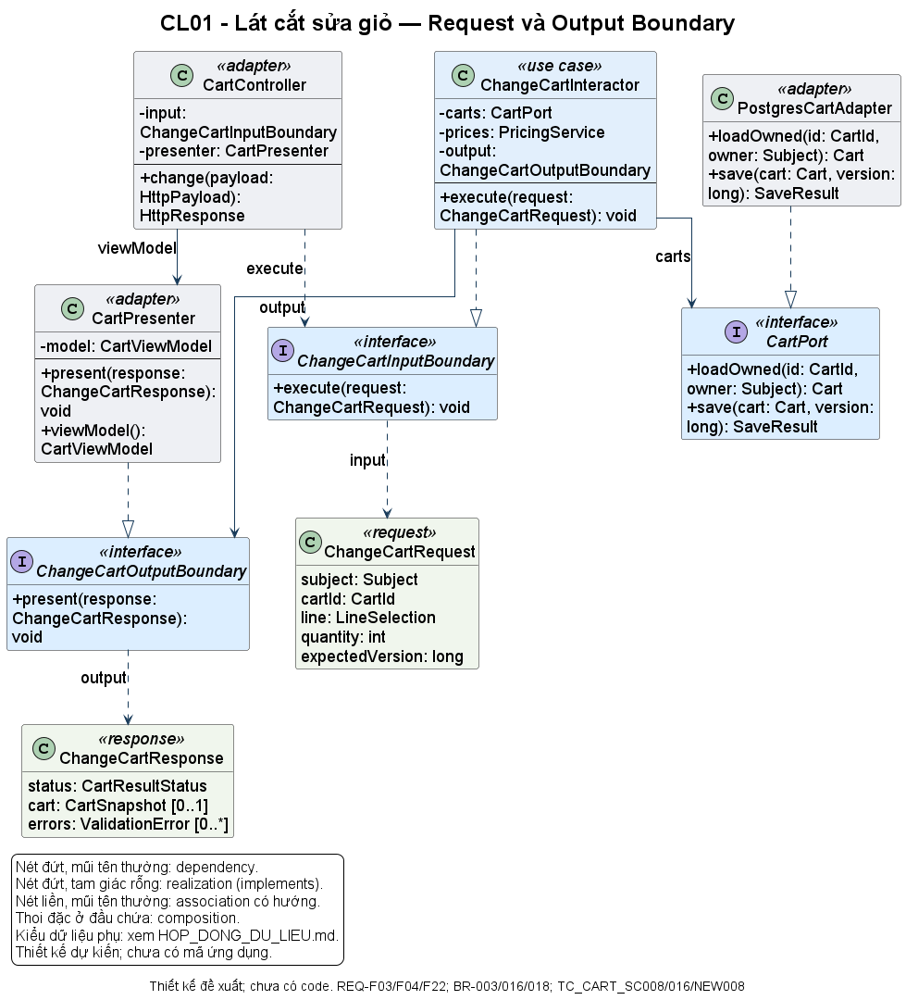
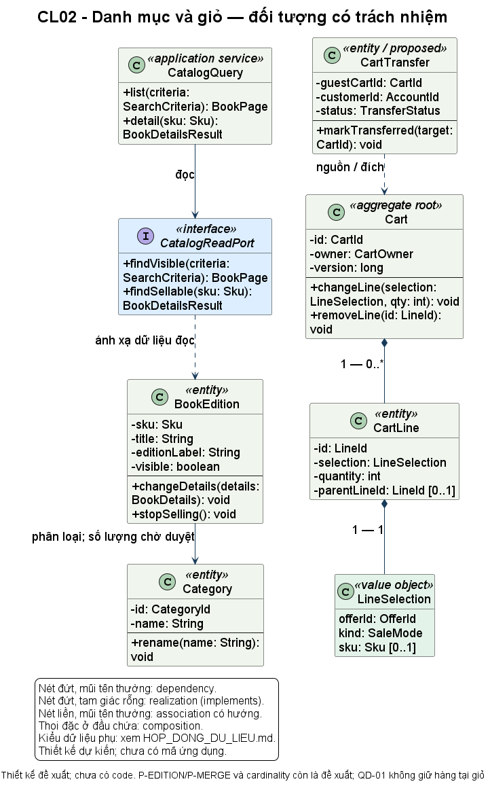
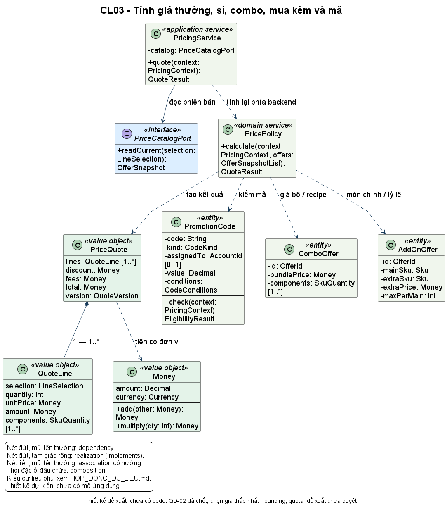
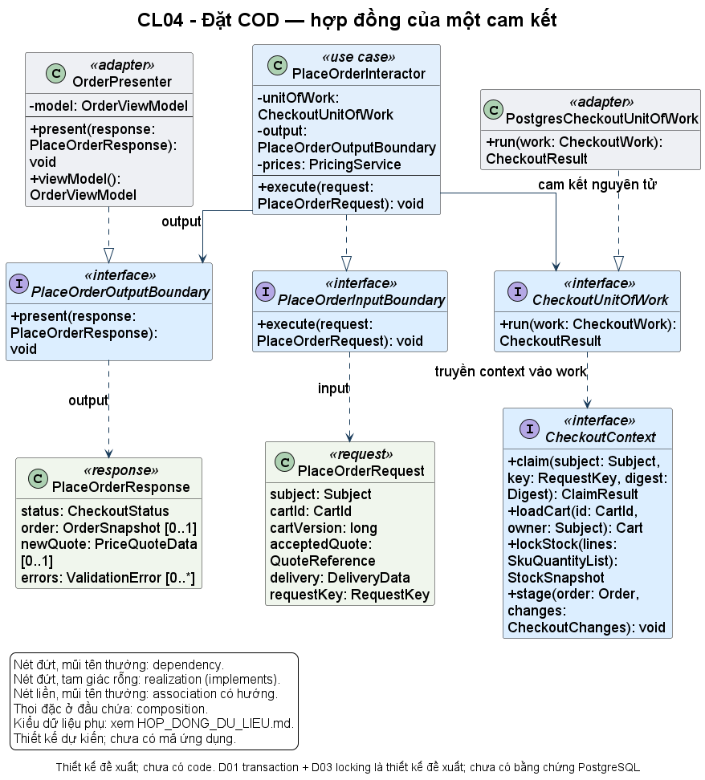
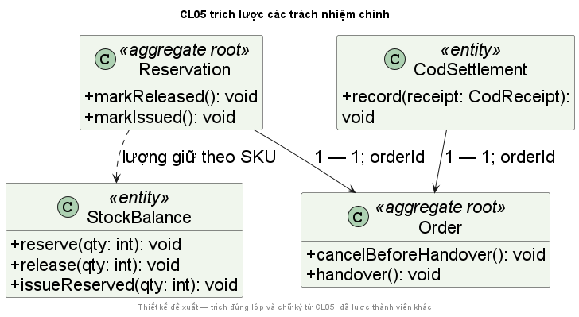
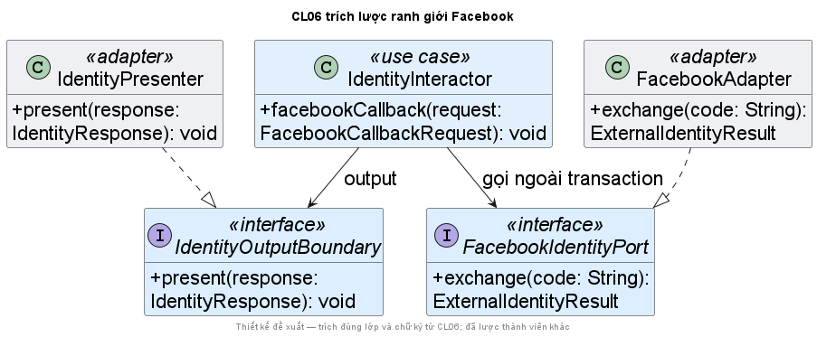
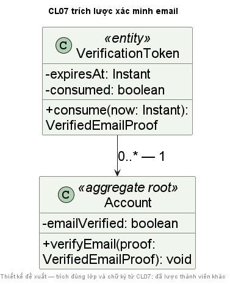
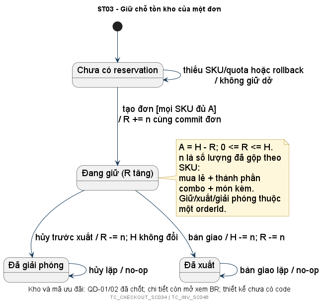

# Website giới thiệu và bán sách trực tuyến

Báo cáo tiểu luận môn Thiết kế và xây dựng phần mềm. Sinh viên Nguyễn Duy Trường, MSSV 24150180; thực hiện cá nhân. Ngành Công nghệ thông tin, chuyên ngành Kỹ thuật phần mềm. Giảng viên Lê Huỳnh Phước. Mã học phần 241401; lớp học phần 020100138702.

**Trạng thái:** bản phân tích, đặc tả và thiết kế để xem xét. Chương trình và kiểm thử ứng dụng chưa thực hiện. Báo cáo trình bày phương án thiết kế, bằng chứng kiểm tài liệu và kế hoạch kiểm chứng; không sử dụng kết quả bài giữa kỳ để thay cho thực nghiệm website.

File này là nguồn nội dung chính của báo cáo sống. Word trong thư mục `bao_cao` là bản xuất để đọc và trình bày. Khi quy tắc, thiết kế hoặc kết quả chạy thay đổi, cập nhật nguồn rồi xuất lại Word. Review và truy vết là tài liệu hỗ trợ.

## 1 Tổng quan bài toán và căn cứ

### 1.1 Mục tiêu

Website hỗ trợ người đọc tìm hiểu sách, lựa chọn sản phẩm, quản lý giỏ và đặt hàng; hỗ trợ cửa hàng quản lý danh mục, kho, đơn và thu tiền COD. Vấn đề chính là bảo đảm nhất quán giữa giá bán, hàng có thể bán, quyền truy cập và trạng thái đơn. Giao diện thuận tiện cần đi cùng các quy tắc được kiểm chứng.

Bài tiểu luận chuyển yêu cầu thành hành vi kiểm chứng được, phân chia trách nhiệm theo Clean Architecture và mô tả đường đi của dữ liệu. Phạm vi giữ đủ các hình thức bán mà tài liệu môn học liệt kê. Chính sách chưa duyệt được ghi riêng, không trình bày như chức năng đã hoàn thành.

<!-- page -->
### 1.2 Căn cứ sử dụng

| Nguồn | Vị trí | Áp dụng |
|---|---|---|
| SRC01 DanhSachDeTai_Final | Trang 1 và đề tài 05 trang 2 | Vai trò và chức năng |
| SRC02 Cấu trúc tiểu luận | Trang 2 | Gherkin, draw.io, SOLID, DDD, lát cắt và kiểm thử |
| SRC03 Phiếu chấm | Trang 1 mục 3.1 đến 3.5 | Đặc tả, Class UML, test, tài liệu sống, chương trình |
| SRC05 Ảnh nghiệp vụ | Toàn ảnh | Sáu nhóm nghiệp vụ bắt buộc |
| SRC06 Software Architecture | Slide 12, 15 đến 18 | Phân tầng và chiều phụ thuộc |
| SRC07 Request Response Model | Slide 4 đến 10 | Request, Response, Input và Output Boundary |
| SRC08 Kiến Trúc Độc Lập | Slide 2 đến 10 | Lý do thay đổi và phân chia tính năng |
| SRC09 Đạn Vạch Đường | Slide 5 đến 8, 10 đến 12 | Lát cắt nhỏ chạy xuyên suốt |
| SRC10 TDD BDD Blueprint | Trang PDF 4, 6 đến 12 | BDD vòng ngoài, TDD vòng trong |

Danh mục đầy đủ và giới hạn đọc tại [nguồn G0](G0/01_DANH_MUC_NGUON.md). Hai sách tham khảo chỉ được đọc chọn lọc. Phiếu chấm có cột điểm trống nên không gán trọng số hoặc ngưỡng đạt.

<!-- page -->
## 2 Phạm vi và quy tắc nghiệp vụ

### 2.1 Vai trò và công nghệ

| Vai trò | Chức năng | Ràng buộc |
|---|---|---|
| Guest | Xem danh sách và chi tiết; chọn mua; xem, sửa, bỏ dòng giỏ; đăng ký | Không đặt hàng hoặc quản trị |
| Customer | Quyền Guest; đăng nhập, đăng xuất, đặt và xem đơn của mình | Xác minh email trước khi đặt |
| Admin | Quyền Customer; tìm và quản lý sách, loại, tài khoản, đơn | Kiểm quyền ở backend; quyền kho và COD cần chốt chi tiết |

Giới thiệu, tìm kiếm và lọc công khai là yêu cầu bổ sung của chủ đề tài tại SRC16. Java, Spring Boot, PostgreSQL qua Docker, Jupiter, email và Facebook thật đã được xác nhận. Phiên bản và cấu hình build chưa được chọn; hiện chưa có ứng dụng website.

COD nằm trong phạm vi. Online là hướng mở rộng; trả hàng, hoàn tiền và đối soát vận chuyển chưa được duyệt. Không thêm microservices hoặc cloud chỉ để tăng quy mô.

### 2.2 Thuật ngữ và quyết định

| Thuật ngữ | Ý nghĩa |
|---|---|
| SKU | Định danh tồn và đối tượng bán; cách phân biệt ấn bản còn đề xuất |
| Giỏ | Lựa chọn của khách, chưa giữ hàng |
| Báo giá | Giá tính lại từ backend với điều kiện hiện hành |
| Snapshot đơn | Giá, giảm, phí, lựa chọn và thông tin nhận đã chấp nhận |
| Combo | Bộ sản phẩm bán cùng nhau |
| Mua kèm | Sách hoặc phụ kiện khách chọn mua thêm có tính tiền |
| Reservation | Lượng SKU được giữ cho đúng một đơn |

QD-01 đã chốt: giỏ không giữ; tạo đơn giữ chỗ; bàn giao mới xuất; hủy trước bàn giao giải phóng lượng giữ một lần. QD-02 đã chốt: coupon giảm phần trăm, voucher giảm tiền cố định cho tài khoản; tối đa một mã cho đơn chỉ có giá thường, không cộng với giảm sản phẩm, sỉ, combo hoặc mua kèm.

[Sổ BR](QUY_TAC_NGHIEP_VU.md) giữ trạng thái BR-001 đến BR-031. Định danh ấn bản, gộp giỏ, làm tròn, ưu tiên giá, quota mã, recipe combo/kèm, trạng thái và quyền COD, phí, TTL token và liên kết Facebook còn cần duyệt. Ví dụ trong feature không tự trở thành chính sách đã chấp thuận.

<!-- page -->
### 2.3 Tồn thực tế và giữ chỗ

Gọi H là lượng thực tế, R là lượng đang giữ, A = H − R là lượng có thể bán. Invariant 0 ≤ R ≤ H phân biệt hàng đã hứa cho khách với hàng đã rời kho.

| Hành động | Trước | Sau | Ý nghĩa |
|---|---|---|---|
| Thêm giỏ | H 10, R 0 | H 10, R 0 | Chưa cam kết tồn |
| Đặt 2 sản phẩm | H 10, R 0 | H 10, R 2 | A còn 8 |
| Hủy trước giao | H 10, R 2 | H 10, R 0 | Không cộng H |
| Bàn giao thay cho hủy | H 10, R 2 | H 8, R 0 | Xuất đúng lượng đang giữ |

Hủy và bàn giao là hai nhánh thay thế, không là hai bước nối tiếp của bảng. Hủy lặp không được giải phóng giữ chỗ của đơn khác. Bàn giao lặp không xuất thêm hàng. Khi hai thao tác cạnh tranh, chỉ một chuyển trạng thái hợp lệ được cam kết.

Hai khách mua sản phẩm cuối là rủi ro xuyên nhiều thành phần. Đọc tồn rồi lưu đơn rời nhau không đủ bảo đảm đúng. D01 đề nghị transaction chung; D03 đề nghị khóa hoặc kiểm version, thứ tự khóa nhất quán. Những lựa chọn này cần kiểm trên PostgreSQL bằng các kết nối độc lập.

### 2.4 Giá và các hình thức bán

Giá backend là căn cứ số phải thu. Tổng do trình duyệt gửi chỉ thể hiện điều khách đã thấy. Báo giá không giữ tồn hoặc tiêu lượt mã. Nếu giá thay đổi, phương án hiện tại là trả báo giá mới và yêu cầu chấp nhận trước khi tạo đơn.

QD-02 áp dụng ở cấp đơn: giỏ có cả sách thường và combo không được áp mã toàn đơn. Voucher còn gắn với tài khoản được cấp. Cách làm tròn, trần giảm, thời điểm tiêu hoặc hoàn lượt chưa được chốt; không suy ra từ một fixture có số tiền cụ thể.

Giá sỉ, combo và mua kèm vẫn thuộc phạm vi bắt buộc. Khi triển khai, snapshot phải giữ recipe và quan hệ đã chấp nhận để hủy hoặc bàn giao không dùng cấu hình mới thay đổi. Chia lát cắt chỉ là thứ tự làm, không loại nghiệp vụ khỏi bài.

<!-- page -->
## 3 Đặc tả bằng Gherkin

### 3.1 Cấu trúc và tình trạng

[Feature chính](../features/web_ban_sach_tinh_nang.feature) có 1 Feature, 48 Rule, 152 định nghĩa scenario và 219 trường hợp khai triển. Có 111 định nghĩa, tương ứng 160 trường hợp, còn ít nhất một chi tiết cần xác nhận. Đây là số lượng tài liệu, không phải số test đã đạt.

Given mô tả trạng thái độc lập, When là một hành động chính, Then mô tả kết quả quan sát được. REQ liên kết yêu cầu; BR liên kết chính sách; TC định danh tình huống. Tag `needs_confirmation` ghi quyết định chưa chốt, không phải trạng thái test hoặc tag được phép bỏ qua để làm báo cáo xanh.

### 3.2 Ví dụ một hành vi nhỏ

Trích lược TC_CART_SC016, REQ-F04, BR-003/013/016. Fixture S001 giá 120000 VND và S002 giá 180000 VND, không phí hoặc ưu đãi khác. Phí bằng 0 là dữ liệu thử, không phải chính sách miễn phí toàn website.

```gherkin
Scenario: Số lượng bằng 0 chỉ bỏ dòng sách được chọn
  Given guest có 2 quyển "S001" và 1 quyển "S002" trong giỏ
  When guest cập nhật số lượng "S001" thành 0
  Then giỏ không còn dòng "S001"
  And giỏ vẫn có 1 quyển "S002"
  And tổng tiền sách là 180000 VND
```

Kịch bản kiểm đúng phạm vi thay đổi: bỏ dòng được chọn, giữ dòng khác và tính lại tổng. Để kiểm QD-01, cần đối chiếu thêm H/R trước và sau. Tổng đúng chưa đủ chứng minh kho không bị thay đổi.

### 3.3 Hành vi ở ranh giới

Đặt hàng kiểm email, chủ giỏ, giá hiện hành, lựa chọn còn bán và lượng có thể giữ. Success chỉ đi ra sau commit. Thiếu hàng, giá chưa chấp nhận hoặc lỗi ghi không để lại đơn và giữ chỗ dở. Mất phản hồi sau commit phải tìm kết quả theo key khi retry.

Facebook đăng nhập thành công không tự chứng minh email đã xác minh. Nhà cung cấp nhận thư cũng không làm `emailVerified` thành true. TC_AUTH_REV004 và REV012 tách hai sự kiện này để tránh cấp quyền đặt hàng sai.

<!-- page -->
### 3.4 Bao phủ và truy vết

| Nhóm | Scenario tiêu biểu | UML |
|---|---|---|
| Danh mục | TC_CATALOG_SC001, SC005, NEW001 đến NEW004 | AD01, SQ01, CL02 |
| Giỏ | TC_CART_SC008, SC016, NEW008 | AD02, SQ02, CL01 |
| Giá và cách bán | TC_PRICE_BH01 đến BH22, REV003 | AD03, SQ03, CL03 |
| Đặt và cạnh tranh tồn | TC_CHECKOUT_SC034, NEW006, NEW016 | SQ04, SQ04B, CL04 |
| Hủy và bàn giao | TC_ORDER_REV002; TC_INV_REV009, REV013 | SQ06, SQ06C, CL05 |
| COD | TC_PAY_TT01 đến TT07 | AD05, SQ05, ST02 |
| Kho | TC_INV_KHO01, KHO05, REV010 | AD07, SQ07, ST03 |
| Xác thực và quyền | TC_AUTH_XT01 đến XT07; TC_ADMIN_SC053 | SQ08, SQ08B, SQ09 |

Mã rút gọn cùng ô kế thừa tiền tố TC đứng trước. Danh sách đầy đủ đến từng Examples có trong [ma trận truy vết](TRUY_VET_YEU_CAU.csv): REQ → BR → Scenario → UML → Test → Code → Bằng chứng. Hiện hai cột Test/Code ghi chưa thực hiện.

### 3.5 Kết quả review

SC031 đã được phân biệt với REV006 đến REV008: giỏ Customer ban đầu rỗng khác trường hợp hai giỏ đã có hàng. Chính sách gộp vẫn là đề xuất. Khi báo giá đổi, đặc tả nêu giữ giỏ, không tạo đơn hay giữ quota trước khi khách chấp nhận. Nhóm mã trên giỏ lẫn giá đặc biệt phản ánh QD-02.

Log parser ghi PARSE_ERRORS=0, SCENARIOS=152, EXPANDED_CASES=219, TAG_PARAMETER_ID_ERRORS=0 tại `docs/bang_chung/gherkin_parse.log`. Chưa có step definitions gọi website; không kết luận 219 trường hợp đã chạy thành công.

Khi chính sách được duyệt, cập nhật BR, scenario bị ảnh hưởng, UML và kế hoạch kiểm chứng. Không sửa expected result chỉ để test xanh. Mã TC giữ ổn định để log và ảnh còn truy ngược được. Kết quả chi tiết tại [review đặc tả](review_dac_ta_web_ban_sach.md).

<!-- page -->
## 4 Kiến trúc và UML

### 4.1 Chính sách và ranh giới

Cấp cao gồm quy tắc mua hàng, tính giá, giữ tồn và chuyển trạng thái. Cấp thấp gồm HTTP, SQL, provider và hiển thị. Cấp bậc xác định theo trách nhiệm, không theo thư mục hay quan hệ cha con.

Đề xuất một ứng dụng triển khai chung với các module Catalog, Cart, Pricing, Inventory, Orders, Payments, Identity. Trong từng tính năng, domain bảo vệ invariant; application điều phối và sở hữu port; adapter chuyển dữ liệu; infrastructure hiện thực chi tiết; composition root nối các implementation.

Controller tạo Request từ input và danh tính đã kiểm. Interactor thực hiện Input Boundary, phối hợp domain và port rồi gửi Response qua Output Boundary. Presenter bên ngoài thực hiện hợp đồng này, định dạng ViewModel. Request/Response không mang HTTP hoặc JPA entity vào core.

### 4.2 Phân biệt ba hướng

Chiều phụ thuộc mã nguồn do các kiểu được tham chiếu quyết định. Luồng gọi là thứ tự lời gọi lúc chạy. Luồng dữ liệu là nguồn, đích và nội dung Request/Response. Lời gọi đi ra presenter qua output port không làm core phụ thuộc concrete presenter.

Application có thể gọi một domain service và nhận giá trị trực tiếp bên trong use case. Điều đó khác với ranh giới delivery, nơi thiết kế áp dụng Output Boundary theo SRC07. Presenter giữ model phải theo từng request, tránh singleton có trạng thái làm lẫn kết quả của hai khách.

### 4.3 Hệ thống sơ đồ

Bộ hiện có 7 Class, 10 Activity, 14 Sequence, 3 State và 1 Component, tổng 35 UML; thêm 2 DFD. Mã PlantUML, PNG, SVG lưu trong [thư viện sơ đồ](uml/index.html). File `Nguyen_Duy_Truong_24150180_WebBanSach.drawio` có 7 trang native để sửa lớp và cạnh.

Activity kiểm nhánh, Sequence kiểm lời gọi/dữ liệu, State kiểm chuyển trạng thái, Component kiểm phụ thuộc. DFD mô tả nguồn, tiến trình và kho dữ liệu; không gọi DFD là UML. Sơ đồ là thiết kế đề nghị, chưa phải cấu trúc Java đã có.

<!-- page -->
### 4.4 Class UML giỏ hàng



CL01: REQ-F03/F04/F22, TC_CART_SC008/SC016/NEW008. ChangeCartInteractor thực hiện Input Boundary, dùng CartPort và Output Boundary. PostgresCartAdapter và CartPresenter thực hiện các port tương ứng; không có phụ thuộc từ interactor tới concrete presenter.

Domain kiểm quy tắc số lượng; use case kiểm chủ giỏ và điều phối lưu. Các chữ ký trong hình là hợp đồng dự kiến, chưa là phương thức Java đã chạy.

<!-- page -->
### 4.5 Class UML danh mục và giỏ



Cart là aggregate root quản lý dòng và version. CartLine giữ lựa chọn và liên kết món mua kèm. BookEdition định danh đối tượng bán; cardinality còn chờ duyệt. CartTransfer là phương án gộp một lần, chưa được triển khai.

CL02 mô tả domain và truy vấn nội bộ; đường delivery đầy đủ xem SQ01/CL01. Việc CatalogQuery trả dữ liệu nội bộ không thay cho Output Boundary tại ranh giới giao diện.

<!-- page -->
### 4.6 Class UML tính giá



PricingService phối hợp dữ liệu backend với PricePolicy để tạo PriceQuote. Money mang đơn vị tiền; PromotionCode, ComboOffer và AddOnOffer giữ điều kiện phù hợp. Quota, recipe và làm tròn vẫn có phần chưa duyệt.

PricePolicy cụ thể là phương án đơn giản để bắt đầu. Không tạo Strategy cho từng tên giá nếu chưa có lý do thay đổi độc lập. Khi cần mở rộng phải chứng minh bằng test hợp đồng, không chỉ số lượng interface.

<!-- page -->
### 4.7 Class UML đặt hàng



PlaceOrderInteractor phản hồi success sau khi CheckoutUnitOfWork hoàn tất. CheckoutContext là interface thuộc application, không đưa Connection hoặc EntityManager vào core. D01 đề nghị một transaction cho đơn, snapshot, giữ tồn, quota theo chính sách, giỏ và request key.

REQ-F07/F20/F21, TC_CHECKOUT_SC034/NEW006/NEW016 đối chiếu SQ04/SQ04B. Lỗi trước commit cần rollback; nếu kết quả commit chưa rõ, tra key trước khi quyết định làm lại.

<!-- page -->
### 4.8 Class UML đơn kho và COD



Order bảo vệ snapshot và trạng thái. StockBalance quản lý H/R; Reservation gắn giữ chỗ với đúng đơn. CodSettlement quản lý thu tiền, không xuất kho. RequestRecord hỗ trợ nhận diện thao tác lặp.

QD-01 chốt biến đổi tồn; bộ trạng thái chi tiết và quyền ghi COD trong ST01/ST02 vẫn là phương án. Nhiều aggregate có thể phối hợp trong một transaction ở quy mô bài, không cần database riêng từng aggregate.

<!-- page -->
### 4.9 Class UML xác thực và dịch vụ thật



IdentityInteractor dùng FacebookIdentityPort thay SDK. MailJobWorker dùng MailDeliveryPort sau commit theo đề xuất D02. Nghiệm thu cần adapter thật; fake chỉ phục vụ kiểm chính sách riêng.

Facebook callback chứa code/state; server kiểm provider subject, không nhận role do frontend tự xác nhận. IdentityInputBoundary đang là nhóm mô tả, có thể tách theo client khi triển khai để giữ ISP.

<!-- page -->
### 4.10 Class UML tài khoản và token



Account và VerificationToken phối hợp dùng token và xác minh cùng commit. MailJob lưu ý định gửi thư, không chứng minh quyền sở hữu email. ExternalIdentityLink cần chính sách liên kết được duyệt, không tự ghép chỉ vì email trùng.

Ba hình CL05, CL06 và CL07 trong báo cáo là trích lược lớp và thành viên để đọc rõ trên A4; không thêm lớp hay đổi chữ ký. Các thành viên bị lược và toàn bộ quan hệ nằm trong SVG và draw.io gốc. Không đưa mật khẩu, token hoặc client secret vào báo cáo. Ảnh tại đây xuất từ PlantUML; chưa có bằng chứng mở và xuất trực tiếp từ diagrams.net.

<!-- page -->
### 4.11 Vòng đời và kiểm luồng dữ liệu



Reservation từ Held sang Released khi hủy trước giao hoặc Issued khi bàn giao. Hai nhánh loại trừ nhau; retry không tạo tác động thêm. Cách kiểm soát bằng SQL, khóa hoặc version cần kiểm chứng database thật.

Review đã lần theo 20 nhóm tình huống trọng tâm: Given → When → nhánh → dữ liệu → Then. Đã bổ sung Output Boundary, nhánh mất quyền ở SQ09, bỏ phản hồi trùng SQ07 và mô tả cạnh tranh hủy/bàn giao SQ06C.

Kết luận giới hạn: luồng thiết kế phù hợp với các scenario đã đối chiếu trong [bảng review](review_luong_du_lieu.md), theo điều kiện từng dòng. Các case khác có chỉ mục truy vết, không được coi là đã thực thi hoặc review sâu chỉ vì có liên kết.

<!-- page -->
## 5 Nguyên lý và lựa chọn thiết kế

### 5.1 OOP và DDD

Encapsulation thể hiện qua StockBalance bảo vệ H/R, Order bảo vệ snapshot và cạnh trạng thái, Cart bảo vệ chủ/dòng. Abstraction thể hiện qua port diễn đạt nhu cầu application. Đa hình dự kiến cho phép thay adapter/presenter giữ hợp đồng; cần test thực tế để chứng minh.

Không ép kế thừa giữa các loại sách hay hình thức giá nếu chưa có quan hệ thay thế hợp lệ. Entity có định danh; Money và LineSelection là value object; Cart/Order là aggregate. Các thuật ngữ chỉ có ý nghĩa khi phương thức bảo vệ invariant, không chỉ đổi tên package.

### 5.2 SOLID

| Nguyên lý | Áp dụng | Cần chứng minh khi code |
|---|---|---|
| SRP | Tách tính giá, điều phối, hiển thị, lưu theo lý do thay đổi | Review vị trí logic |
| OCP | Thay presenter/adapter qua port | Cùng use case với hai implementation; root vẫn đổi |
| LSP | Adapter giữ nghĩa owner/version/lỗi | Test hợp đồng chung |
| ISP | Port đọc, sửa giỏ, output, mail, Facebook theo client | Không phương thức rỗng để đủ implements |
| DIP | Core sở hữu port, chi tiết thực hiện | Kiểm import, kiểu trả về, khởi tạo |

DI là cách truyền dependency. DIP là hướng phụ thuộc và nơi sở hữu hợp đồng. Kế thừa là quan hệ thay thế kiểu. Constructor nhận interface không đủ chứng minh toàn kiến trúc đúng.

### 5.3 Phụ thuộc tốt và chi phí

Interactor phụ thuộc Cart là chặt có chủ đích để thực hiện nghiệp vụ. Port ổn định trước thay đổi chi tiết nhưng hợp đồng đổi vẫn ảnh hưởng các bên. Composition root biết concrete adapter là hợp lý; core biết HTTP/JPA/SDK sẽ làm chính sách phụ thuộc chi tiết.

Không phải mọi phụ thuộc chặt đều xấu. Thêm abstraction làm tăng chi phí đọc, mapping và test. Chỉ thêm tại ranh giới có lý do biến đổi hoặc kiểm chứng rõ ràng.

<!-- page -->
### 5.4 Pattern và phương án đơn giản

| Vấn đề | Lựa chọn | Chi phí so với cách đơn giản |
|---|---|---|
| Core độc lập hạ tầng | Ports and Adapters | Thêm hợp đồng/mapping so với gọi JPA trực tiếp |
| Định dạng đầu ra | Presenter và Humble Object | Cần quản lý vòng đời ViewModel |
| Đơn và tồn cùng cam kết | Unit of Work D01 | Khóa và transaction phức tạp hơn save riêng |
| Email lỗi sau đăng ký | Job/outbox D02 | Retry cần worker, trạng thái và xử lý thư trùng |
| Nhiều chế độ giá | PricePolicy cụ thể trước | Tách Strategy khi có căn cứ thay đổi |

D01/D02 là đề xuất, chưa phải implementation nghiệm thu. Không ép Factory Method hay Abstract Factory từ bài giữa kỳ vào website. Pattern phải gắn với vấn đề thật, vai trò và đánh đổi.

### 5.5 Tùy chọn để mở và hợp đồng

Port để mở cách hiển thị, lưu và provider. Tuy vậy Java/Spring Boot, PostgreSQL và tích hợp thật đã được xác nhận, không được bỏ dưới lý do trì hoãn. Khóa bi quan hay update có điều kiện cần kiểm chứng; không phải tạo cả hai ngay.

Phí, ưu tiên giá và vòng đời mã là chính sách cần chủ đề tài duyệt. [Hợp đồng dữ liệu](HOP_DONG_DU_LIEU.md) ghi đầu vào, tiền điều kiện, kết quả, lỗi, tác dụng phụ. `save` từ chối version cũ, `reserve` từ chối quá A, `consume` không xác minh token đã dùng.

Khi code, hợp đồng viết trước trong Javadoc ở nơi sở hữu chính sách. Implementation kế thừa hợp đồng nếu không thay đổi. Không viết xong code rồi thêm mô tả để tạo lịch sử TDD hồi tố.

<!-- page -->
## 6 Kế hoạch kiểm thử và triển khai

### 6.1 Nhịp BDD và TDD

BDD thống nhất ví dụ hành vi. Glue chuẩn bị dữ liệu, gọi use case, kiểm kết quả; không chứa phép tính tiền/trừ tồn. Jupiter kiểm đơn vị hành vi. Integration kiểm adapter/database; xuyên suốt kiểm đường giao diện đến dữ liệu và đầu ra.

Sau duyệt: chọn scenario → chạy test thấy lỗi đúng lý do → code vừa đủ → test đạt → refactor giữ hành vi → chạy lại → cập nhật UML và báo cáo. Có test hoặc log xanh không tự chứng minh lịch sử TDD.

Môn học yêu cầu glue nên G3 đề nghị Cucumber trên JUnit Platform cho acceptance, Jupiter cho unit/integration, không dùng JUnit 4. Parser Gherkin không thay runner. Cấu hình và phiên bản phải được xác minh khi bắt đầu, chưa tạo runner trong giai đoạn tài liệu.

### 6.2 Ma trận kiểm chứng

| Rủi ro | Cấp kiểm | Oracle |
|---|---|---|
| Giá sai hoặc tin frontend | Unit, acceptance | Dòng, giảm, tổng tính từ backend |
| Sai chủ giỏ/đơn | Use case, HTTP | Không lộ dữ liệu; không ghi thay đổi |
| Hàng cuối | PostgreSQL | Hai kết nối; tối đa một đơn giữ được |
| Lỗi ghi giữa chừng | Transaction | Không đơn/reservation/ledger dở |
| Retry sau commit | Acceptance, database | Một orderId, một lần reserve |
| Hủy cạnh tranh bàn giao | Database | Một transition; H/R nhất quán |
| COD ghi thu sớm | Domain, acceptance | Tạo hoặc bàn giao chưa thành Đã thu |
| Provider giả thành công | Tích hợp thật | Thư thực nhận, callback hợp lệ; sai state bị từ chối |

Fake repository đạt không chứng minh transaction. Fake mail đạt không chứng minh gửi thư. Provider chưa cấu hình thì ghi bị chặn, không thay yêu cầu bằng mô phỏng để báo hoàn tất.

<!-- page -->
### 6.3 Lát cắt xin duyệt và mở rộng

S1: Guest xem sách thường, thêm từ danh sách hoặc chi tiết, xem giỏ, đổi lượng và bỏ dòng bằng 0. Luồng Web → Request → Input Boundary → domain → PostgreSQL → Output Boundary → Presenter; kèm lỗi input, SKU, owner và version.

S1 nhỏ nhưng kiểm đủ wiring, lưu thực tế và lỗi trước khi phối hợp nhiều aggregate. Chi tiết xin duyệt được ghi tại [hồ sơ S1](G3/01_HO_SO_DUYET_S1.md). Hồ sơ chưa được đánh dấu đã duyệt; chưa tạo code hoặc test tự động.

| Lát cắt | Kết quả | Rủi ro cần kiểm |
|---|---|---|
| S1 Giỏ thường | Chọn, xem, sửa, bỏ sách | Owner, qty, version, lưu |
| S2 Email | Đăng ký và xác minh thật | Token, mật khẩu, provider lỗi |
| S3 Đặt COD | Snapshot và giữ hàng | Requote, concurrency, retry |
| S4 Kho và thu tiền | Nhập, bàn giao, hủy, ghi COD | State, H/R, rollback |
| S5a đến S5e Cách bán | Giảm, mã, sỉ, combo, mua kèm | Giá, quota, tồn thành phần |
| S6 Facebook và quản trị | Provider thật, đúng quyền | Linking, phân quyền |

Mỗi lát cắt có đặc tả, test thành công và lỗi, luồng thật, UML và tài liệu đồng bộ, nghiệm thu trước khi mở rộng. [Kế hoạch G3](G3/02_KE_HOACH_KIEM_THU.md) chỉ test case văn bản và bằng chứng cần thu, chưa có kết quả chạy ứng dụng.

### 6.4 Kế hoạch chứng minh TDD

Ghi lệnh, phiên bản, số test được phát hiện, lý do Red và kết quả Green sau thay đổi. Một lỗi compile hoặc thiếu dependency không được tự gọi là test hành vi Red mong muốn. Refactor không thêm quy tắc mới; giữ log trước và sau để giải thích được thay đổi.

Ảnh feature có thể chụp từ file hiện có. Ảnh glue, unit test và chương trình chỉ bổ sung sau khi thật sự tồn tại và chạy. Không dựng ảnh mẫu để điền vào mục kết quả.

<!-- page -->
## 7 Kết quả và đối chiếu nghiệm thu

### 7.1 Bằng chứng đã có

152 scenario, 219 cases và parser không lỗi cú pháp; 35 UML, 2 DFD và draw.io native 7 trang. Đã kiểm cấu trúc REQ/BR, XML, ảnh và liên kết trong đợt tài liệu trước. Log gốc giữ ở `docs/bang_chung`; kiểm Word ghi riêng, không đổi số liệu tài liệu thành test ứng dụng.

### 7.2 Phiếu chấm

| Tiêu chí SRC03 | Bằng chứng | Chưa hoàn thành |
|---|---|---|
| 1 Bố cục | Các chương bài toán, đặc tả, thiết kế, kiểm chứng | Đồng bộ sau code |
| 2 Hình thức | Bìa theo mẫu, thông tin thật, nguồn và hình | Rà lại bản nộp sau thực nghiệm |
| 3.1 Đặc tả | Feature, BR, review, truy vết | Duyệt chi tiết và chạy acceptance |
| 3.2 Class UML | Draw.io 7 trang | Đối chiếu với Java thực tế |
| 3.3 Kiểm thử | Test case và kế hoạch | Glue, Jupiter, log, ảnh thật |
| 3.4 Tài liệu sống | Nguồn báo cáo liên kết bằng chứng | Cập nhật từng lát cắt |
| 3.5 Chương trình | Thiết kế và hợp đồng | Website, database, provider, demo |

Không điền điểm thay giảng viên. Chưa đủ bằng chứng nghiệm thu toàn bài.

### 7.3 Phần cần quyết định

Chưa có xác nhận cho phép code một lát cắt cụ thể theo cổng G3 đã thống nhất. Chính sách còn mở cần duyệt theo lát cắt phụ thuộc, không tự chốt toàn bộ. Dịch vụ thật cần tài khoản/cấu hình do chủ đề tài quản lý; bí mật nằm ngoài báo cáo và source.

Bộ tài liệu cho phép kiểm thiết kế, nhưng chưa chứng minh phần mềm chạy đúng. Phần thực nghiệm phải bổ sung bằng kết quả thật, không dùng ảnh gallery UML làm giao diện website.

<!-- page -->
## 8 Kết luận và nội dung cần nắm

### 8.1 Kết luận hiện tại

Đề tài có bộ phân tích và thiết kế truy vết được về phạm vi, trách nhiệm và dữ liệu. Kho tách thực tế với giữ chỗ; báo giá khác snapshot; trạng thái thu tiền khác trạng thái đơn; abstraction thuộc phía chính sách sử dụng. Các điểm này liên kết yêu cầu, scenario và UML.

Bản hiện tại chưa là phần mềm hoàn chỉnh. Bước tiếp theo là duyệt S1, triển khai BDD/TDD, dùng kết quả chạy để cập nhật thiết kế. Chỉ khi các lát cắt bắt buộc được kiểm chứng và đồng bộ hồ sơ mới có căn cứ kết luận hoàn thành tiểu luận cuối kỳ.

### 8.2 Cách giải thích bài làm

Mở bằng bài toán giá, tồn và quyền. Dùng TC_CART_SC016 giải thích Given–When–Then rồi CL01 chỉ Request, use case, port và Response. Dùng QD-01/ST03 giải thích giữ khác xuất; SQ04B chỉ cạnh tranh tồn. Nói SOLID bằng trách nhiệm và hợp đồng cụ thể, không chỉ đọc định nghĩa.

**Giỏ không giữ hàng thì khách có chắc đặt được không?** Không. QD-01 chỉ giữ khi tạo đơn; phải kiểm A lại lúc đặt.

**Output port có ích gì?** Application phát Response qua hợp đồng mình sở hữu; presenter quyết định hiển thị. Cách này áp dụng SRC07 và tránh core biết chi tiết UI.

**Unit test đủ chứng minh không vượt tồn chưa?** Chưa. Cần hai giao dịch độc lập trên PostgreSQL, quan sát đơn, H/R, reservation và rollback.

**Tại sao chưa đưa Factory Method vào?** Chưa có vấn đề tạo đối tượng cần mẫu đó. Bài cuối kỳ chọn pattern theo vấn đề thực tế, không sao chép tiêu chí giữa kỳ.

**Tài liệu sống là gì?** Báo cáo được cập nhật khi BR, UML, code hoặc bằng chứng đổi; phản ánh cả phần đã làm và chưa làm. Word là bản xuất của cùng nguồn, không tách thành báo cáo khác.

<!-- page -->
## Tài liệu tham khảo và tài nguyên

1. Tài liệu môn học, DanhSachDeTai_Final, bản `(1).docx` được cung cấp, trang 1–2. Không có năm xuất bản đã xác minh.
2. TKXDPM Cấu trúc nội dung tiểu luận cuối kỳ, trang 2; Phiếu chấm tiểu luận TK và XDPM, trang 1; Mẫu trình bày tiểu luận, bản DOC được cung cấp. Không tự đặt trọng số.
3. Software Architecture; ResquestResponseModel; Kiến Trúc Độc Lập; Đạn Vạch Đường Lập Trình Trúng Đích Trong Bóng Đêm, các bản `(1).pptx`. Slide sử dụng ghi tại mục 1.2.
4. The TDD BDD Blueprint, PDF được cung cấp, trang PDF 4 và 6–12. Log trong nguồn là ví dụ, không phải kết quả website.
5. Sam Keen, Clean Architecture with Python, Packt Publishing, 2025, ISBN 978-1-83664-289-3. Phần đã đọc phục vụ báo cáo: trang in 79–85, 123–128, 191–194.
6. Robert C. Martin, Clean Architecture A Craftsman’s Guide to Software Structure and Design, Pearson, copyright 2018 trên bản cung cấp, ISBN 978-0-13-449416-6. Tham khảo chương 19, 20, 22, 23, 28. Tên file có năm 2017 khác trang copyright; đã ghi nhận, không tự kết luận ấn bản.

Danh mục và phần chưa đọc tại [G0](G0/01_DANH_MUC_NGUON.md). Không sao chép toàn sách vào bài.

| Tài nguyên | Đường dẫn trong dự án |
|---|---|
| Feature | features/web_ban_sach_tinh_nang.feature |
| BR | docs/QUY_TAC_NGHIEP_VU.md |
| Hợp đồng | docs/HOP_DONG_DU_LIEU.md |
| UML | docs/uml và docs/uml/index.html |
| Truy vết | docs/TRUY_VET_YEU_CAU.csv |
| Review luồng | docs/review_luong_du_lieu.md |
| Hồ sơ S1 | docs/G3/01_HO_SO_DUYET_S1.md |
| Kế hoạch test | docs/G3/02_KE_HOACH_KIEM_THU.md |

Đường dẫn Word tính từ thư mục gốc đề tài để tìm được khi chuyển máy. Markdown giữ liên kết tương đối. Bằng chứng kiểm Word lưu riêng tại `docs/bang_chung/kiem_tra_bao_cao.json`.
